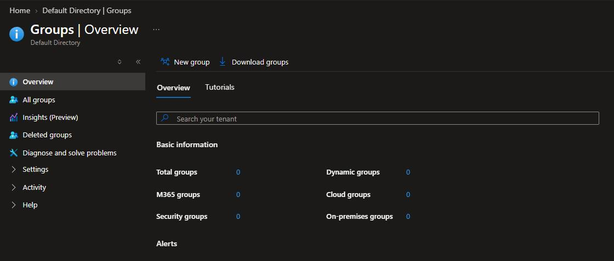
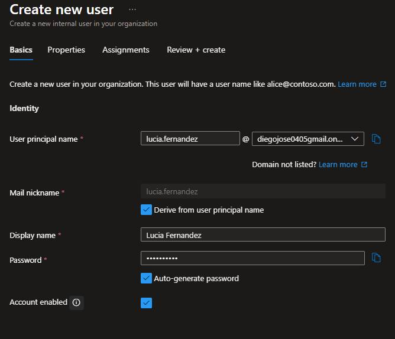
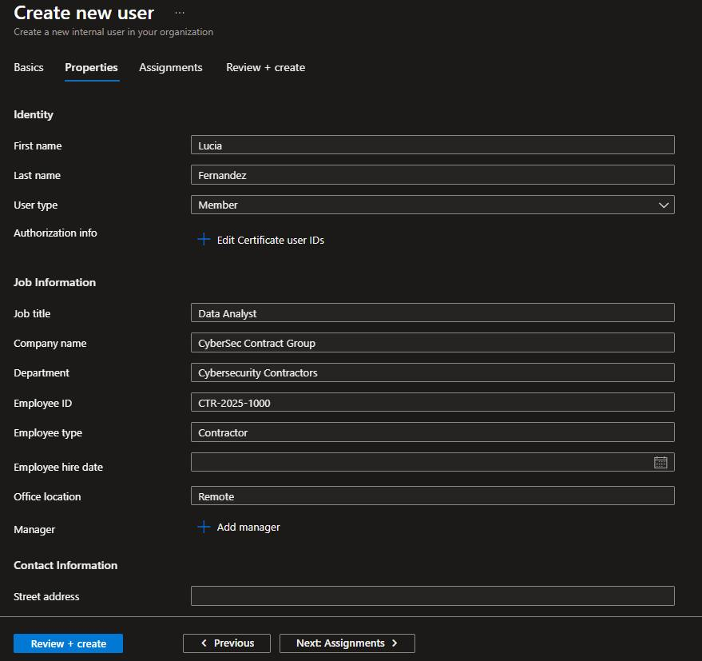
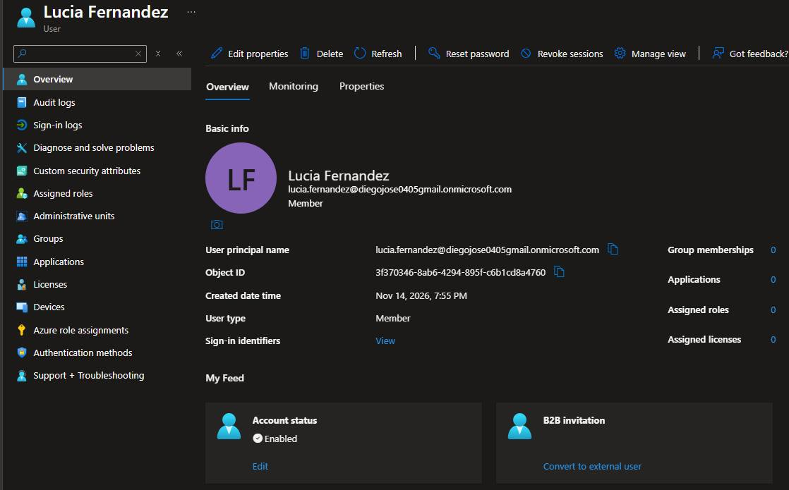

# 1 · Create a User Manually

[← Back to index](../README.md)

Create Lucia Fernandez in Entra ID with job info and verify the account is enabled.

---

This manual process shows what the script does behind the scenes. The example uses **Lucia Fernandez**.

**Step 1. Open Microsoft Entra ID.**

From the Azure portal, open Microsoft Entra ID.

**Step 2. Go to Manage > Users.**

In the left menu, open the Users section.

**Step 3. Review the user list and click New user.**

**Step 4. Create the user: Basics tab.**

Create an internal user in your organization. Complete:

- **User principal name:** `lucia.fernandez@diegojose0405gmail.onmicrosoft.com`
- **Mail nickname:** derived from the user principal name.
- **Display name:** `Lucia Fernandez`
- **Password:** generate a temporary password and store it in a safe place. Do not publish it.
- **Account enabled:** on.

Click **Next: Properties**.

**Step 5. Complete the properties: Properties tab.**

Complete the identity and job information:

- **First name:** `Lucia`
- **Last name:** `Fernandez`
- **User type:** `Member`
- **Job title:** `Data Analyst`
- **Company name:** `CyberSec Contract Group`
- **Department:** `Cybersecurity Contractors`
- **Employee ID:** `CTR-2025-1000`
- **Employee type:** `Contractor`
- **Office location:** `Remote`
- **Manager:** add the manager if it already exists.

Click **Review + create** and then **Create**.

**Result:** the user is created and enabled.

> **Check:** in the user profile you should see the User principal name, the Object ID, the creation date, and the status `Enabled`. In this example the creation date is November 14, 2026.

---

[↑ Index](../README.md) | [Next: 2 · Create a Group and Assign Membership →](../02-create-group-and-assign-membership/)
