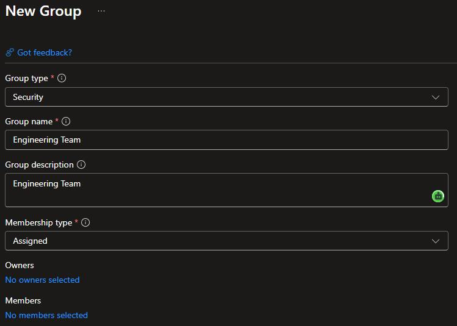
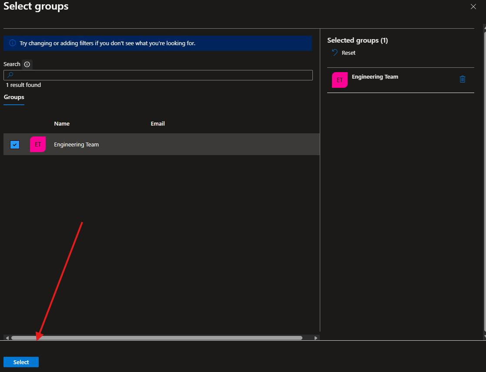
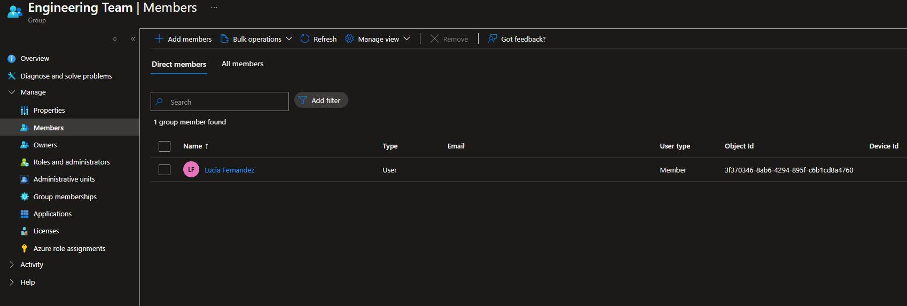

# 2 · Create a Group and Assign Membership

[← Back to index](../README.md)

Create the Engineering Team security group and assign Lucia Fernandez to it.

---

**Step 1. Review existing groups.**

Go to **Groups > Overview** and verify that the group you are about to create does not exist yet.

**Step 2. Create the group.**

Go to **Groups > New group** and complete:

- **Group type:** `Security`
- **Group name:** `Engineering Team`
- **Group description:** `Engineering Team`
- **Membership type:** `Assigned`

Click **Create**.

**Step 3. Assign the user to the group.**

Go back to **Users**, open the user profile, go to **Groups > Add memberships**, search for the group, check it, and click **Select**.

In the screenshot below, `Engineering Team` is checked and appears in **Selected groups (1)**. Click **Select** at the bottom to confirm.

**Step 4. Verify the membership.**

Go to **Engineering Team > Members**. You should see 1 group member found: **Lucia Fernandez**, Type `User`, User type `Member`.

> **Best practice:** always assign permissions through groups, never directly to users. When a user changes roles, you only move them from one group to another and their permissions change automatically.

---

[← Previous: 1 · Create a User Manually](../01-create-user-manually/) | [↑ Index](../README.md) | [Next: 3 · Reset Password, Disable, and Re-enable an Account →](../03-reset-password-disable-and-re-enable-an-account/)
