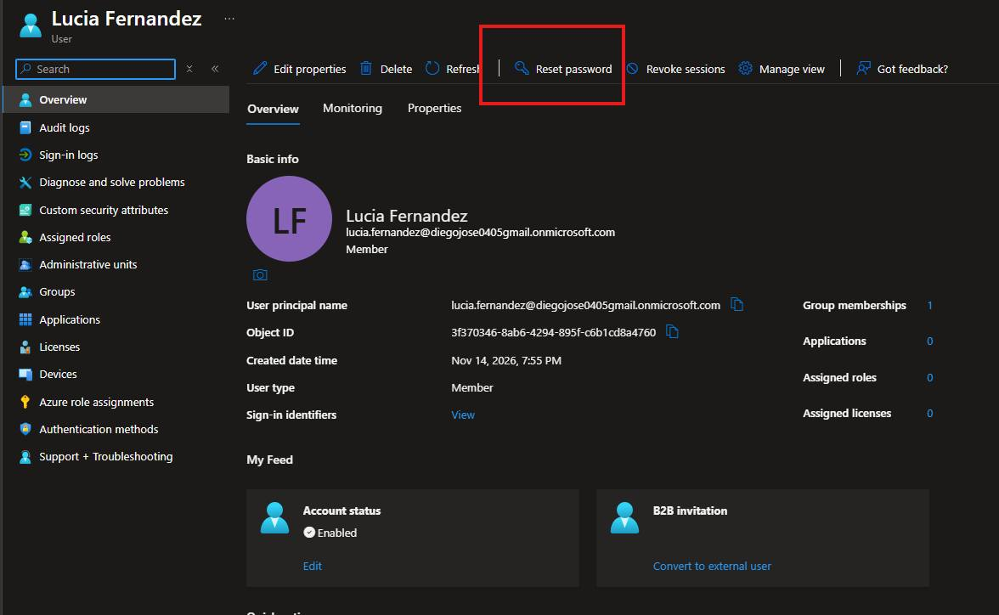
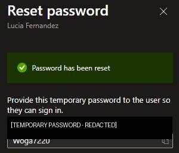
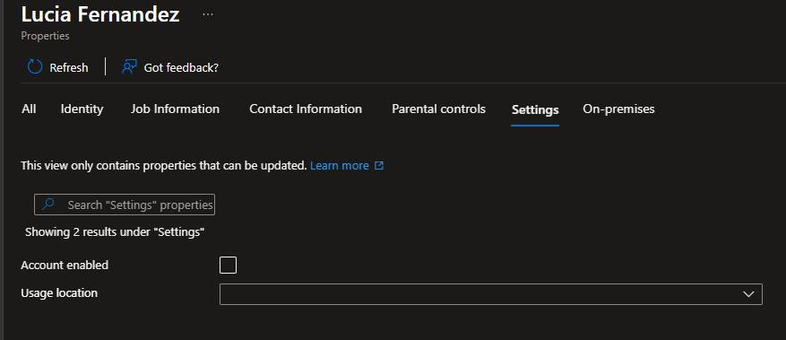
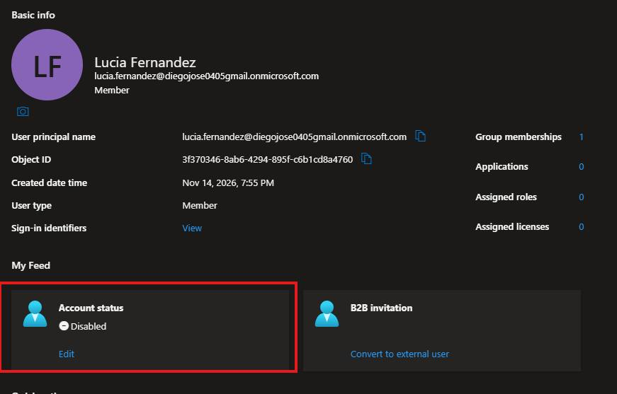

# 3 · Reset Password, Disable, and Re-enable an Account

[← Back to index](../README.md)

Reset the password, disable the account for a Leaver, and re-enable it again.

---

**Reset password:**

1. Open the user profile.
2. Click **Reset password** in the top toolbar. In the screenshot it is highlighted in red.

3. Entra ID generates a temporary password. Save it in a safe place. Do not publish it.

> **Important for GitHub:** the original screenshot showed the temporary password in clear text. Use the redacted version above (`12-reset-password-result-REDACTED.png`) for the repository. Do not upload the original screenshot with the visible password.

**Disable an account (Leaver process):**

1. Open the user profile.
2. Go to **Properties > Settings**.
3. Uncheck **Account enabled**, as shown below.
4. Save the changes.

**Result:** the profile now shows **Account status: Disabled**.

**Re-enable an account:**

Repeat the same steps, but this time leave **Account enabled** checked and save the changes.

> **Golden rule for Leaver:** when an employee leaves, disable their account immediately. Do not wait until the end of the day. That is how you prevent unauthorized access.

---

[← Previous: 2 · Create a Group and Assign Membership](../02-create-group-and-assign-membership/) | [↑ Index](../README.md) | [Next: 4 · Sign-in Logs: Audit and Monitoring →](../04-sign-in-logs-audit-and-monitoring/)
