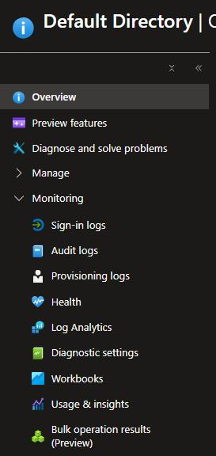
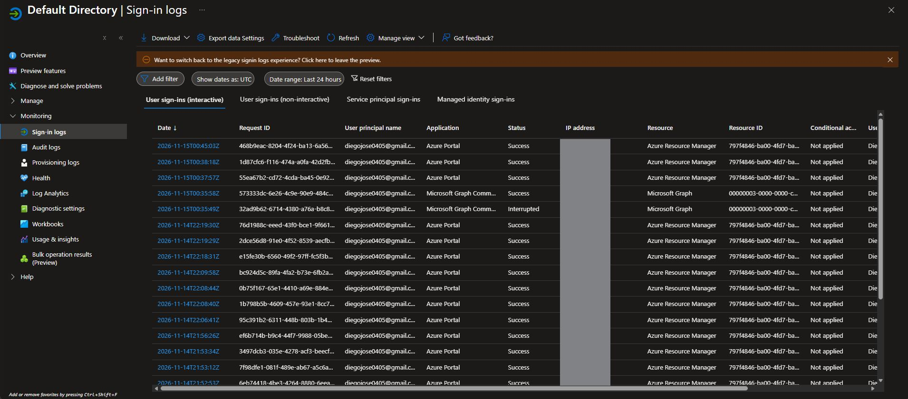

# 4 · Sign-in Logs: Audit and Monitoring

[← Back to index](../README.md)

Audit who signed in, from where, and spot failed attempts in Sign-in logs.

---

**Step 1.** Go to **Monitoring > Sign-in logs** in the left menu.

**Step 2.** In this view you can see sign-in information and filter it as you like: by user, date, status, application, location, or IP address.

The screenshot below shows **User sign-ins (interactive)** with columns for Date, Request ID, User principal name, Application, Status, IP address, Resource, Resource ID, and Conditional Access. The filters at the top are **Add filter**, **Show dates as: UTC**, **Date range: Last 24 hours**, and **Reset filters**.

> **Why it matters:** Sign-in logs let you audit who signed in, from where, and whether there were failed attempts. It is your first tool to detect a possible threat.

> **Privacy note for GitHub:** the screenshot shows your admin UPN and IP addresses. For a public repository, consider cropping the IP address column or blurring sensitive values before publishing.

---

[← Previous: 3 · Reset Password, Disable, and Re-enable an Account](../03-reset-password-disable-and-re-enable-an-account/) | [↑ Index](../README.md) | [Next: 5 · Mover and Leaver: Promotion and Offboarding Simulation →](../05-mover-and-leaver-promotion-and-offboarding/)
