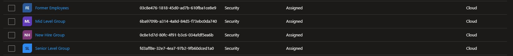
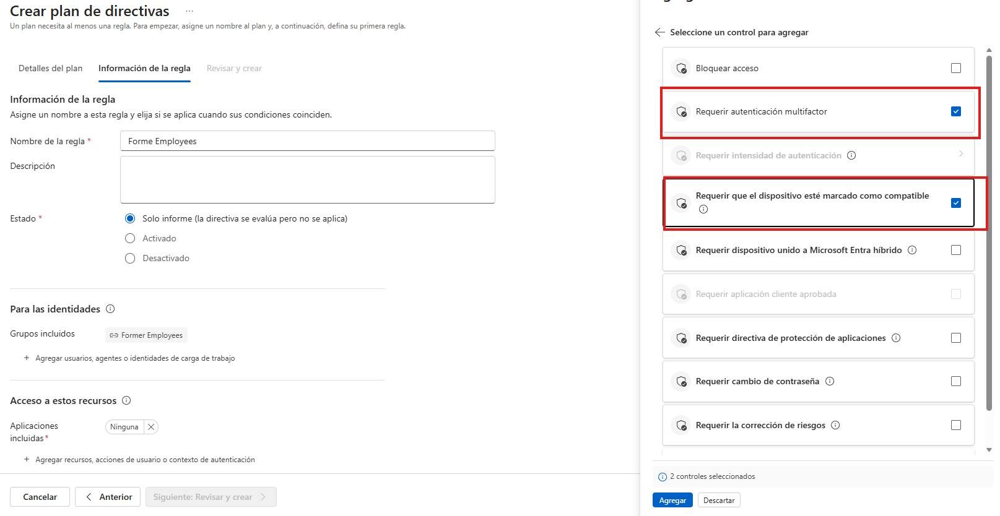
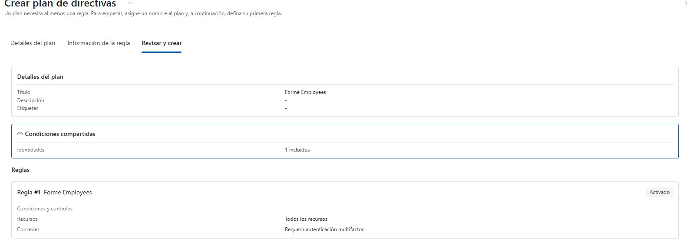
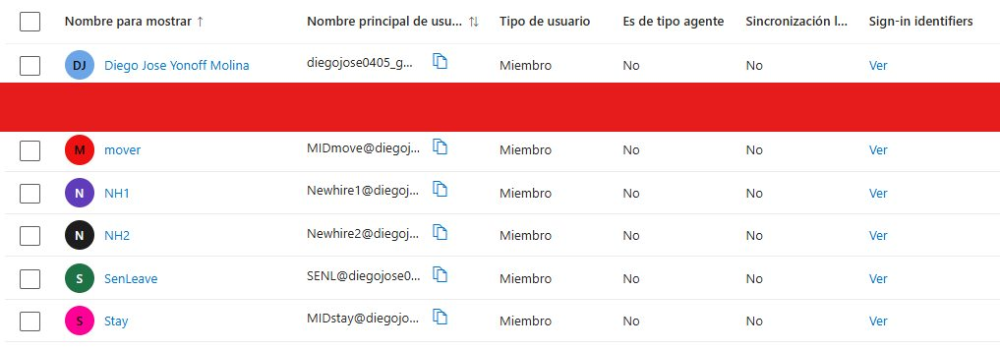
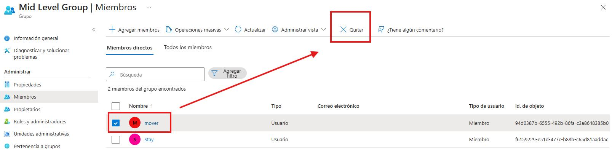
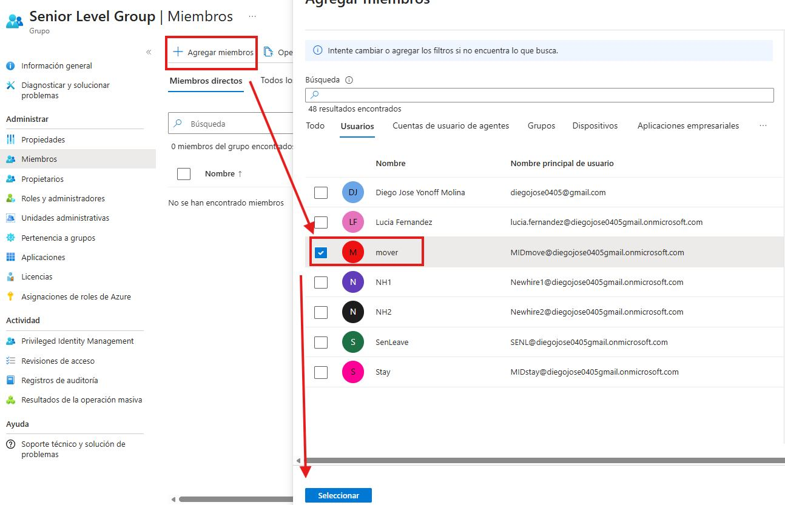
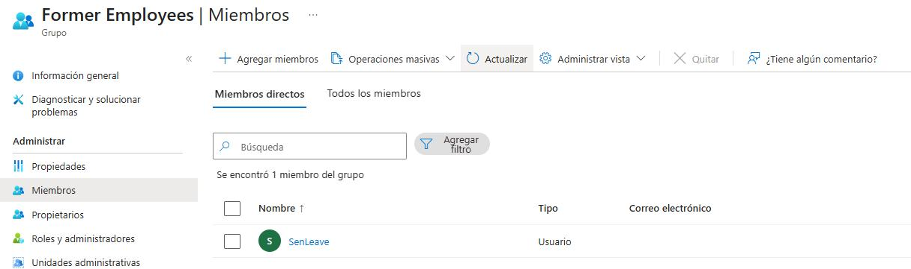

# 5 · Mover and Leaver: Promotion and Offboarding Simulation

[← Back to index](../README.md)

Simulate a promotion from Mid Level to Senior Level and an offboarding to Former Employees.

---

In this section you apply everything you have learned to create users and groups and simulate a role change and an exit.

#### Groups to create

Create these 4 groups:

- `Former Employees`
- `Mid Level Group`
- `New Hire Group`
- `Senior Level Group`

The 4 groups are created as Security groups with Assigned membership:

#### Group policies

Configure the policies for each group.

> Important note: for this test, the compliant device policy is disabled, but at enterprise level it is very important to keep it enabled.

The example below shows the policy for **Former Employees**.

In the rule details, the included group is **Former Employees**, the state is **Report-only** (the policy is evaluated but not applied), and the selected controls are **Require multifactor authentication** and **Require device to be marked as compliant**.

In the **Review and create** step, the plan title is **Former Employees**, the shared condition includes 1 identity, and Rule #1 is **Enabled** with Grant set to **Require multifactor authentication** for all resources.

#### Users to create

In **Users**, create these users:

- `Mover`
- `NH1`
- `NH2`
- `SenLeave`
- `Stay`

The user list shows the 5 demo users plus the admin account. All demo users are Type `Member`:

#### Initial assignment

Assign each user to their group:

- `Mover` and `Stay` in **Mid Level Group**.
- `SenLeave` in **Senior Level Group**.
- `NH1` and `NH2` in **New Hire Group**.

#### Mover promotion simulation

1. Go to the `Mover` group and remove them from it.

In **Mid Level Group > Members**, 2 group members are found. Select `mover` and click **Remove** in the top toolbar, as highlighted in the screenshot.

2. Go to **Senior Level Group**. There you will only find `SenLeave`. Remove them right away for their departure and add the `Mover`.

In **Senior Level Group > Members**, the group initially has 0 members. Click **Add members**, check `mover` in the picker, and click **Select** to add them.

> Note: in this simulation, `SenLeave` is removed from Senior Level Group as part of the offboarding step before or right after adding `mover`, so the group ends up with the promoted user only.

3. Go to **Former Employees > Members** and add `SenLeave`.

In **Former Employees > Members**, 1 group member is found: **SenLeave**.

> **Expected result:** the `Mover` ends up in **Senior Level Group**, `SenLeave` ends up in **Former Employees**, and their account must be disabled.

---

[← Previous: 4 · Sign-in Logs: Audit and Monitoring](../04-sign-in-logs-audit-and-monitoring/) | [↑ Index](../README.md) | [Next: 6 · Access Review →](../06-access-review/)
