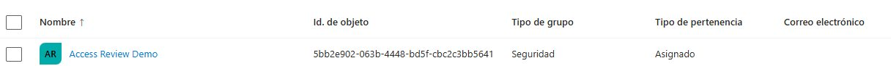
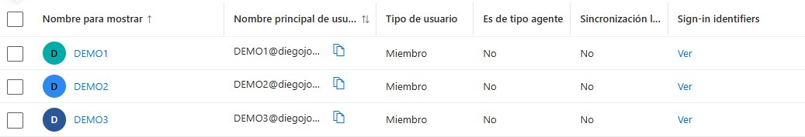
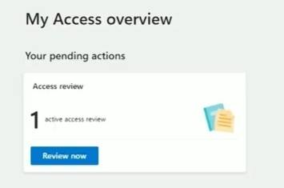
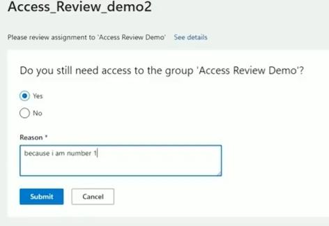
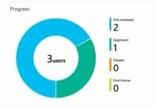

# 6 · Access Review

[← Back to index](../README.md)

Create a demo group and app, run an Access Review, and verify the result in My Access.

---

The goal of an Access Review is to check that some users no longer need certain permissions or licenses.

#### Lab objectives

- Create a demo group and an enterprise application.
- Assign users to the group.
- Configure an Access Review (Teams + Groups).
- Require justification and auto-apply decisions.
- Complete the review from the user portal.
- Apply results and verify access removal.
- Tear down the environment cleanly.

#### Steps

1. Create a group named `Access Review Demo` and use 3 users: `DEMO1`, `DEMO2`, and `DEMO3`.

The group is created as a Security group with Assigned membership:

The 3 demo users are created as Type `Member`:

2. Add the users to the group.
3. Go to **Applications**, create an application named `Access-review-demo-app`, and assign it the group `Access Review Demo`.
4. Go to **Identity Governance > Access reviews > New access review** and create a review named `Access_Review_demo2`.
5. Sign in to Microsoft My Access from the Access Review account.

In **My Access > Overview**, the reviewer sees **Your pending actions** with **1 active access review**. Click **Review now** to open it.

In the review form for `Access_Review_demo2`, the question is: **Do you still need access to the group 'Access Review Demo'?** The reviewer selects **Yes** and must provide a reason in the **Reason** field before clicking **Submit**.

6. Check the result in **Group > Access Review**.

The progress view shows **3 users** in total:

- **Not reviewed:** 2
- **Approved:** 1
- **Denied:** 0
- **Don't know:** 0

---

[← Previous: 5 · Mover and Leaver: Promotion and Offboarding Simulation](../05-mover-and-leaver-promotion-and-offboarding/) | [↑ Index](../README.md) | [Next: 7 · Break Glass and Conditional Access →](../07-break-glass-and-conditional-access/)
