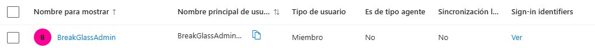
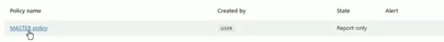
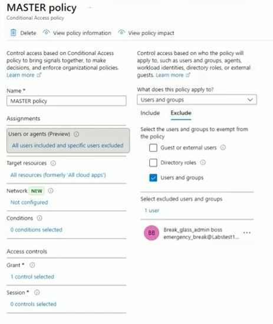

# 7 · Break Glass and Conditional Access

[← Back to index](../README.md)

Create a Break Glass admin and exclude it from a Conditional Access policy.

---

#### Why you need a Break Glass account

Everyone needs a safe path in case they get locked out. If a Conditional Access policy locks you out, you need an account that lets you sign in again to fix the problem.

Create a user `BreakGlassAdmin` for this purpose.

The Break Glass user is created in **Users**. In the list it appears as `BreakGlassAdmin`, Type `Member`, with sign-in identifiers available.

#### Create the policy

Create a Conditional Access policy.

The policy is named `MASTER policy`. In the policy list it appears with State **Report-only**, which means it is evaluated but not enforced yet.

In the policy details, the assignment is **Users or agents**, with **All users included and specific users excluded**. In the **Exclude** tab, the Break Glass account is selected under **Users and groups**, so it is exempt from the policy.

#### Exclude Break Glass

Make sure the `BreakGlass` account is **excluded** from the policy.

> **Key point:** the goal is to show the value of Conditional Access and the importance of having an account that lets you get back into the workstation if you get blocked.

---

[← Previous: 6 · Access Review](../06-access-review/) | [↑ Index](../README.md)
