# Lab 01: Active Directory Tiered Administration & Automated Provisioning

## 1. Objective & Business Use Case
Eliminate manual, error-prone user creation and flat directory structures by implementing a **Tier-0 / Standard User OU hierarchy**, enforcing **AGDLP** (*Account -> Global -> Domain Local -> Permission*) role-based access control, and automating onboarding via idempotent PowerShell scripting.

## 2. Architecture Diagram
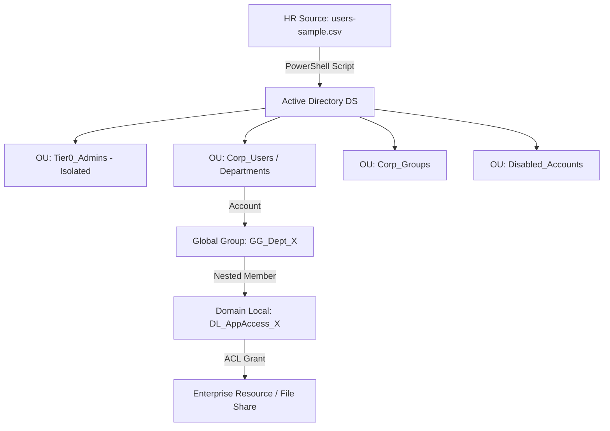

## 3. Implemented Configuration
* **OU Structure:** Separated `Tier0_Admins` from `Corp_Users` (subdivided by `Engineering`, `Finance`, `IT`, `HR`), `Corp_Groups`, and `Disabled_Accounts` with accidental deletion protection enabled (`ProtectedFromAccidentalDeletion = $true`).
* **RBAC Model (AGDLP):** Users are placed exclusively into departmental Global Groups (`GG_Dept_*`), which are nested inside Domain Local permission groups (`DL_AppAccess_*`).
* **Group Policy Objects (GPOs):**
  * **Account Lockout Policy:** Threshold of `5` invalid logon attempts, `15-minute` lockout duration, and `15-minute` observation window.
  * **Advanced Audit Policy:** Enabled *Audit account management* (Event IDs `4720`, `4726`) and *Audit logon events* (Event IDs `4624`, `4625`) for SIEM telemetry readiness.

## 4. Automation & Protocol Inspection
The provisioning script ([`scripts/New-ADStructureAndUsers.ps1`](scripts/New-ADStructureAndUsers.ps1)) generates randomized 16-character passwords per user, enforces `ChangePasswordAtLogon = $true`, and checks existing objects before execution to guarantee safe re-runs (see [`scripts/Run.md`](scripts/Run.md)).

## 5. Troubleshooting (Real Issues Resolved)
| Issue Encountered | Root Cause | Diagnostic & Resolution |
| :--- | :--- | :--- |
| `New-ADUser : The server is unwilling to process the request` | Default Domain Policy password complexity rejected short test strings. | Replaced static test passwords with `New-RandomComplexPassword` enforcing uppercase, lowercase, digits, and symbols. |
| Loss of outbound Internet resolution right after `Install-ADDSForest` | Promoting the server to a Domain Controller overwrote the NIC DNS client to `127.0.0.1` without external DNS forwarders configured. | Added external DNS forwarders (`8.8.8.8` / `1.1.1.1`) in DNS Manager so local queries resolve internally while external requests forward cleanly. |
| Nested group membership not reflecting immediately in user token | Kerberos Ticket Granting Ticket (TGT) caches group SIDs until ticket renewal. | Verified group nesting via `Get-ADPrincipalGroupMembership` and forced ticket refresh with `klist purge`. |

## 6. Security Controls Applied
* **Privilege Separation:** Tier-0 administrative accounts are isolated in a dedicated OU blocked from standard user GPO inheritance.
* **Zero Hardcoded Secrets:** Temporary onboarding passwords are generated dynamically in memory as `SecureString` objects.
* **Principle of Least Privilege:** No direct user permissions are assigned to resources; all access flows strictly through AGDLP nesting.

---

## 7. Hands-On Implementation & Visual Evidence Walkthrough

### Phase 1: Domain Controller VM Build & Forest Promotion
To build a clean, isolated enterprise lab from scratch, I provisioned a VirtualBox virtual machine using the **Windows Server 2022 Standard Evaluation (Desktop Experience)** ISO:
* **VM Name:** `DC01-IAMLAB` (Hostname: `DC01`)
* **Compute & Storage:** `4 GB RAM`, `2 vCPUs`, `40 GB` dynamically allocated VDI, `NAT` network adapter
* **Network & Forest Initialization:** Assigned static IP `10.0.2.10/24` (`Gateway: 10.0.2.2`), installed `AD-Domain-Services` with management tools, and promoted the server via `Install-ADDSForest` to root domain **`corp.iamlab.local`** (NetBIOS: `CORP`, Forest/Domain Functional Level: `WinThreshold`) with integrated DNS.

### Phase 2: Routable UPN Suffix Configuration
Because `.local` domains cannot be verified in Microsoft Entra ID, I opened **Active Directory Domains and Trusts**, navigated to **Properties**, and registered the routable custom UPN suffix used for cloud synchronization in Lab 02:

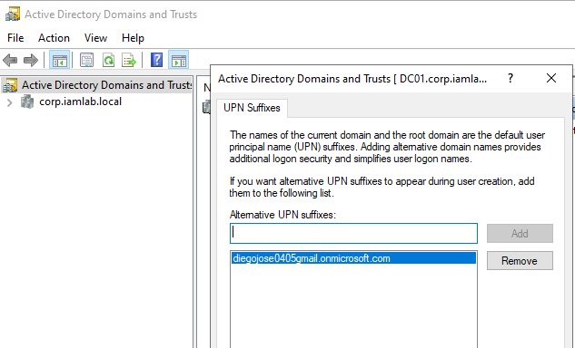

### Phase 3: Automated OU, AGDLP & Bulk User Provisioning
Next, I created `C:\IAM-Lab`, staged [`scripts/users-sample.csv`](scripts/users-sample.csv) with four baseline employees across *Engineering*, *Finance*, *IT*, and *HR*, and executed [`scripts/New-ADStructureAndUsers.ps1`](scripts/New-ADStructureAndUsers.ps1). The script idempotently built `Corp_Users`, `Corp_Groups`, `Tier0_Admins`, and `Disabled_Accounts`, enforced the 5-attempt Account Lockout Policy, generated 16-character randomized passwords with forced first-logon rotation, and mapped users into departmental Global Groups:

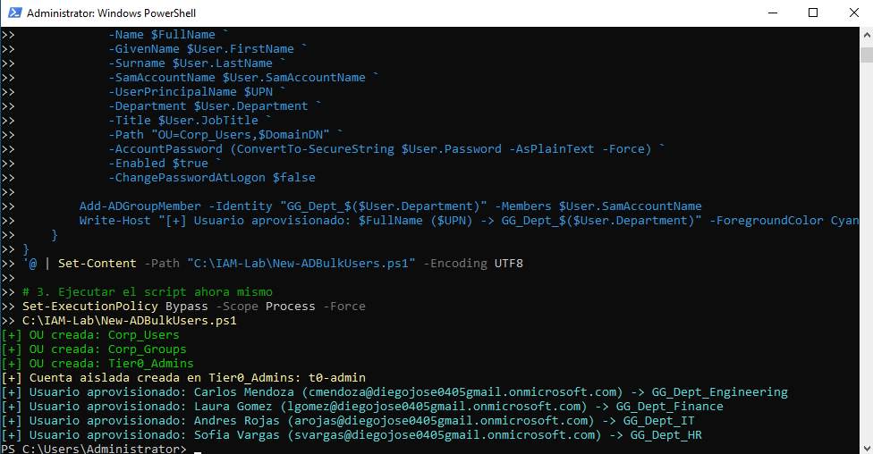

### Phase 4: Resolving Post-Promotion DNS Forwarders
Immediately after promoting `DC01`, outbound web resolution broke because `Install-ADDSForest` pointed the primary DNS adapter to loopback `127.0.0.1` without external forwarders. I resolved this in **DNS Manager** by configuring upstream external forwarders:

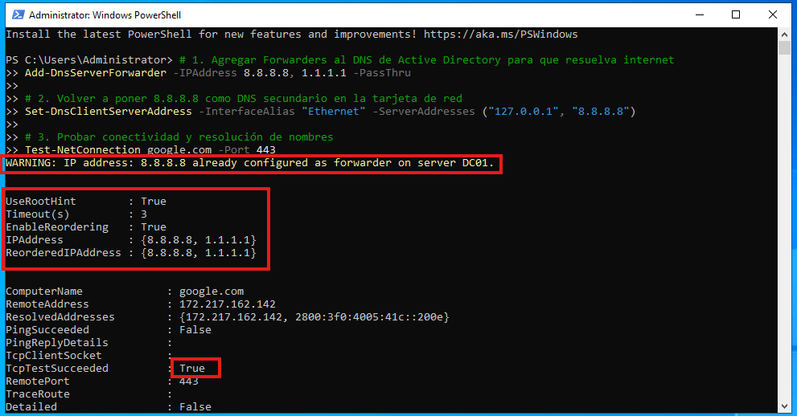

### Phase 5: Verifying AGDLP Nested Group Architecture
Opening **Active Directory Users and Computers** with *Advanced Features* enabled confirmed that all departmental Global Groups (`GG_Dept_*`) and Domain Local access groups (`DL_AppAccess_*`) were provisioned cleanly under `Corp_Groups`:

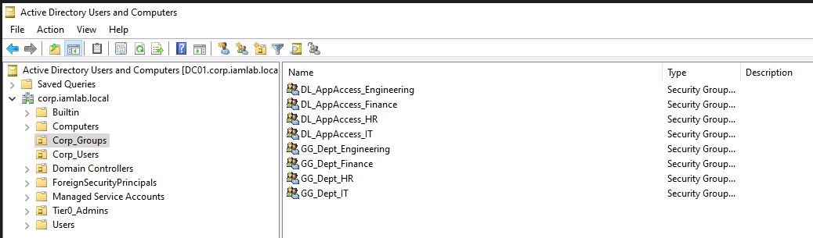

Inspecting the **Members** tab of `DL_AppAccess_Engineering` verified that `GG_Dept_Engineering` is nested inside the Domain Local group—confirming strict adherence to the **AGDLP** model rather than direct user ACL assignments:

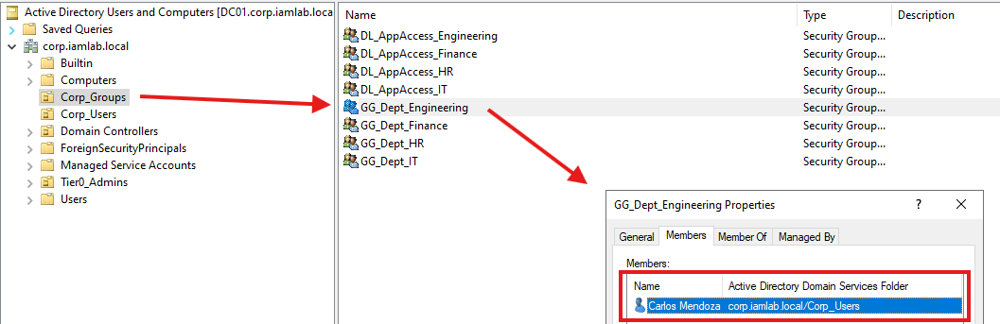

### Phase 6: GPO Audit Policy Hardening & SIEM Event Validation
To prepare the Domain Controller for SOC/SIEM telemetry ingestion, I edited the **Default Domain Controllers Policy** under `Computer Configuration -> Policies -> Windows Settings -> Security Settings -> Local Policies -> Audit Policy`:

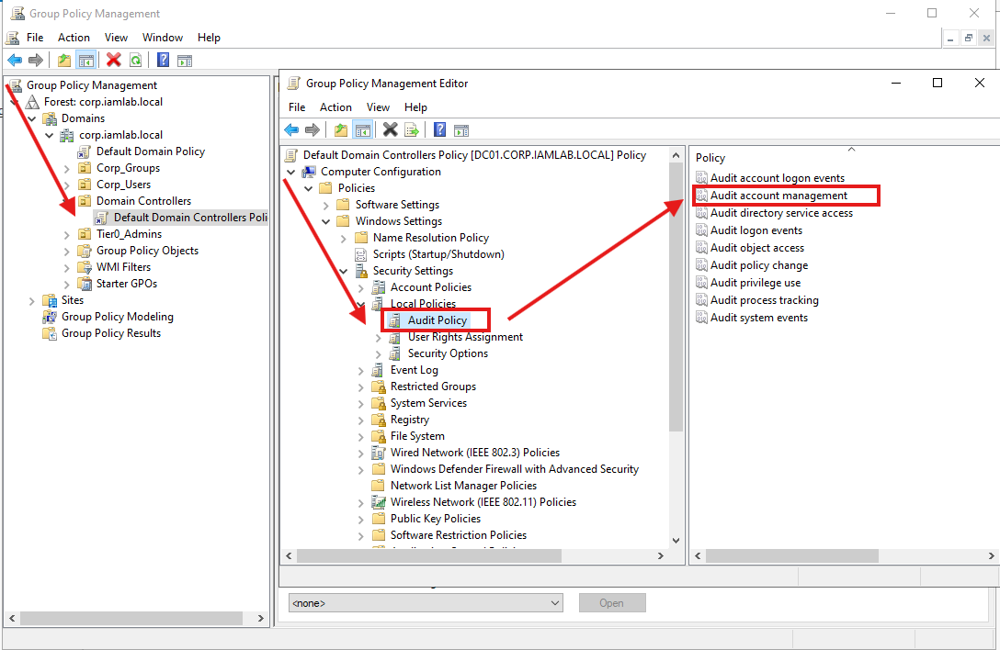

I enabled both **Success** and **Failure** auditing on **Audit account management** (capturing user creation/modification/deletion such as Event ID `4720` and `4726`) and **Audit logon events** (capturing successful/failed authentication attempts such as Event ID `4624` and `4625`):

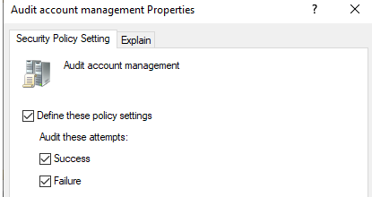

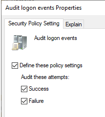

Finally, I forced a policy refresh with `gpupdate /force` and simulated a failed logon attempt to trigger Event ID `4625`:

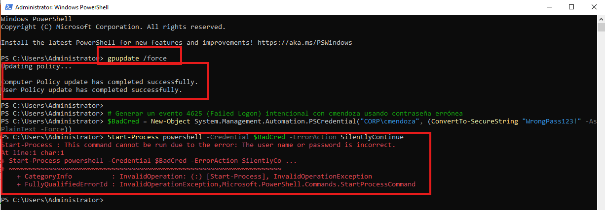

Inspecting the Windows **Security** log in **Event Viewer** confirmed that both account provisioning telemetry (`4720`) and failed authentication telemetry (`4625`) were accurately recorded:

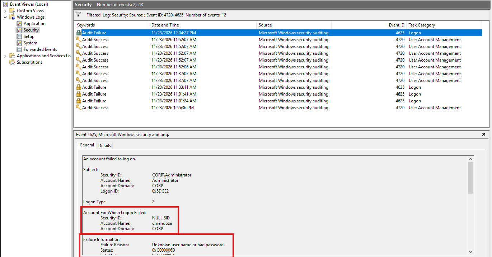
