# Lab 02: Hybrid Identity Integration (AD DS + Microsoft Entra Connect)

## 1. Objective & Business Use Case
Extend on-premises Active Directory identities to Microsoft Entra ID to enable single sign-on (SSO) across cloud SaaS applications while keeping on-premises AD as the authoritative source of truth and preventing privileged Tier-0 accounts from syncing to the cloud.

## 2. Architecture Diagram
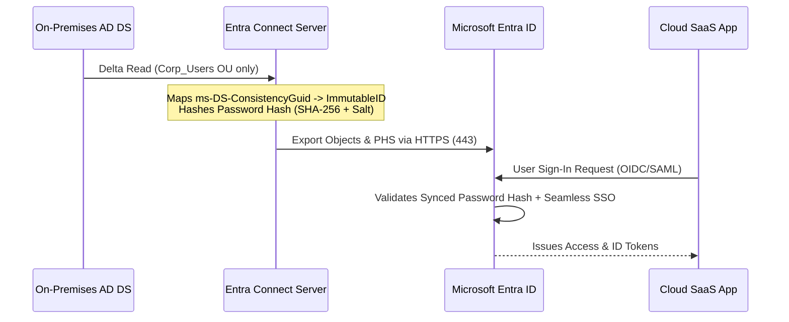

## 3. Implemented Configuration
* **Authentication Method:** **Password Hash Synchronization (PHS)** paired with **Seamless SSO** (Kerberos decryption key stored in `AZUREADSSOACC$` computer account).
* **Source Anchor:** Configured `ms-DS-ConsistencyGuid` instead of `objectGUID` to support future cross-forest AD migrations without breaking cloud object links.
* **OU-Based Filtering:** Scoped synchronization strictly to `OU=Corp_Users` and `OU=Corp_Groups`, explicitly excluding `OU=Tier0_Admins` and service accounts.

## 4. Automation & Protocol Inspection
[`scripts/Invoke-HybridSyncValidation.ps1`](scripts/Invoke-HybridSyncValidation.ps1) audits UPN suffixes against the verified custom domain before triggering `Start-ADSyncSyncCycle -PolicyType Delta`, preventing fallback `.onmicrosoft.com` UPN mismatches (see [`scripts/Run.md`](scripts/Run.md)).

## 5. Troubleshooting (Real Issues Resolved)
| Issue Encountered | Root Cause | Diagnostic & Resolution |
| :--- | :--- | :--- |
| Entra admin portal failed to render in default Windows Server browser | Outdated Internet Explorer / legacy WebView engine lacked modern TLS and JavaScript support required by `entra.microsoft.com`. | Disabled IE Enhanced Security Configuration and updated Microsoft Edge on `DC01` prior to downloading the agent. |
| Entra Connect wizard threw a WAM authentication error when connecting to Entra ID | Windows Web Account Manager (WAM) broker failed inside the isolated lab VM session. | Re-launched the configuration wizard with `AzureADConnect.exe /InteractiveAuth` to bypass WAM and complete browser-based authentication. |
| Synced users initially landed on an earlier test tenant domain | Needed to migrate hybrid sync to the dedicated lab tenant (`DiegoYonoffLab.onmicrosoft.com`) with active Entra ID P2 licensing. | Registered `DiegoYonoffLab.onmicrosoft.com` as an AD UPN suffix, updated all `Corp_Users` UPNs, cleanly reinstalled Entra Connect, and re-linked to the target tenant. |

## 6. Security Controls Applied
* **Tier-0 Cloud Isolation:** On-premises Domain Admins (`OU=Tier0_Admins`) are excluded from Entra Connect scope so an on-premises breach does not automatically compromise Entra Global Administrator roles.
* **Least-Privilege Sync Service Account:** The `MSOL_*` connector account is restricted solely to *Replicating Directory Changes* and *Replicating Directory Changes All*.

---

## 7. Hands-On Implementation & Visual Evidence Walkthrough

### Phase 1: Dedicated Cloud Sync Identity & VM Browser Preparation
Rather than authenticating Entra Connect with a daily administrative account, I provisioned a dedicated cloud-only service identity (`entra-sync-admin`) assigned to **Hybrid Identity Administrator**:

On `DC01`, accessing the Entra admin center initially failed due to legacy browser engine restrictions on Windows Server 2022. Updating the browser resolved portal compatibility:

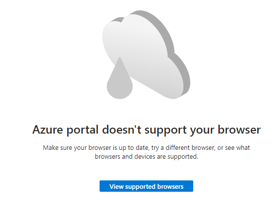

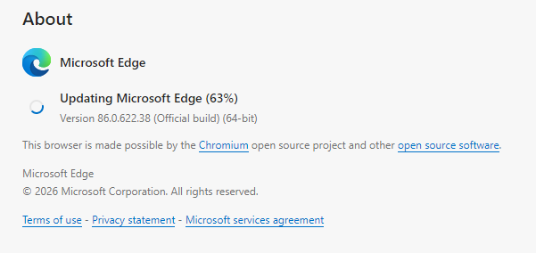

From **Identity -> Hybrid management -> Microsoft Entra Connect -> Connect Sync**, I downloaded the `AzureADConnect.msi` installer:

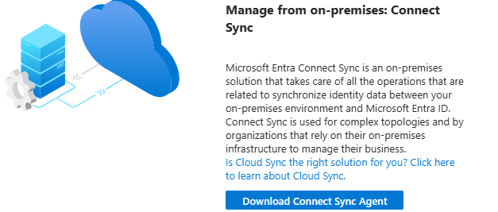

### Phase 2: Custom Entra Connect Installation & Authentication Troubleshooting
Using **Customize** (avoiding Express Settings so OU filtering and Source Anchor could be explicitly hardened), I selected **Password Hash Synchronization (PHS)** and enabled **Seamless Single Sign-On**:

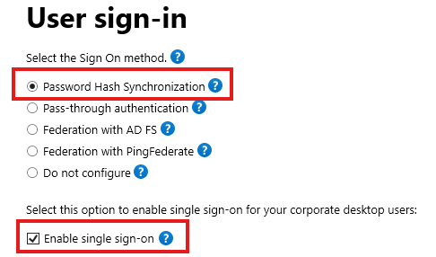

During initial authentication with `entra-sync-admin`, I completed the mandatory first-logon password rotation and MFA enrollment:

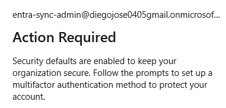

Next, I connected the on-premises forest `corp.iamlab.local` by generating a dedicated least-privilege `MSOL_*` AD DS Connector account:

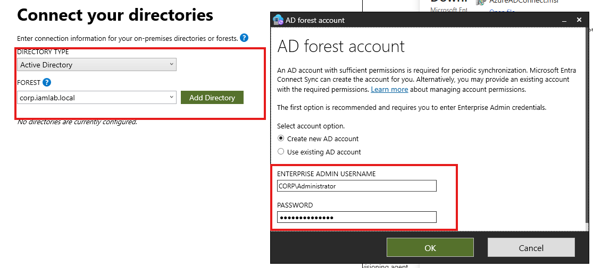

When re-authenticating to Entra ID, the wizard encountered a Windows Web Account Manager (WAM) broker error. Launching `AzureADConnect.exe` with the `/InteractiveAuth` switch resolved the authentication handoff cleanly:

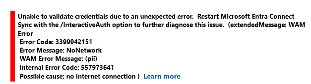

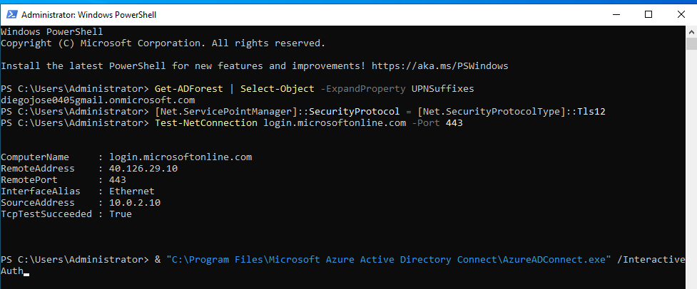

### Phase 3: OU Filtering (Tier-0 Isolation) & Synchronization Verification
In **Domain and OU filtering**, I enforced **Sync selected domains and OUs**, selecting exclusively `Corp_Users` and `Corp_Groups` while leaving `Tier0_Admins` unchecked to prevent privileged lateral movement between on-premises AD and the cloud tenant:

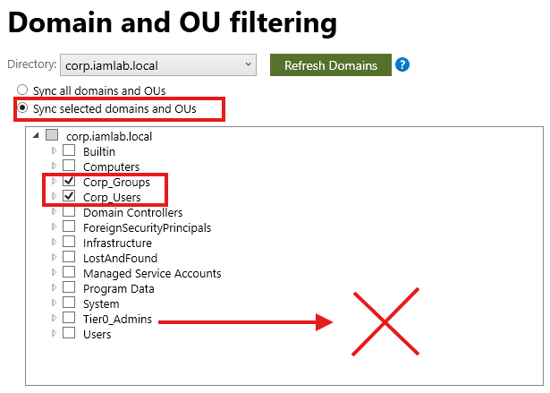

After confirming `ms-DS-ConsistencyGuid` as the immutable Source Anchor, I reviewed the summary configuration and initiated the initial synchronization cycle:

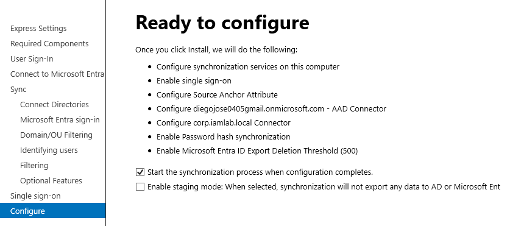

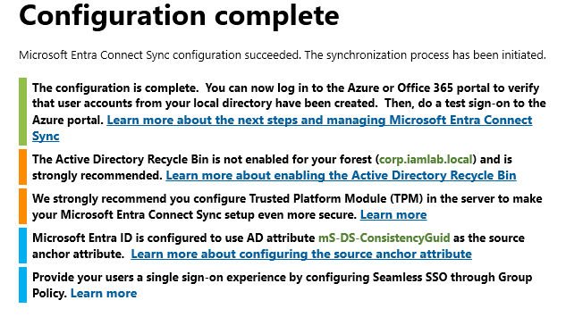

Checking **Identity -> Users -> All users** in Microsoft Entra ID confirmed that standard workforce accounts (`cmendoza`, `lgomez`, `arojas`, `svargas`) synced with the *On-premises sync enabled* badge while Tier-0 admin accounts remained strictly isolated on-premises:

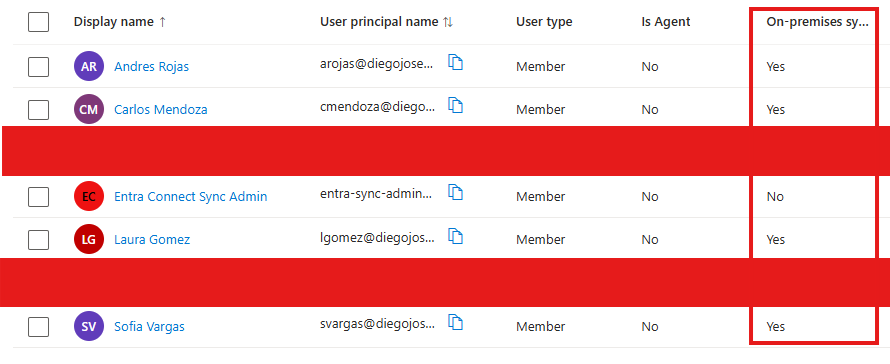

Finally, I activated the **Microsoft Entra ID P2** trial license on `DiegoYonoffLab.onmicrosoft.com` and migrated the on-premises UPN suffixes to `@DiegoYonoffLab.onmicrosoft.com` to unlock Dynamic Groups, PIM, Identity Protection, and Entitlement Management for Labs 03–05:

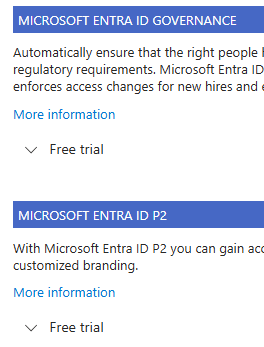
