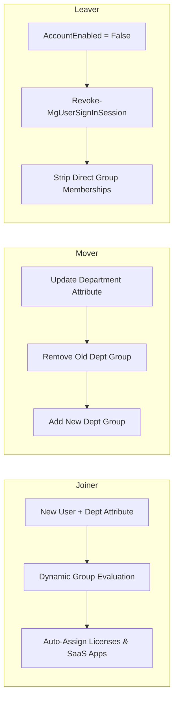
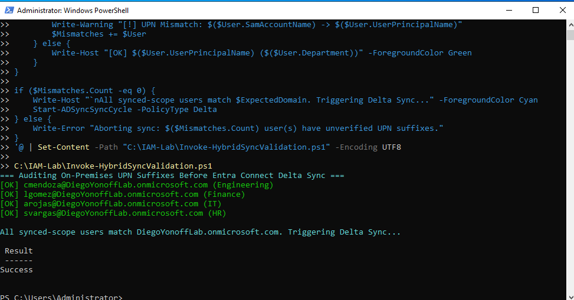
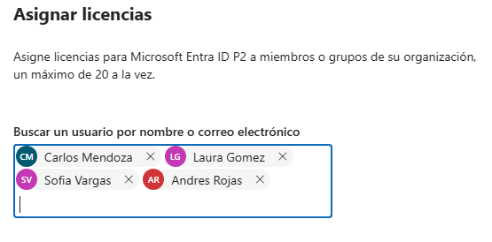
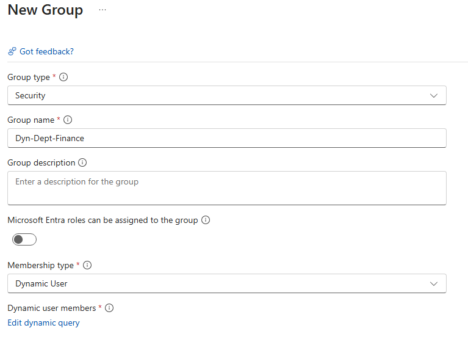
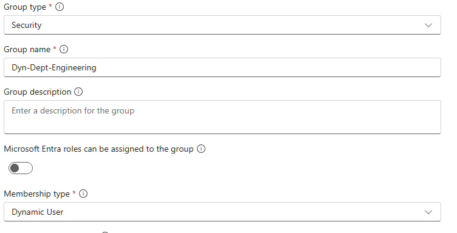
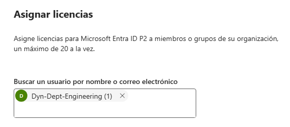
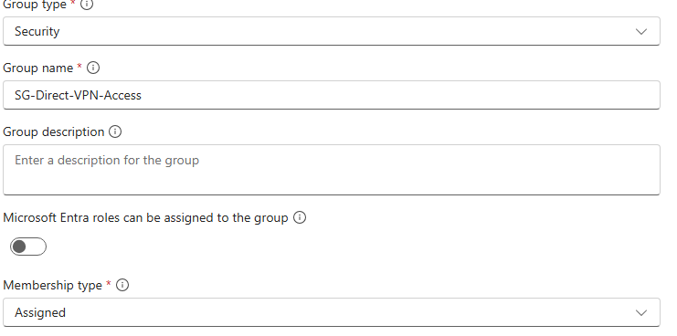
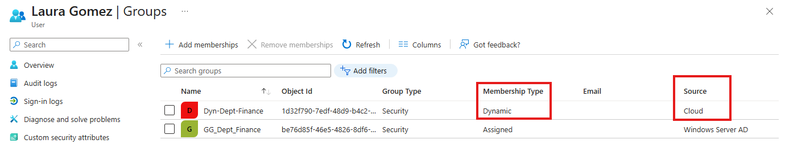
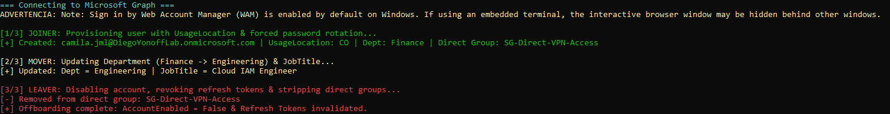
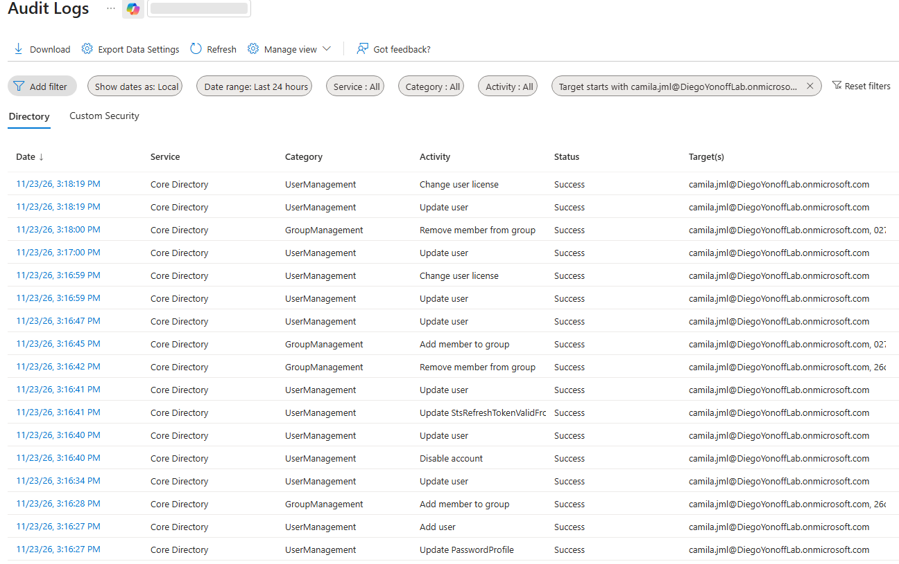

# Lab 03: Automated User Lifecycle Management (Joiner-Mover-Leaver)

## 1. Objective & Business Use Case
Eliminate orphan accounts and privilege creep across department transfers by automating the **Joiner-Mover-Leaver (JML)** lifecycle via **Microsoft Graph API** and attribute-driven **Entra ID Dynamic Groups**.

## 2. Architecture Diagram

## 3. Implemented Configuration
* **Dynamic Security Groups:** Configured attribute-based membership rules so access updates automatically without manual ticket intervention:
  * **Engineering Rule (`Dyn-Dept-Engineering`):** `(user.department -eq "Engineering") and (user.accountEnabled -eq true)`
  * **Finance Rule (`Dyn-Dept-Finance`):** `(user.department -eq "Finance") and (user.accountEnabled -eq true)`
* **Group-Based App & License Assignment:** Bound Microsoft Entra ID P2 licenses directly to `Dyn-Dept-Engineering` so department transfers trigger automatic license provisioning and deprovisioning.

## 4. Automation & Protocol Inspection
[`scripts/Invoke-EntraJML.ps1`](scripts/Invoke-EntraJML.ps1) orchestrates all three lifecycle phases via Microsoft Graph (see [`scripts/Run.md`](scripts/Run.md)):
* **Joiner:** Creates the identity (`camila.jml@DiegoYonoffLab.onmicrosoft.com`) with `UsageLocation = "CO"` (required for license allocation), forces password rotation on first login, and assigns initial direct group membership (`SG-Direct-VPN-Access`).
* **Mover:** Mutates `Department` (`Finance -> Engineering`) and `JobTitle`, triggering automatic dynamic group re-evaluation.
* **Leaver:** Disables sign-in (`AccountEnabled = $false`), invokes `Revoke-MgUserSignInSession` (`POST /users/{id}/revokeSignInSessions`) to invalidate refresh tokens immediately, and strips direct group memberships.

## 5. Troubleshooting (Real Issues Resolved)
| Issue Encountered | Root Cause | Diagnostic & Resolution |
| :--- | :--- | :--- |
| User remained authenticated in browser after setting `AccountEnabled = $false` | Existing OAuth2 Refresh Tokens and Persistent Browser Sessions remain valid until expiry unless explicitly invalidated. | Added `Revoke-MgUserSignInSession` immediately after disabling the account in the `Leaver` workflow. |
| Group-based license assignment failed during Joiner phase | Entra ID blocks license allocation when the user's `UsageLocation` attribute is null. | Enforced explicit `-UsageLocation "CO"` parameter during `New-MgUser` execution. |

## 6. Security Controls Applied
* **Immediate Session Termination:** Combining account disablement with refresh token revocation (`Update StsRefreshTokensValidFrom`) closes the post-offboarding access window.
* **Zero Privilege Accumulation:** Dynamic rules include `and (user.accountEnabled -eq true)` so disabled accounts automatically drop out of dynamic groups and forfeit group-assigned licenses.

---

## 7. Hands-On Implementation & Visual Evidence Walkthrough

### Phase 1: Pre-Sync UPN Audit & Baseline P2 License Allocation
Before executing lifecycle automation, I ran [`Invoke-HybridSyncValidation.ps1`](../02-hybrid-identity-entra-connect/scripts/Invoke-HybridSyncValidation.ps1) to confirm all hybrid users matched `@DiegoYonoffLab.onmicrosoft.com`:

Next, I assigned **Microsoft Entra ID P2** licenses to the baseline directory identities so dynamic group rules and governance features could evaluate them:

### Phase 2: Dynamic Security Groups & Group-Based Licensing
To implement automated *birthright access*, I created two attribute-driven dynamic security groups (`Dyn-Dept-Finance` and `Dyn-Dept-Engineering`) that evaluate both `user.department` and `user.accountEnabled -eq true`:

I then bound automatic **Microsoft Entra ID P2** license assignment directly to `Dyn-Dept-Engineering` so users moving into Engineering receive licenses automatically without helpdesk tickets:

To validate that the Leaver script strips static/direct memberships alongside dynamic ones, I created an assigned security group (`SG-Direct-VPN-Access`):

Within two minutes of rule creation, Entra ID automatically evaluated `Dyn-Dept-Finance` and provisioned **Laura Gomez (`lgomez`)** based on her synced `Department = Finance` attribute:

### Phase 3: End-to-End Graph API JML Execution & Audit Log Telemetry
Executing [`scripts/Invoke-EntraJML.ps1`](scripts/Invoke-EntraJML.ps1) ran a complete Joiner, Mover, and Leaver simulation for test identity `camila.jml@DiegoYonoffLab.onmicrosoft.com`:

Inspecting **Entra ID Audit Logs** confirmed every stage of the lifecycle with exact timestamps:
1. **Joiner:** `Add user`, `Update PasswordProfile`, and `Add member to group` (`SG-Direct-VPN-Access`).
2. **Mover:** `Update user` (`Department: Finance -> Engineering`), triggering automatic addition to `Dyn-Dept-Engineering` and group-based license allocation.
3. **Leaver:** `Disable account`, `Update StsRefreshTokensValidFrom` (instant refresh token invalidation), `Remove member from group` (direct group stripped), followed by automatic dynamic group removal and license reclamation once `accountEnabled` flipped to `false`:

