# Lab 04: Conditional Access Zero Trust Policies & PIM Governance

## 1. Objective & Business Use Case
Enforce Zero Trust access verification on every authentication request and eliminate standing administrative privileges by combining **Microsoft Entra Conditional Access** with **Privileged Identity Management (PIM)** Just-In-Time (JIT) elevation.

## 2. Architecture Diagram
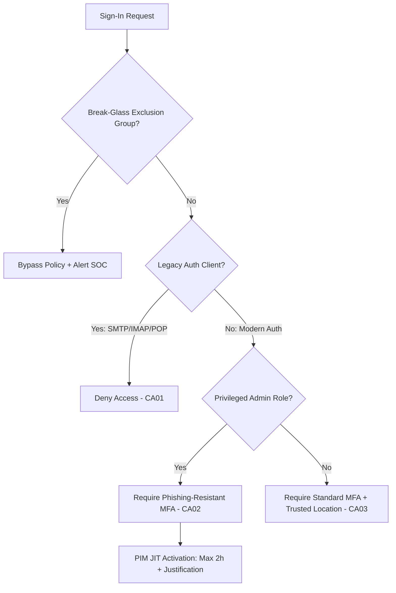

## 3. Implemented Configuration
* **Break-Glass Emergency Accounts:** Created two cloud-only emergency accounts (`breakglass1` and `breakglass2`) assigned to `SG-BreakGlass-Exclude` and excluded from all Conditional Access policies (`excludeGroups`) to prevent total tenant lockout. This is an accepted trade-off: break-glass accounts bypass MFA and geography enforcement, so they depend on long high-entropy credentials, continuous sign-in monitoring, and the quarterly access review configured in Lab 05.
* **Named Locations:** Configured `Approved-Corporate-Countries` restricting approved authentication geographies to **Colombia** and the **United States**.
* **Conditional Access Policy Suite (Staged in `Report-only`):**
  * `CA01 - Block Legacy Authentication`: Blocks `exchangeActiveSync` and `other` clients that cannot enforce MFA.
  * `CA02 - Require Phishing-Resistant MFA for Admins`: Enforces **Phishing-resistant MFA (FIDO2 / Passkeys)** authentication strength for directory roles (`Global Administrator`, `User Administrator`, `Privileged Role Administrator`).
  * `CA03 - Block High-Risk Sign-Ins & Untrusted Geographies`: Denies access from non-approved countries outside `Approved-Corporate-Countries`.
* **PIM Role Governance:** Converted *Global Administrator* and *User Administrator* assignments from **Active (Permanent)** to **Eligible**, enforcing:
  * Maximum activation duration: `2 hours`.
  * Required MFA verification on activation.
  * Mandatory business justification string and audit logging.

## 4. Automation & Protocol Inspection
Policy definitions are exported via [`scripts/Export-ConditionalAccessPolicies.ps1`](scripts/Export-ConditionalAccessPolicies.ps1) as declarative JSON artifacts ([`policies/ca-block-legacy-auth.json`](policies/ca-block-legacy-auth.json)) compatible with the Microsoft Graph `/identity/conditionalAccess/policies` endpoint for version-controlled policy-as-code tracking (see [`scripts/Run.md`](scripts/Run.md)). The GUID under `conditions.users.excludeGroups` in the artifact is the object ID of `SG-BreakGlass-Exclude` in this tenant.

## 5. Troubleshooting (Real Issues Resolved)
| Issue Encountered | Root Cause | Diagnostic & Resolution |
| :--- | :--- | :--- |
| Risk of self-lockout while testing strict FIDO2 / geo-blocking policies | Enforcing `CA02` or `CA03` directly without a physical FIDO2 key registered can lock out the primary lab admin session. | Staged policies in `Report-only` mode, excluded `SG-BreakGlass-Exclude`, and validated enforcement via the **Conditional Access What If Tool** before going live. |
| Policy blocked legacy non-interactive authentication flows | Older clients using basic/legacy auth endpoints (`Exchange ActiveSync` / `other`) cannot satisfy modern MFA challenges. | Confirmed via `What If` simulation that `CA01` blocks legacy clients while leaving modern MSAL browser/desktop clients unaffected. |

## 6. Security Controls Applied
* **Zero Standing Privilege (ZSP):** Privileged roles remain inactive by default (`Eligible`), shrinking the attack surface against credential and token theft.
* **Anti-Lockout Resilience:** Dedicated cloud-only Break-Glass accounts are excluded from Conditional Access and monitored via Entra audit/sign-in logs.

---

## 7. Hands-On Implementation & Visual Evidence Walkthrough

### Phase 1: Anti-Lockout Break-Glass Accounts & Named Locations
Before creating restrictive Conditional Access rules, I created the `SG-BreakGlass-Exclude` security group and provisioned two cloud-only emergency Global Administrator accounts (`breakglass1` and `breakglass2`) inside it:

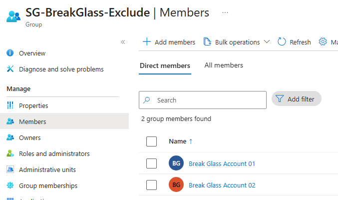

Next, I configured an IP-based **Named Location** (`Approved-Corporate-Countries`) allowing sign-ins exclusively from **Colombia** and the **United States**:

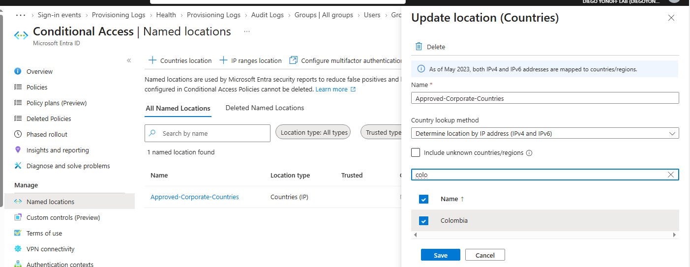

### Phase 2: Conditional Access Suite & `What If` Policy Simulation
I deployed the three Zero Trust Conditional Access policies (`CA01`, `CA02`, and `CA03`) in **Report-only** mode with `SG-BreakGlass-Exclude` explicitly excluded:

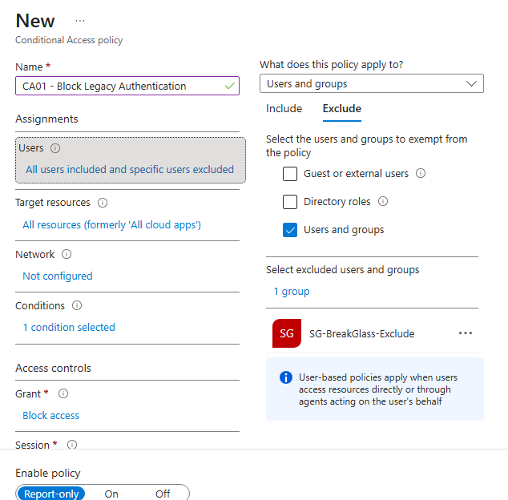

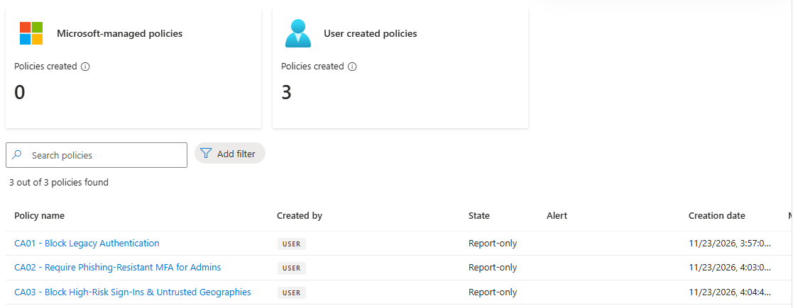

To verify policy behavior safely before enforcement, I ran the **Conditional Access What If** tool simulating user `cmendoza` connecting via an `Exchange ActiveSync` legacy client:

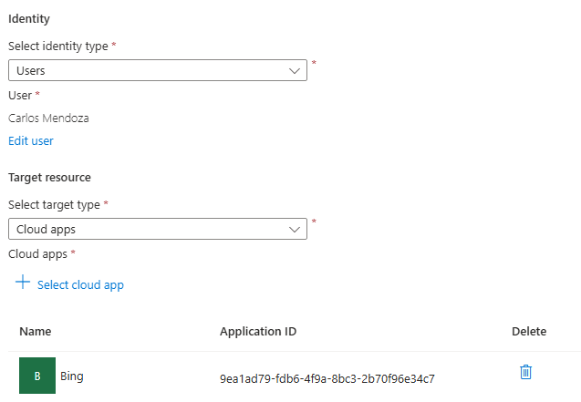

The evaluation confirmed that `CA01 - Block Legacy Authentication` triggers and blocks the legacy connection, while `CA02` and `CA03` correctly remain unapplied for a non-admin user inside an approved geography:

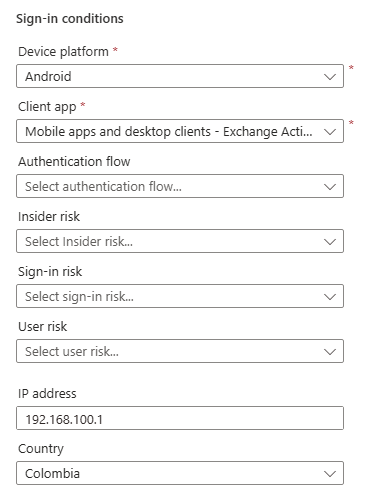

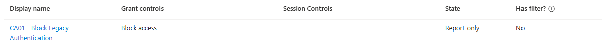

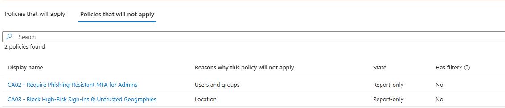

### Phase 3: Privileged Identity Management (PIM) Just-In-Time Governance
To eliminate permanent standing administrative privileges, I transitioned directory role assignments in **Privileged Identity Management (PIM)** to **Eligible**:
* Assigned **Andres Rojas (`arojas`)** as **Eligible** for `User Administrator` with a `2-hour` maximum activation window, mandatory MFA, and required business justification.
* Assigned **Carlos Mendoza (`cmendoza`)** as **Eligible** for `Global Administrator` under the same `2-hour` JIT governance controls.

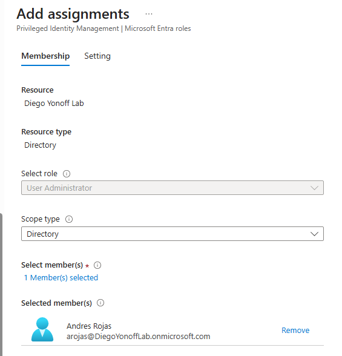

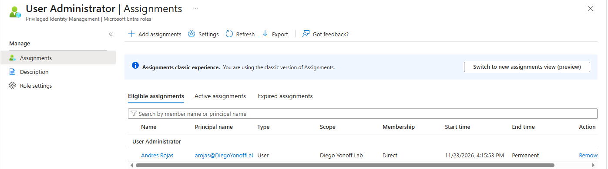

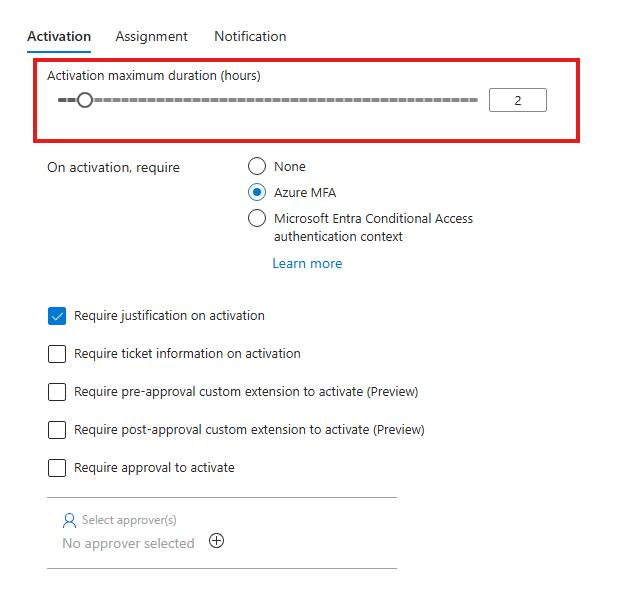

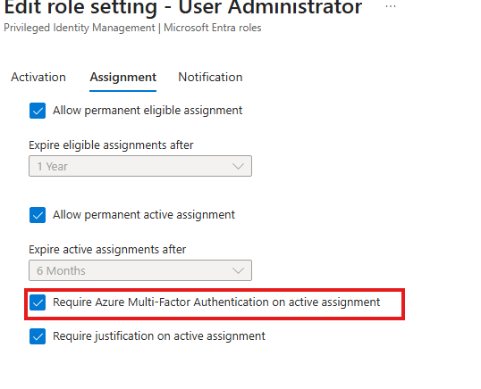

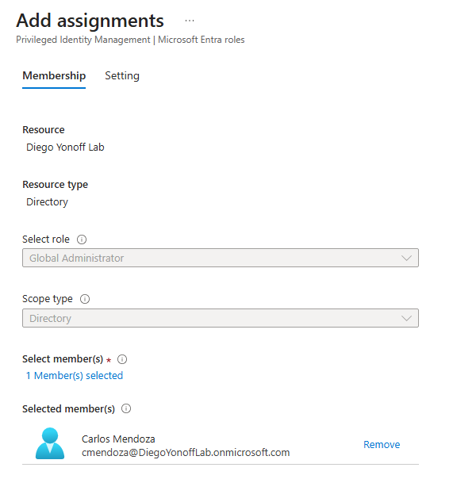

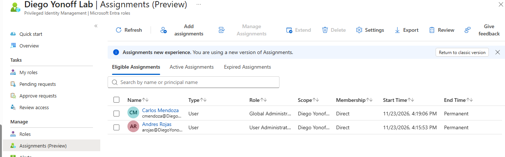

### Phase 4: Exporting Conditional Access Policies as Code (JSON)
Finally, I ran [`scripts/Export-ConditionalAccessPolicies.ps1`](scripts/Export-ConditionalAccessPolicies.ps1) via Microsoft Graph (`Policy.Read.All`) to serialize `CA01` into a clean, version-controllable JSON artifact ([`policies/ca-block-legacy-auth.json`](policies/ca-block-legacy-auth.json)):

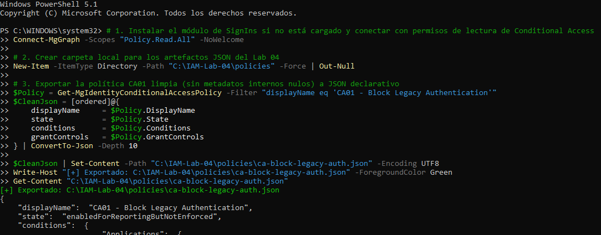
