# Lab 05: Identity Governance, Identity Protection & App Delegation

## 1. Objective & Business Use Case
Enforce automated access lifecycle governance, risk-based adaptive protection, and least-privilege administrative delegation across Microsoft Entra ID—eliminating permanent standing access to sensitive workspaces and preventing illicit OAuth application consent grants.

## 2. Architecture Diagram
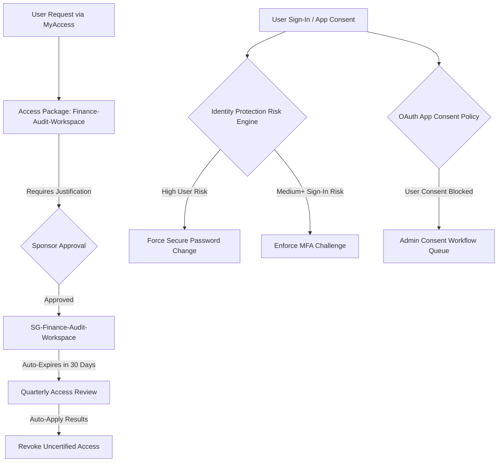

## 3. Implemented Configuration
* **Entitlement Management (`Access Packages`):** Created `Finance-Audit-Workspace` binding `SG-Finance-Audit-Workspace` with mandatory requestor justification, single-stage sponsor approval, `30-day` automatic expiration, and quarterly access reviews.
* **Access Reviews:** Configured certification campaigns (`Quarterly-BreakGlass-Governance-Review`) over privileged emergency accounts (`SG-BreakGlass-Exclude`) with `Auto apply results to resource` enabled.
* **Microsoft Entra Identity Protection (P2):**
  * *User Risk Policy (`CA04 - Remediate High User Risk`):* Enforces MFA + secure password change on `High` user risk (excluding `SG-BreakGlass-Exclude`).
  * *Sign-In Risk Policy (`CA05 - Challenge Medium+ Sign-In Risk`):* Enforces MFA on `Medium` and `High` sign-in risk.
  * *MFA Registration Policy:* Enforces mandatory MFA registration across workforce identities via Authentication Methods Registration Campaign.
* **Delegation & App Governance:**
  * *Administrative Units:* Created `AU-LATAM-Operations` and scoped `User Administrator` permissions strictly to regional members.
  * *App Registration & Consent:* Registered `Corp-Internal-Portal-API` with custom App Role (`Reports.Read.All`), disabled unrestricted end-user OAuth consent, and routed requests to the Admin Consent Workflow.
  * *B2B & Password Hardening:* Restricted guest invitations to privileged admin roles, enabled SSPR for `Dyn-Dept-Engineering`, and configured Smart Lockout (`5` attempts / `60s`) with custom banned passwords (`DiegoYonoffLab`, `Barranquilla`, `IamLab2026`).

## 4. Automation & Protocol Inspection
Access package requests, sponsor approvals, and access review attestations were executed and verified end-to-end through the Microsoft Entra `MyAccess` portal (`https://myaccess.microsoft.com`), generating immutable audit trails in Entra `AuditLogs` (`EntitlementManagement` and `AccessReview` categories).

## 5. Troubleshooting (Real Issues Resolved)
| Issue Encountered | Root Cause | Diagnostic & Resolution |
| :--- | :--- | :--- |
| Legacy Identity Protection User/Sign-In Risk policy blades were deprecated/disabled in portal | Microsoft migrated legacy Identity Protection risk policies into unified **Conditional Access** policies (`User risk` and `Sign-in risk` conditions). | Implemented `CA04 - Remediate High User Risk` and `CA05 - Challenge Medium+ Sign-In Risk` directly inside Conditional Access. |
| Dynamic security groups did not appear in the Access Package resource picker | Microsoft Entra Entitlement Management supports Assigned security groups, Microsoft 365 groups, and Teams—not Dynamic groups—as direct package resources. | Created dedicated assigned security group `SG-Finance-Audit-Workspace` and bound it to the Access Package resource role. |
| Scoped User Administrator could still view directory-wide user objects | Administrative Units restrict write/management actions (`Reset Password`, `Update User`) to AU members while preserving default directory read visibility. | Verified RBAC boundary by confirming password reset succeeded on `AU-LATAM-Operations` members and returned `Authorization_RequestDenied` on non-AU users. |

## 6. Security Controls Applied
* **Time-Bound Access & Zero Standing Entitlements:** Access Package assignments automatically expire after 30 days unless recertified via Access Reviews.
* **Illicit Consent Grant Defense:** Disabling end-user OAuth app consent blocks third-party token-theft applications from harvesting Microsoft Graph permissions.
* **Blast-Radius Containment:** Administrative Units prevent regional helpdesk admins from modifying executive or Tier-0 accounts.

---

## 7. Hands-On Implementation & Visual Evidence Walkthrough

### Phase 1: Administrative Units, B2B Governance, SSPR & Smart Lockout
To contain administrative blast radius, I created the Administrative Unit **`AU-LATAM-Operations`**, populated it with regional users (`cmendoza` and `lgomez`), and assigned **Andres Rojas (`arojas`)** as a scoped **User Administrator** inside that unit only:

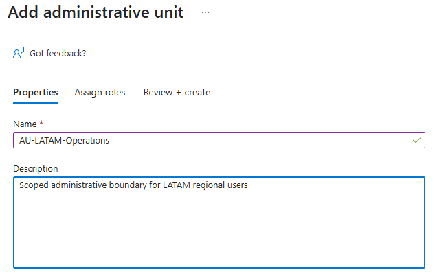

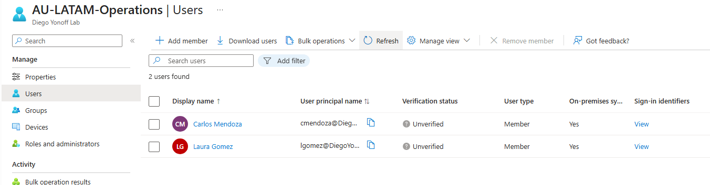

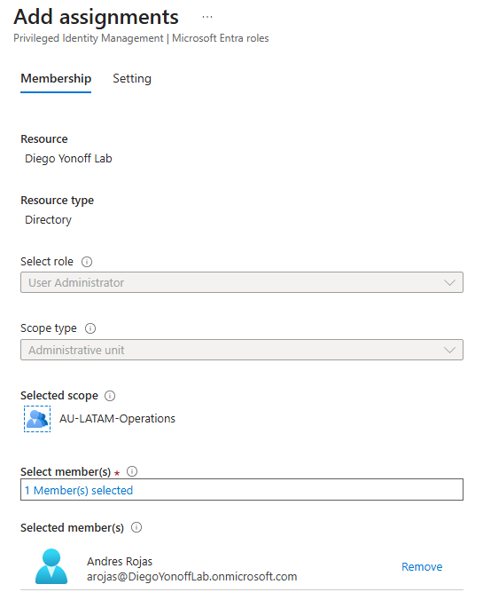

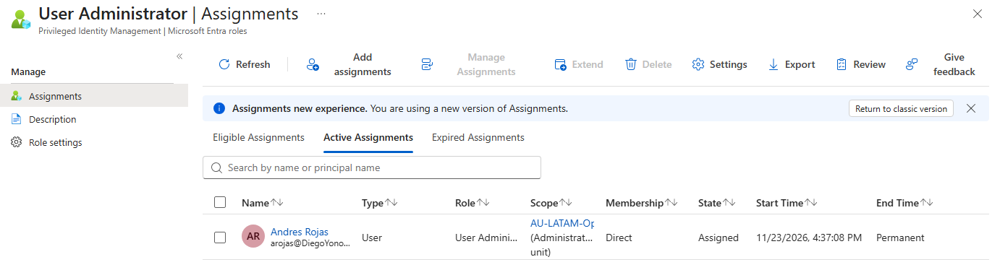

Next, I hardened **External Identities (B2B)** so only privileged admin roles can invite external guests, and invited an external auditor identity (`External SOC Auditor`):

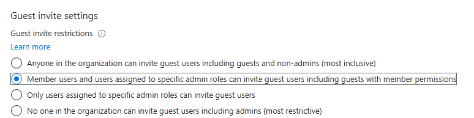

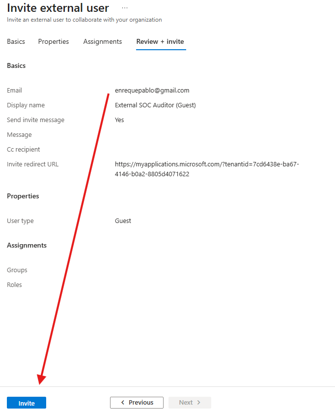

I enabled **Self-Service Password Reset (SSPR)** scoped to `Dyn-Dept-Engineering` and hardened **Password Protection** with **Smart Lockout** (`5` failed attempts, `60-second` lockout) plus custom banned organizational terms (`DiegoYonoffLab`, `Barranquilla`, `IamLab2026`):

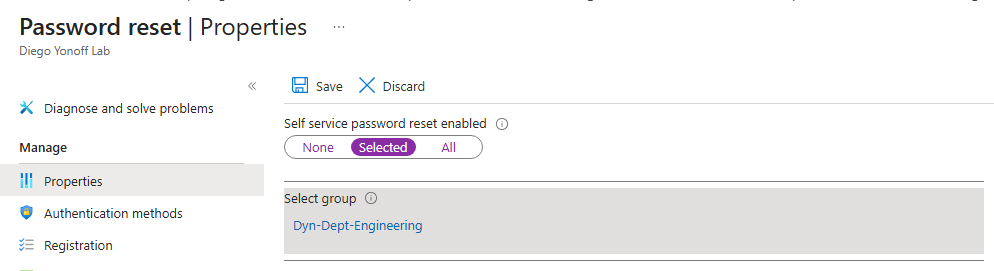

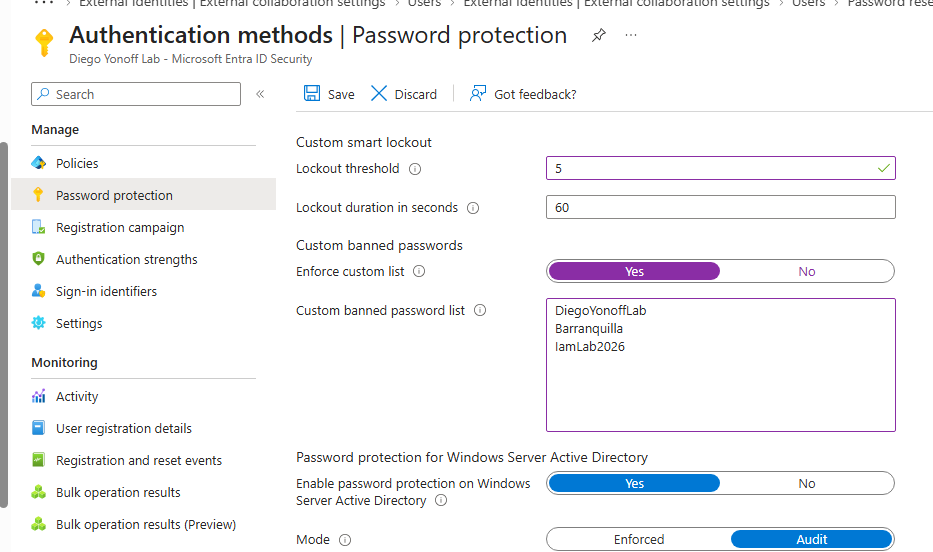

### Phase 2: Application Governance & OAuth Consent Hardening
To demonstrate the architectural distinction between an **Application Object** (global blueprint) and an **Enterprise Application / Service Principal** (local tenant enforcement instance), I registered `Corp-Internal-Portal-API`, exposed its Application ID URI, defined a custom `Reports.Read.All` (`Reports Auditor`) app role, and assigned `cmendoza` on the Enterprise App Service Principal:

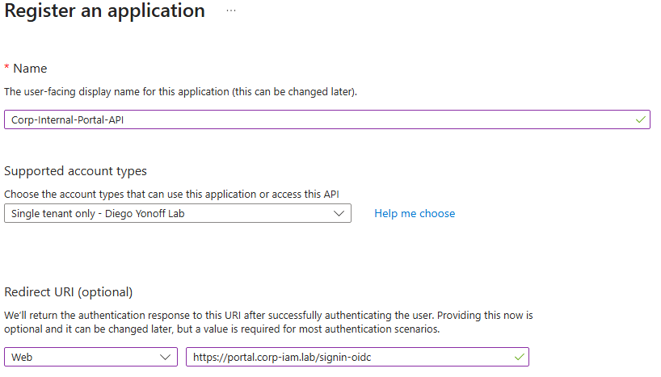

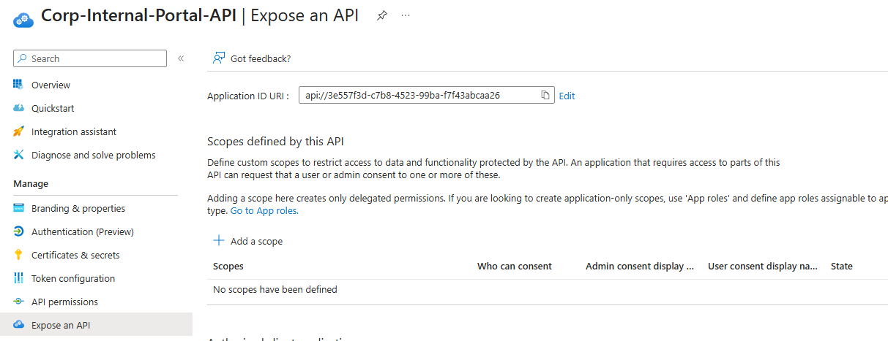

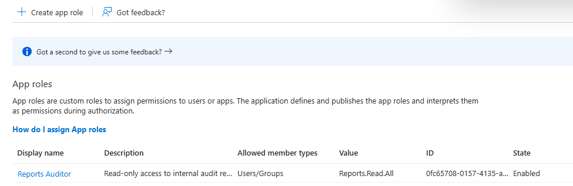

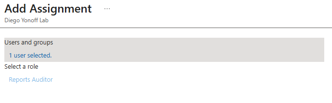

To defend against **Illicit OAuth Consent Grant** phishing attacks, I disabled end-user application consent (`Do not allow user consent`) and enabled the **Admin Consent Workflow** with designated administrative reviewers:

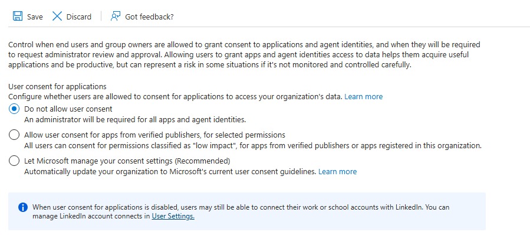

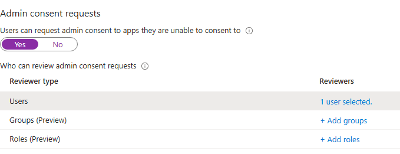

### Phase 3: Identity Protection Risk Policies & MFA Registration Campaign
Because Microsoft migrated legacy Identity Protection risk blades into Conditional Access, I implemented adaptive risk enforcement directly via `CA04 - Remediate High User Risk` (requiring MFA + password change) and `CA05 - Challenge Medium+ Sign-In Risk` (requiring fresh MFA):

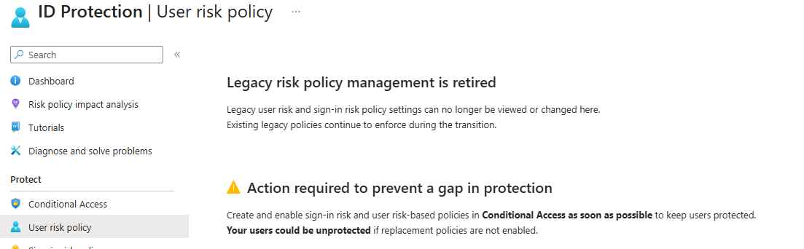

I also enforced directory-wide MFA onboarding through the **Multifactor Authentication Registration Policy** and **Authentication Methods Registration Campaign**:

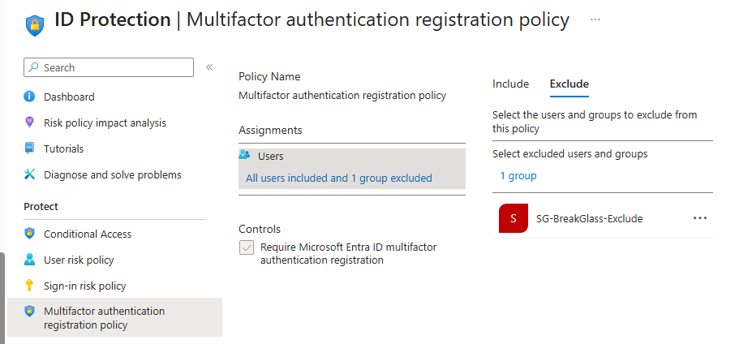

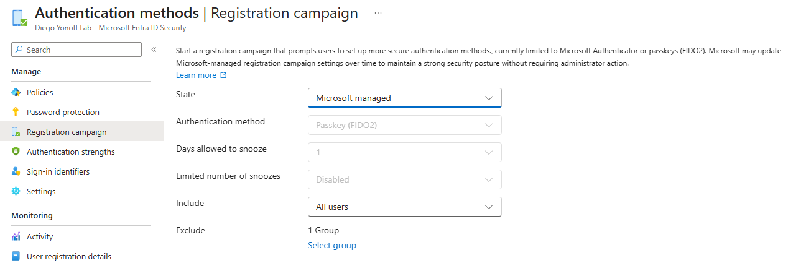

### Phase 4: Entitlement Management (Access Packages) & `MyAccess` Workflow
I created the assigned security group `SG-Finance-Audit-Workspace` and wrapped it inside the **`Finance-Audit-Workspace`** Access Package requiring business justification, single-stage sponsor approval, `30-day` automatic expiration, and quarterly recertification:

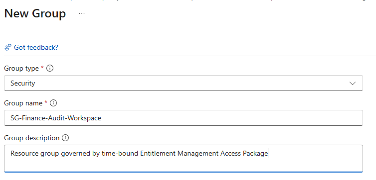

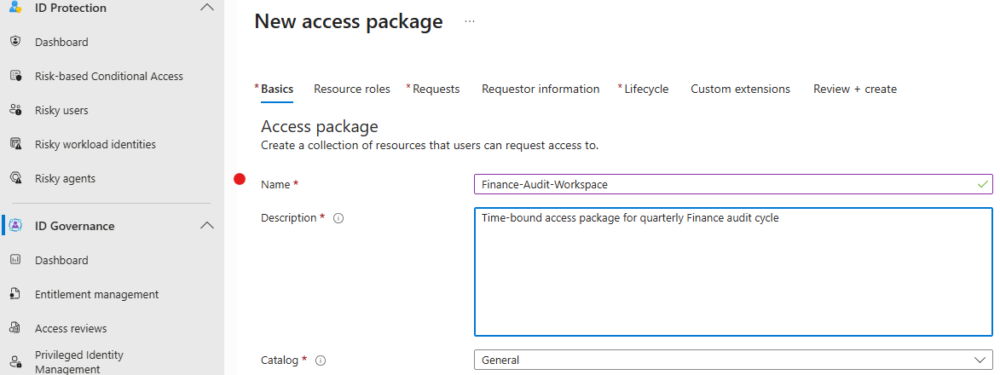

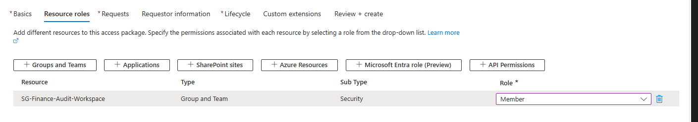

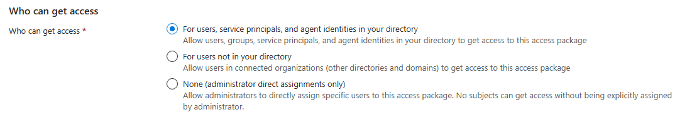

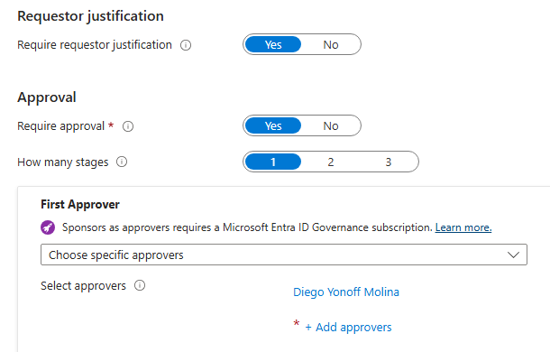

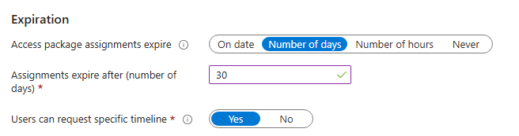

Signing into **`https://myaccess.microsoft.com`** as `cmendoza`, I submitted an access request with justification; then switching to the sponsor session (`DiegoYonoffMolina`, the tenant's primary administrator account acting as access-package sponsor), I reviewed and approved the request—delivering time-bound group membership:

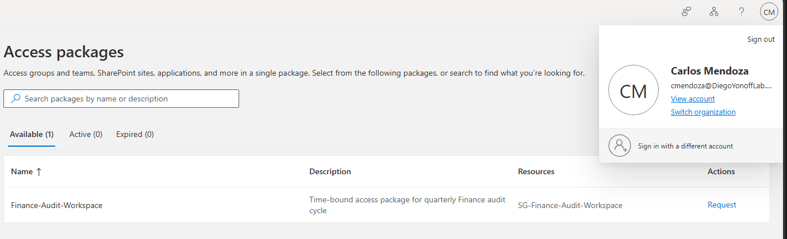

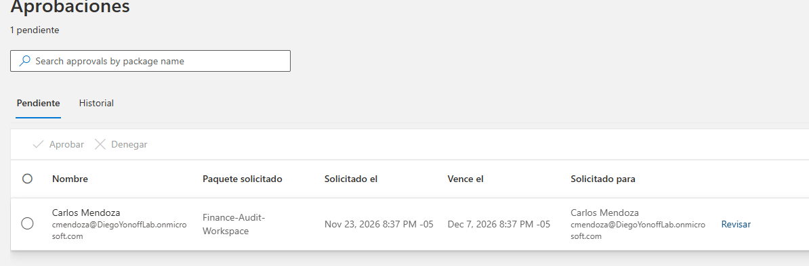

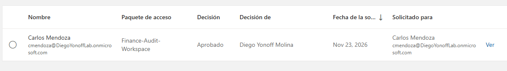

### Phase 5: Access Reviews & Privileged Account Certification
Finally, I configured an **Access Review** (`Quarterly-BreakGlass-Governance-Review`) targeting `SG-BreakGlass-Exclude` with **`Auto apply results to resource`** enabled so uncertified accounts are automatically stripped:

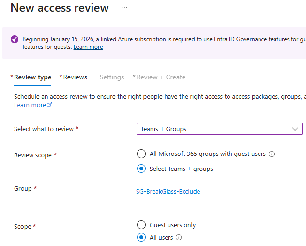

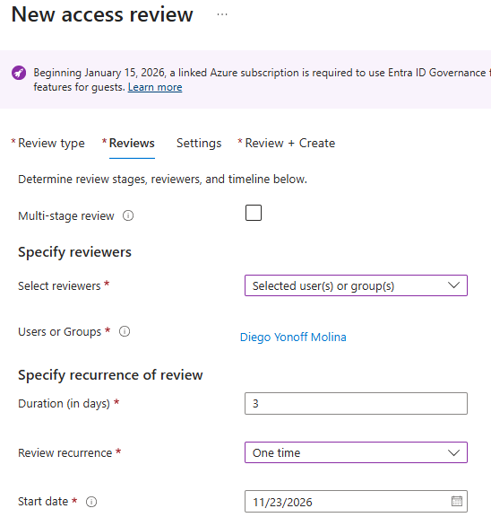

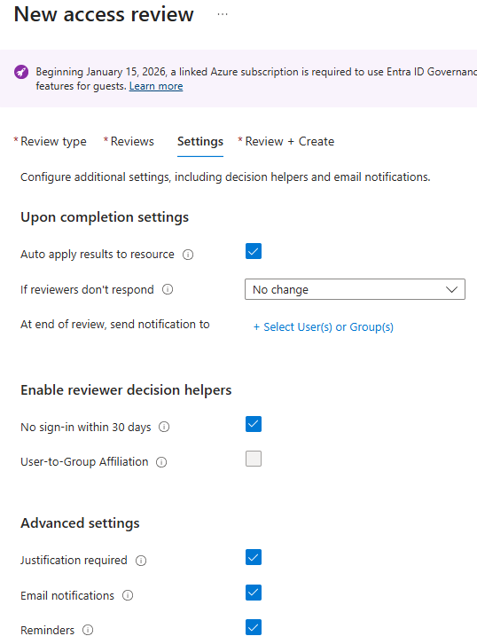

Completing the attestation inside **`https://myaccess.microsoft.com`** documented formal audit justification confirming both Break-Glass emergency accounts remain valid:

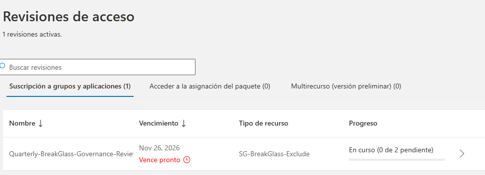

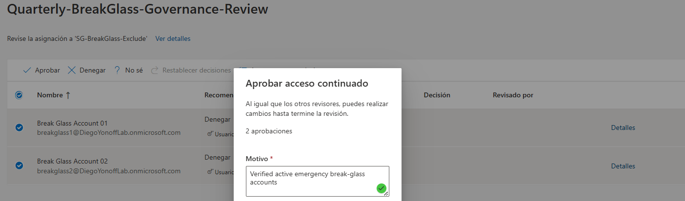
