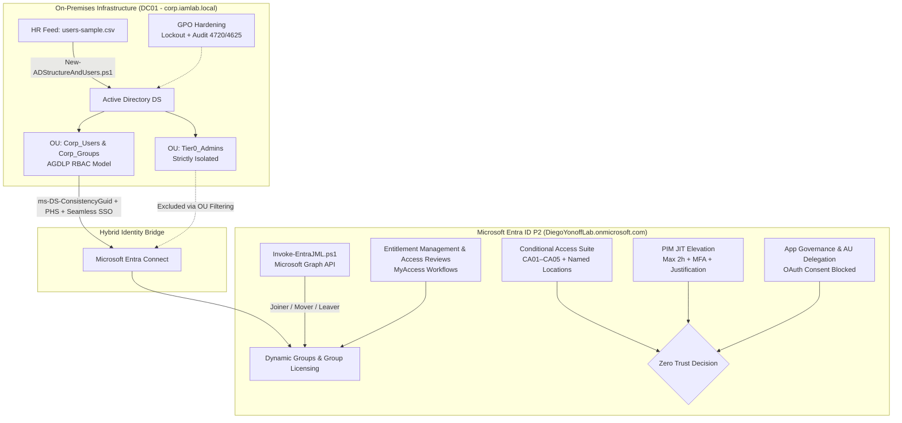

# Module 01: Enterprise Hybrid Identity & Access Management (Active Directory DS + Microsoft Entra ID)

An end-to-end, hands-on **Identity & Access Management (IAM)** and **Identity Security Engineering** portfolio series built from a clean `Windows Server 2022` Domain Controller VM through cloud hybrid synchronization (`Microsoft Entra Connect`), automated lifecycle orchestration (`Microsoft Graph API`), Zero Trust policy enforcement (`Conditional Access` & `PIM`), and full identity governance (`Entitlement Management`, `Access Reviews`, `Identity Protection`, and `OAuth App Governance`).

> **Companion Reference:** For textbook definitions paired with real-world enterprise deployment scenarios for every acronym, policy, and architecture pattern used across these labs, see **[`GLOSSARY.md`](GLOSSARY.md)**.

---

## End-to-End Hybrid & Cloud IAM Architecture

---

## Repository Structure & Lab Index

| Lab | Domain & Focus Area | Key Technologies & Controls | Automation & Artifacts |
| :--- | :--- | :--- | :--- |
| **[`01-active-directory-administration`](01-active-directory-administration/README.md)** | On-Premises AD DS Tiered Administration & Provisioning | Windows Server 2022 DC, Tier-0 OU Isolation, AGDLP RBAC, Account Lockout GPO, Event ID `4720`/`4625` Auditing | [`New-ADStructureAndUsers.ps1`](01-active-directory-administration/scripts/New-ADStructureAndUsers.ps1) [`users-sample.csv`](01-active-directory-administration/scripts/users-sample.csv) [`Run.md`](01-active-directory-administration/scripts/Run.md) |
| **[`02-hybrid-identity-entra-connect`](02-hybrid-identity-entra-connect/README.md)** | Hybrid Identity Synchronization | Microsoft Entra Connect, Password Hash Sync (PHS), Seamless SSO, `ms-DS-ConsistencyGuid`, OU Filtering | [`Invoke-HybridSyncValidation.ps1`](02-hybrid-identity-entra-connect/scripts/Invoke-HybridSyncValidation.ps1) [`Run.md`](02-hybrid-identity-entra-connect/scripts/Run.md) |
| **[`03-user-lifecycle-management-jml`](03-user-lifecycle-management-jml/README.md)** | Automated Joiner-Mover-Leaver (JML) Lifecycle | Microsoft Graph PowerShell SDK, Dynamic Security Groups, Group-Based Licensing, Refresh Token Revocation | [`Invoke-EntraJML.ps1`](03-user-lifecycle-management-jml/scripts/Invoke-EntraJML.ps1) [`Run.md`](03-user-lifecycle-management-jml/scripts/Run.md) |
| **[`04-conditional-access-pim-governance`](04-conditional-access-pim-governance/README.md)** | Zero Trust Conditional Access & Privileged Identity Management | Break-Glass Accounts, Named Locations, Phishing-Resistant MFA (FIDO2), `What If` Simulation, PIM JIT (`2h` max) | [`Export-ConditionalAccessPolicies.ps1`](04-conditional-access-pim-governance/scripts/Export-ConditionalAccessPolicies.ps1) [`ca-block-legacy-auth.json`](04-conditional-access-pim-governance/policies/ca-block-legacy-auth.json) [`Run.md`](04-conditional-access-pim-governance/scripts/Run.md) |
| **[`05-identity-governance-protection-delegation`](05-identity-governance-protection-delegation/README.md)** | Identity Governance, Risk Protection & App Delegation | Entitlement Management (Access Packages), Access Reviews, Identity Protection (`CA04`/`CA05`), Administrative Units, OAuth Consent Hardening, Smart Lockout | End-to-End `MyAccess` & Entra Audit Evidence (`33` verified captures) |
| **[`GLOSSARY.md`](GLOSSARY.md)** | IAM & SC-300 Concept Reference Guide | Structured **Acronym/Feature -> Theory -> Real-World Practice** breakdown across all 5 labs | Complete reference manual |

---

## Lab Environment Topology

* **On-Premises Forest (`corp.iamlab.local`):**
  * **Domain Controller:** `DC01` (`DC01-IAMLAB` — Windows Server 2022 Standard Evaluation, `4 GB RAM`, `2 vCPUs`, `10.0.2.10/24`).
  * **Routable UPN Suffix:** `DiegoYonoffLab.onmicrosoft.com`.
  * **Organizational Units:** `Tier0_Admins`, `Corp_Users`, `Corp_Groups`, `Disabled_Accounts`.
* **Cloud Tenant (`DiegoYonoffLab.onmicrosoft.com`):**
  * **License Tier:** Microsoft Entra ID P2.
  * **Hybrid Bridge:** Microsoft Entra Connect (Custom installation, PHS + Seamless SSO, `ms-DS-ConsistencyGuid` Source Anchor, `Tier0_Admins` excluded).
  * **Workforce Identities Tested:** `cmendoza` (Engineering), `lgomez` (Finance), `arojas` (IT / Scoped AU Admin / PIM Eligible User Admin), `svargas` (HR), plus temporary Graph lifecycle test user `camila.jml` and emergency accounts `breakglass1` / `breakglass2`.

---

## Real-World Engineering & Troubleshooting Highlights

Every lab documents real operational issues encountered and resolved during deployment rather than sanitized textbook happy paths:
1. **Post-Promotion DNS Blackhole (Lab 01):** Resolving outbound Internet loss immediately after `Install-ADDSForest` by configuring external DNS forwarders (`8.8.8.8` / `1.1.1.1`) while preserving local `127.0.0.1` AD resolution.
2. **Entra Connect WAM Broker Failure (Lab 02):** Bypassing Windows Web Account Manager authentication errors inside an isolated server VM via `AzureADConnect.exe /InteractiveAuth`.
3. **Post-Offboarding Session Persistence (Lab 03):** Closing the OAuth2 refresh token window during employee termination by pairing `AccountEnabled = $false` with `Revoke-MgUserSignInSession` (`Update StsRefreshTokensValidFrom`).
4. **Anti-Lockout Zero Trust Rollout (Lab 04):** Staging FIDO2 and geo-restriction policies in `Report-only` mode with `SG-BreakGlass-Exclude` protection and safe validation via the **Conditional Access What If** engine.
5. **Legacy Identity Protection Migration & Entitlement Constraints (Lab 05):** Implementing modern User/Sign-In Risk policies directly inside Conditional Access (`CA04`/`CA05`) and using Assigned security groups (`SG-Finance-Audit-Workspace`) as Entitlement Management resource targets.

---

## Quick Start for Automation Scripts

Each automated lab contains a `scripts/` directory housing both the production PowerShell script and a dedicated **`Run.md`** execution guide with prerequisites, session execution policy commands, and verification queries:
* **Lab 01:** [`01-active-directory-administration/scripts/Run.md`](01-active-directory-administration/scripts/Run.md)
* **Lab 02:** [`02-hybrid-identity-entra-connect/scripts/Run.md`](02-hybrid-identity-entra-connect/scripts/Run.md)
* **Lab 03:** [`03-user-lifecycle-management-jml/scripts/Run.md`](03-user-lifecycle-management-jml/scripts/Run.md)
* **Lab 04:** [`04-conditional-access-pim-governance/scripts/Run.md`](04-conditional-access-pim-governance/scripts/Run.md)
