# Lab 01: Adaptive SSO & Phishing-Resistant MFA (FIDO2 / WebAuthn)

## 1. Objective & Business Use Case
Mitigate Adversary-in-the-Middle (AiTM) phishing proxies and credential stuffing attacks by replacing legacy OTP factors with **FIDO2 / WebAuthn phishing-resistant authenticators** and enforcing context-aware **Okta Network Zones** on every authentication attempt. This is the Okta counterpart of Lab 04 in Module 01: it hardens the workforce identity perimeter so that stolen passwords, reverse-proxy phishing kits, and Tor-based anonymous sign-ins cannot produce a valid session.

## 2. Architecture Diagram
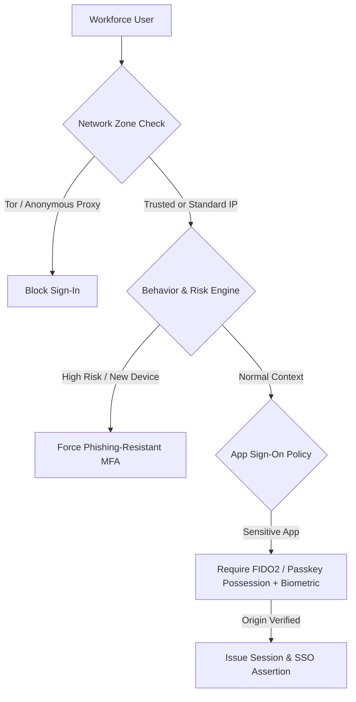

## 3. Implemented Configuration
* **Network Zones:**
  * `BLOCK_Anonymizers`: Dynamic zone blocking known Tor exit nodes and anonymous proxies at the tenant gateway level — traffic matching the zone is dropped *before* any application-level policy is even evaluated.
  * `CORP_Trusted_IPs`: IP-based zone defining corporate egress gateways (current public IP `/32` + simulated corporate range `203.0.113.0/24`) to differentiate internal vs. remote sessions.
* **Authenticator Enrollment Policy:** Enabled **FIDO2 (WebAuthn)** and **Okta FastPass**-grade factors, while explicitly deactivating the **Phone (SMS / Voice)** authenticators — eliminating SIM-swappable factors from the tenant's catalog.
* **Authentication Policy (App Sign-On), two priority-ordered rules:**
  * **Priority 1 — `Allow-BreakGlass-Emergency`:** members of `SG-BreakGlass-Exclude` are allowed from **any IP** with *any 2 factor types* and **no phishing-resistant constraint**, guaranteeing that the emergency accounts never get locked out of their own tenant.
  * **Priority 2 — `Enforce-FIDO2-Phishing-Resistant-Engineering`:** members of `GG_Dept_Engineering` (and not in the break-glass group) connecting from **an IP not in `BLOCK_Anonymizers`** must authenticate with the **Possession factor** constrained to **Phishing-resistant** + **device passcode or biometric verification**, allowing **only the Passkey (FIDO2 WebAuthn) method**, prompting on **every sign-in** and never offering a "stay signed in" option.

## 4. Automation & Protocol Inspection
During WebAuthn authentication, the authenticator signs the client challenge concatenated with the SHA-256 hash of the Relying Party ID (`rpIdHash`, e.g. `integrator-6023165.okta.com`). Even if a user is lured to a pixel-perfect phishing proxy (`okta-login-verify.com`), the browser binds the cryptographic assertion to the *proxy's* domain, so signature verification at the real IdP fails automatically — the session cannot be minted. Validation of the deployed controls was closed in the **Okta System Log** (`Reports -> System Log`), filtering by the test identity and expanding the resulting `user.authentication.auth_via_mfa` / `user.session.start` events to confirm the factor used was `webauthn` / FIDO2 and the source IP resolved inside `CORP_Trusted_IPs`.

## 5. Troubleshooting (Real Issues Resolved)
| Issue Encountered | Root Cause | Diagnostic & Resolution |
| :--- | :--- | :--- |
| WebAuthn enrollment failed with `SecurityError: The operation is insecure` | Local test callback endpoint ran over plain `http://` instead of `https://`. | Configured local TLS termination (`localhost` HTTPS) to satisfy WebAuthn **secure context** requirements. |
| Test admin account blocked after enabling the phishing-resistant rule globally | Policy applied to all users *before* a break-glass exception existed at a higher priority. | Reordered rules so `Allow-BreakGlass-Emergency` (Priority 1) is evaluated before `Enforce-FIDO2-Phishing-Resistant-Engineering` (Priority 2), and scoped the strict rule to `GG_Dept_Engineering` while excluding `SG-BreakGlass-Exclude`. |
| Sign-in tests were "passing" silently without prompting for the FIDO2 factor | A prior Okta global session was reused, so no fresh authentication happened in the incognito window. | Set **Prompt for authentication** to `Every time user signs in to resource` and **Option to stay signed in** to `Don't show`, forcing the WebAuthn challenge on every login test. |
| FIDO2 enrollment locked out users that had no authenticator registered yet | Enrollment policy was set to *Required* globally before any user possessed a passkey. | Left the global **Authenticator Enrollment Policy** at `Optional` and enforced FIDO2 instead at the **Authentication Policy** layer, letting Okta trigger **just-in-time enrollment** at first sign-in. |

## 6. Security Controls Applied
* **Phishing-Resistant MFA (FIDO2 / Passkeys):** Origin-bound public-key cryptography defeats AiTM reverse-proxy phishing kits that replay stolen session cookies.
* **Anonymizer Perimeter:** Dynamic `BLOCK_Anonymizers` zone hard-drops Tor / anonymous proxy traffic at the tenant gateway, shrinking the credential-stuffing attack surface.
* **SIM-Swap Immunity:** SMS and Voice authenticators deactivated tenant-wide, removing the factor most commonly defeated by telecom social engineering.
* **Anti-Lockout Resilience:** Break-Glass accounts (`SG-BreakGlass-Exclude` + Super Administrator role) evaluated first at Priority 1 with relaxed constraints — the accepted trade-off that guarantees emergency access, compensated with monitoring.
* **Forced Re-Authentication:** `Every time user signs in to resource` prevents dormant SSO sessions from masking the true policy behavior during security testing.

---

## 7. Hands-On Implementation & Visual Evidence Walkthrough

### Phase 1: Okta Workforce Tenant Bootstrap
I registered the Okta Workforce tenant using an institutional (university) email account, selecting the developer-oriented role for the tenant profile:

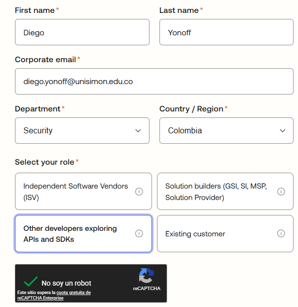

The account activation email arrived at the institutional inbox, and the administrator account was activated:

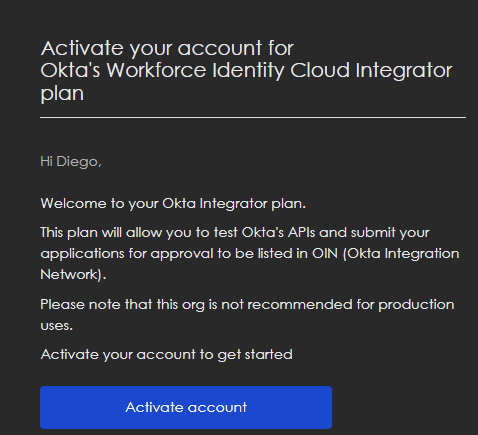

I generated and stored the tenant administrator password in a password manager (Bitwarden) — no administrator credential is ever stored in plaintext or in this repository:

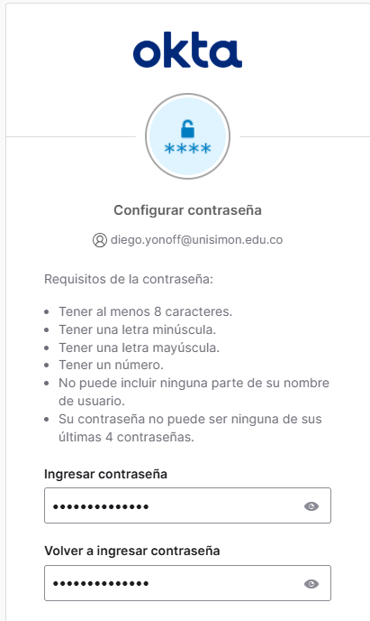

With the tenant provisioned, the Admin Console became available:

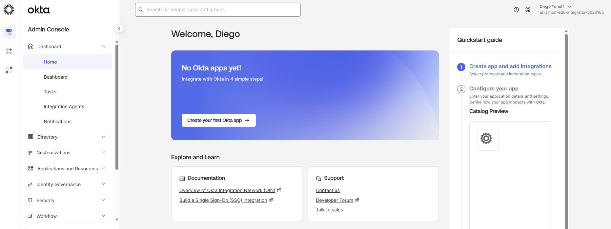

### Phase 2: Directory Baseline — Groups & Test Users (Module-Consistent Naming)
To keep coherence with the Module 01 corporate model, I created three foundational groups in **Directory -> Groups -> Add group**:

* `GG_Dept_Engineering` — *Engineering workforce group subject to phishing-resistant FIDO2 MFA*
* `GG_Dept_Finance` — *Finance workforce group*
* `SG-BreakGlass-Exclude` — *Emergency break-glass accounts excluded from restrictive MFA/Network policies*

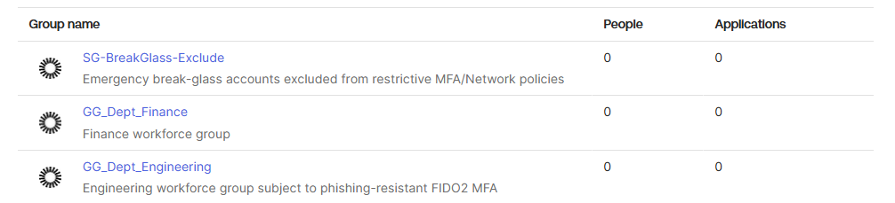

I provisioned the workforce test user **Carlos Mendoza** (`cmendoza@corp-iam.lab`) with an admin-set password and the *User must change password on first login* flag disabled to streamline lab authentication testing, assigning him to `GG_Dept_Engineering`:

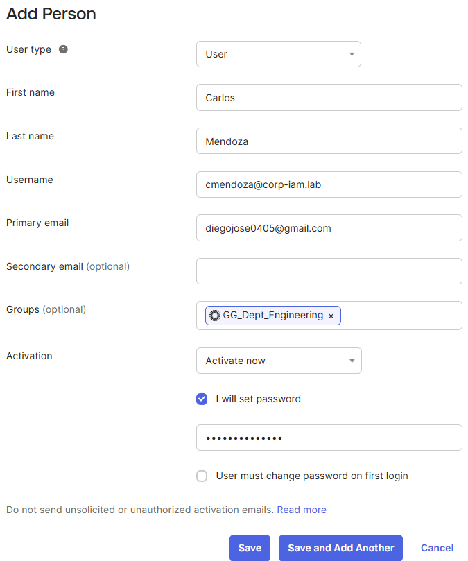

Then the emergency account **breakglass1** (`breakglass1@corp-iam.lab`) was created inside `SG-BreakGlass-Exclude`:

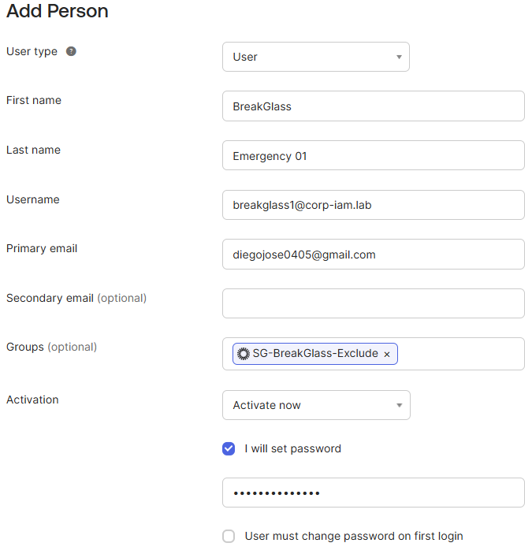

The directory baseline verified from the Universal Directory overview — the groups and workforce users coexisting exactly as in the Entra ID module:

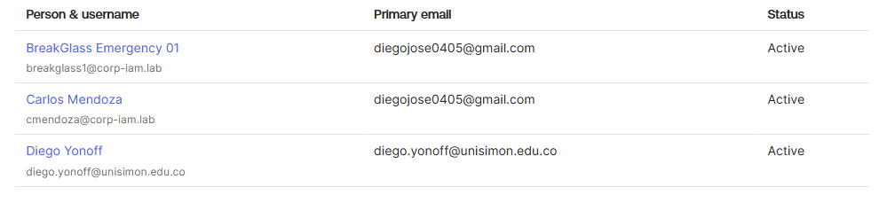

To guarantee anti-lockout resilience, the break-glass account was granted the **Super Administrator** role under **Security -> Administrators** — the Okta equivalent of a cloud-only emergency Global Admin:

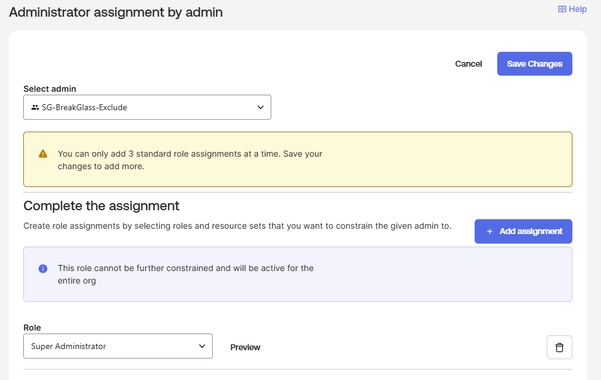

### Phase 3: Network Zones (`BLOCK_Anonymizers` & `CORP_Trusted_IPs`)
Under **Security -> Networks**, I created the dynamic zone `BLOCK_Anonymizers` marking **Tor anonymizer proxy** (and anonymous proxies), enabling **Block access from IPs matching conditions listed in this zone** so Tor egress traffic is dropped at the tenant gateway before any policy evaluation:

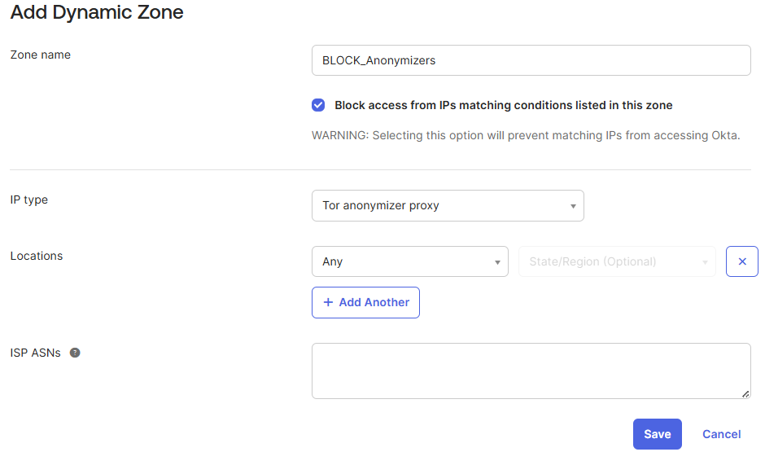

Then the IP zone `CORP_Trusted_IPs` with the current public egress IP in `/32` CIDR notation plus a simulated corporate range `203.0.113.0/24`:

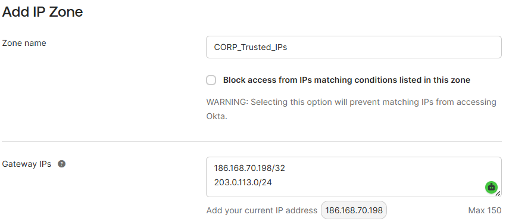

### Phase 4: Authenticator Hardening & Passkey Enrollment
Under **Security -> Authenticators -> Setup**, I verified **FIDO2 (WebAuthn)** active alongside Okta Verify and Password — and deactivated the **Phone (SMS / Voice)** authenticators to remove SIM-swappable factors from the tenant:

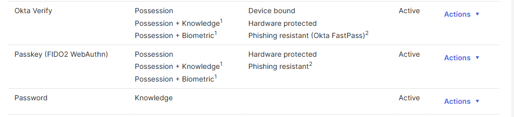

In the **Enrollment** tab, FIDO2 (WebAuthn) was configured as **Optional** at the global level — enforcement happens in the Authentication Policy in Phase 5, not at enrollment, so break-glass accounts are never stranded without a registered key:

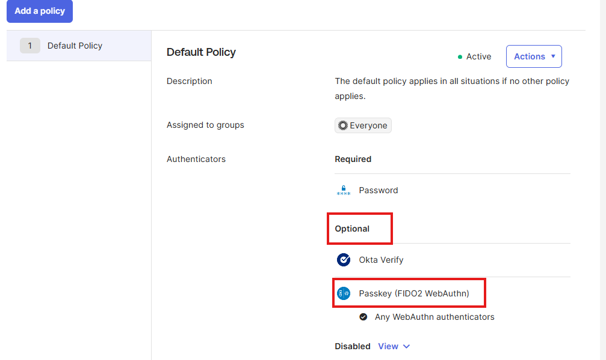

I then enrolled my own FIDO2 passkey via the end-user settings (**Security Methods -> Security Key or Biometric -> Set up**), completing the native Windows Hello / passkey prompt:

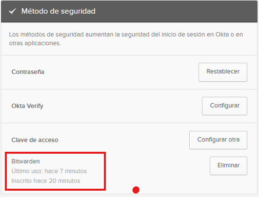

### Phase 5: App Sign-On Policy — Break-Glass Exception + Phishing-Resistant Rule
I built the Authentication (App Sign-On) policy with **two priority-ordered rules**.

**Rule 1 — `Allow-BreakGlass-Emergency` (Priority 1):** scoped to `SG-BreakGlass-Exclude`, from **any IP**, with *any user type / device state / platform*:

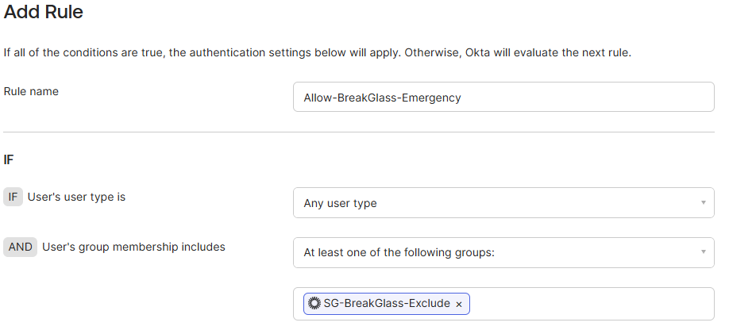

The THEN block allows access after successful authentication with *any 2 factor types*, **explicitly unchecking the phishing-resistant constraint** so the emergency account can always get in — even without a physical FIDO2 key at hand:

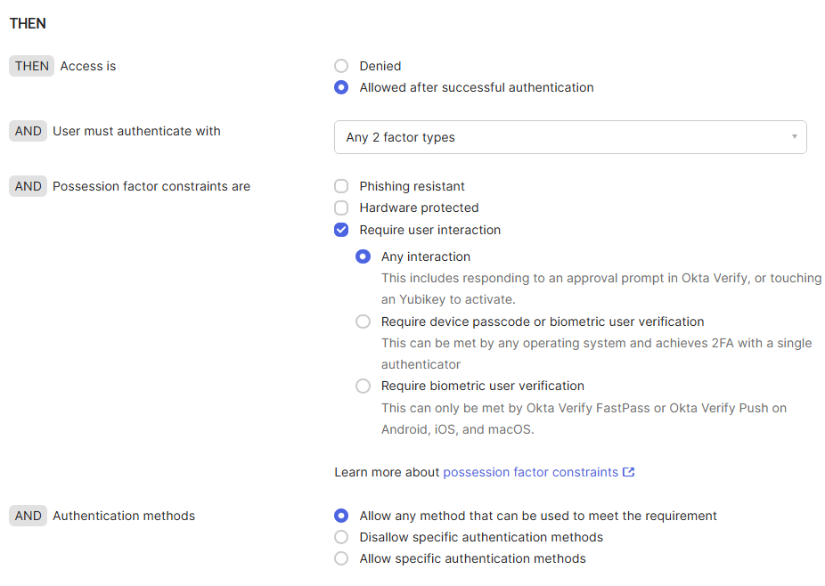

The rule saved and confirmed at the top of the priority stack:

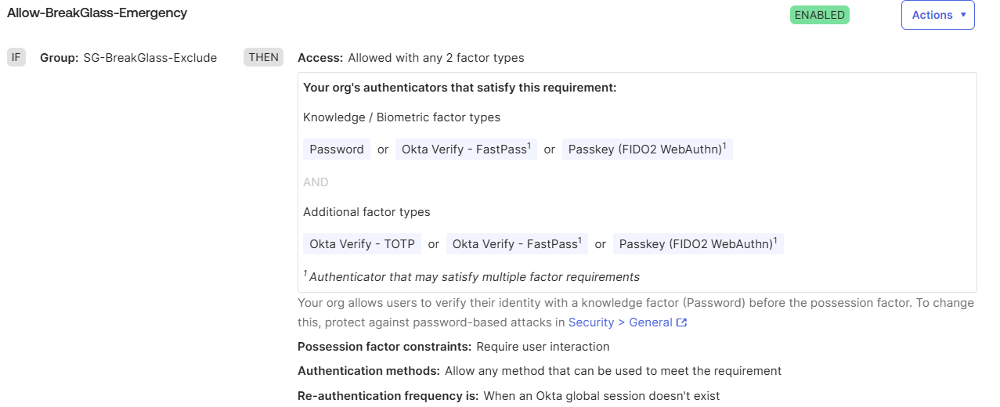

**Rule 2 — `Enforce-FIDO2-Phishing-Resistant-Engineering` (Priority 2):** scoped to `GG_Dept_Engineering` while excluding `SG-BreakGlass-Exclude`, requiring the user's IP to be **not in `BLOCK_Anonymizers`**:

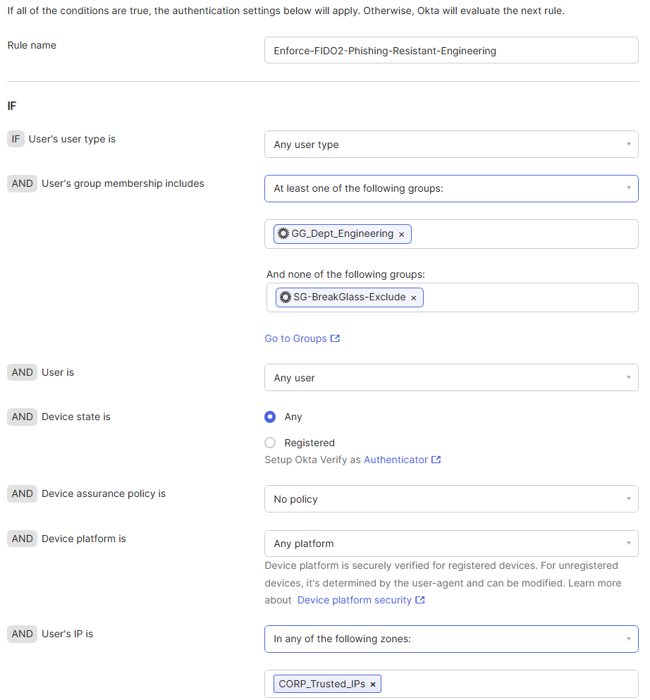

The THEN block switches to the **Possession factor** with two hard constraints — **Phishing resistant** and **Require device passcode or biometric user verification** — and restricts authentication methods to **only Passkey (FIDO2 WebAuthn)**:

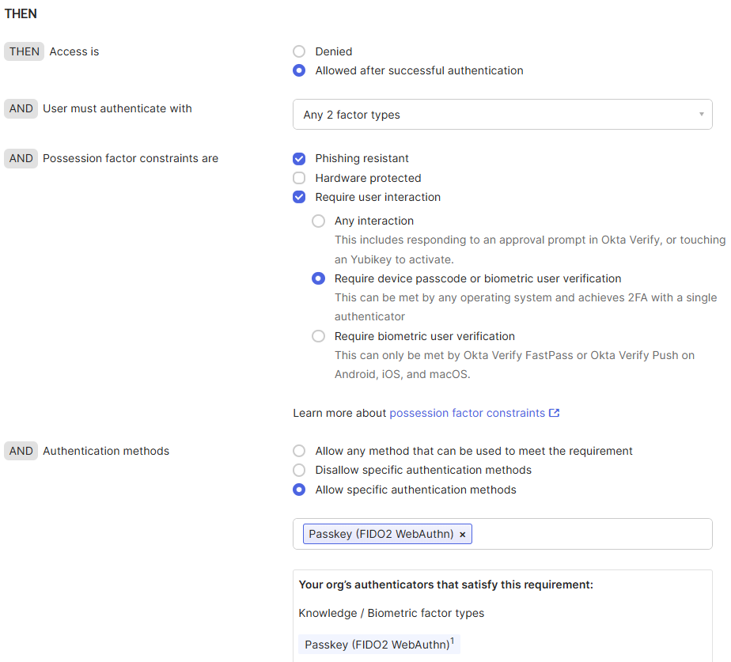

Finally, **Option to stay signed in** set to `Don't show` and **Prompt for authentication** set to `Every time user signs in to resource`, so every incognito test provokes a fresh WebAuthn challenge that a reused session cannot hide:

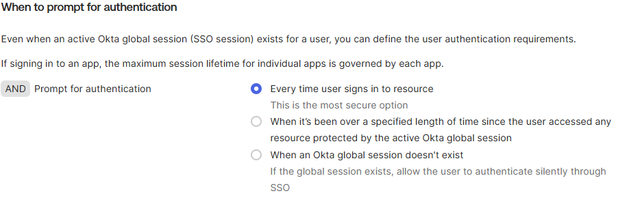

The rule saved at Priority 2, directly beneath the break-glass exception:

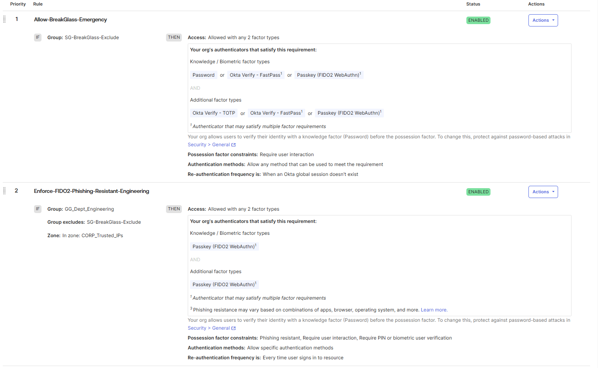

### Phase 6: Live Validation & System Log Verification
I opened an incognito window against the tenant and started the sign-in as the test workforce user `cmendoza@corp-iam.lab`:

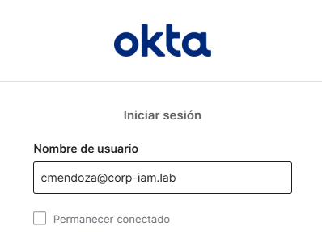

Because the strict policy demands the FIDO2 factor and the account had no passkey yet, Okta triggered **just-in-time enrollment** — the factor was required *before* releasing the dashboard:

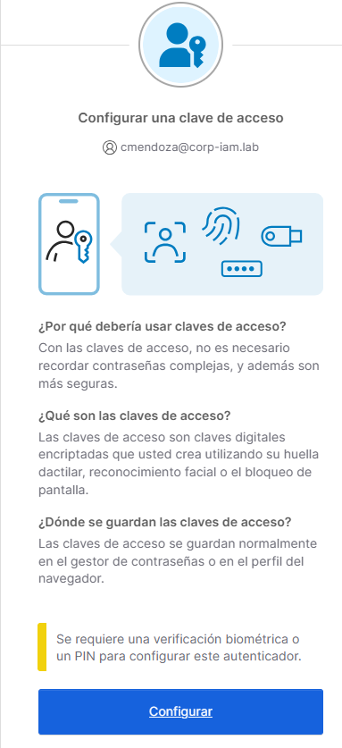

After authenticating, the **System Log** (`Reports -> System Log`) was filtered by the test identity, showing the successful sign-in events for Carlos Mendoza — the login, the MFA authentication, and the authenticator enrollment — sourced from the trusted egress IP:

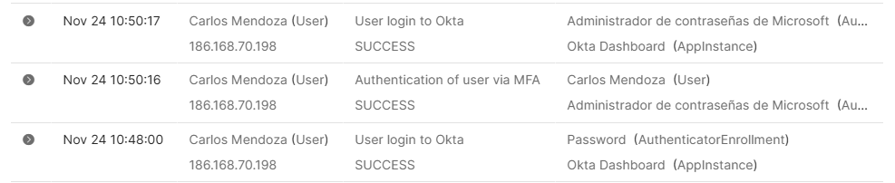
