# Lab 02: OIDC Federation with PKCE & Custom Authorization Claims

## 1. Objective & Business Use Case
Implement federated Single Sign-On for a modern web application using **OpenID Connect (OIDC) Authorization Code Flow with PKCE (`S256`)**, eliminating static client secrets on public clients and injecting directory attributes (`department`, `groups`) into JWT Access Tokens via a Custom Authorization Server. The business outcome: a phishing-resistant SPA login (chained to the FIDO2 policy of Lab 01) plus audience-scoped bearer tokens that a backend API can authorize without a second round-trip to the identity store.

## 2. Architecture Diagram
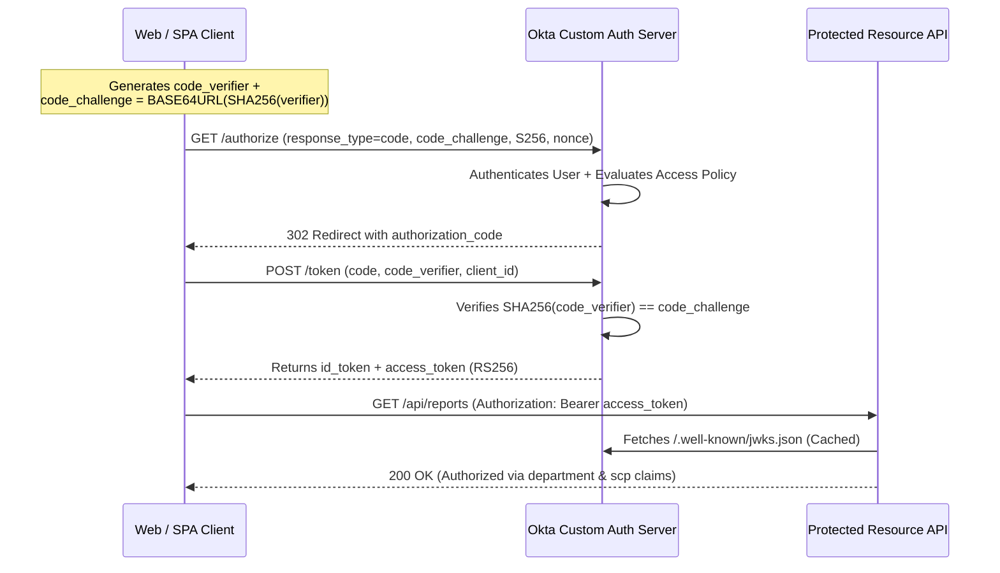

## 3. Implemented Configuration
* **OIDC Application (`Corp-Enterprise-Portal-SPA`):** Registered as a **Single-Page Application** with the **Authorization Code** grant and **PKCE (S256)** enforced as additional verification — no client secret exists to leak or rotate. Sign-in redirect URI `http://localhost:8080/login/callback`, access limited to the `GG_Dept_Engineering` group.
* **Custom Authorization Server (`Enterprise-Portal-AuthServer`, issuer `https://integrator-6023165.okta.com/oauth2/EnterprisePortalAuthServer`):**
  * **Audience (`aud`):** `api://enterprise-portal` to isolate tokens from other internal APIs and the Org issuer.
  * **Custom Scope:** `reports:read` mapped to the Authorization Server Access Policy.
  * **Custom Claims:** `department` (`user.department` via Okta Expression Language) and `groups` (`Matches regex: .*`) injected into the **Access Token** payload with `Always` inclusion.
  * **Access Policy `Portal-API-Access-Policy` (rule `Allow-Engineering-Reports-Scope`):** Authorization Code grant only, *User is assigned the app*, requested scopes `openid profile email reports:read`, and **Access token lifetime = 5 minutes** (`exp - iat = 300s`).
* **Directory prerequisite:** the test identity `cmendoza` carries `department = Engineering` in its Universal Directory profile so the expression-language claim resolves populated.

## 4. Automation & Protocol Inspection
The complete flow — PKCE parameter generation, `/authorize` launch, automatic callback capture, immediate code redemption, and local JWT base64url decoding — is automated in [`scripts/Invoke-OidcPkceFlow.ps1`](scripts/Invoke-OidcPkceFlow.ps1) (execution guide in [`scripts/Run.md`](scripts/Run.md)). The captured result is preserved in [`payloads/decoded-id-access-token.json`](payloads/decoded-id-access-token.json) and highlights critical protocol boundaries:
* **Token Separation:** `id_token` carries `aud = client_id` (`0oa1a98u39gytCccL698`) and the `nonce` for client-side authentication verification, whereas `access_token` carries `aud = api://enterprise-portal`, `scp`, `department`, and `groups` for backend authorization.
* **Short-Lived Access Token:** `exp - iat = 300 seconds` (5 minutes) limits exposure if a bearer token is intercepted.
* **Proof-of-Possession Context:** `amr = [pop]` and `auth_time` in the ID Token evidence the phishing-resistant factor chain inherited from Lab 01.

## 5. Troubleshooting (Real Issues Resolved)
| Issue Encountered | Root Cause | Diagnostic & Resolution |
| :--- | :--- | :--- |
| `400 Bad Request` on `/v1/authorize` (`redirect_uri` mismatch) | The PowerShell flow used `http://localhost:8080/callback` while the SPA application had registered Okta's SPA default `http://localhost:8080/login/callback`. Okta validates the redirect **character-by-character** against the whitelist. | Ruled out user assignment and Access Policy first (both correct), then inspected the app **General** tab and aligned `$Redirect` in the script to the exact registered URI. |
| `403 Access Forbidden (user_not_assigned)` after a successful login | The browser landed on `integrator-6023165-admin.okta.com` (the **Admin Console**) — `cmendoza` is a standard user with no admin role, so Okta refused console access. | Closed all incognito sessions to clear the cookie, and re-launched the flow against the plain tenant URL (`integrator-6023165.okta.com`, no `-admin`), confirming in the System Log that the sign-in itself had succeeded. |
| `400 Bad Request` on `/token` (`PKCE code_verifier is required`) | Client sent `code_challenge` during `/authorize` but omitted `code_verifier` in the token exchange POST body. | Added `code_verifier` to the `application/x-www-form-urlencoded` payload. |
| `invalid_request` against a wrong issuer on `/authorize` | Typo'd `$Issuer` in the PowerShell parameters (custom authorization server issuer must be exact). | Corrected `$Issuer` to `https://integrator-6023165.okta.com/oauth2/EnterprisePortalAuthServer`. |
| Authorization code expired before manual token exchange | Manual copy-paste of the `code` parameter took longer than the code's short validity window (~60s). | Automated the callback: an `HttpListener` on `localhost:8080/login/callback` captures the code and redeems it immediately ([`Invoke-OidcPkceFlow.ps1`](scripts/Invoke-OidcPkceFlow.ps1)). |
| Custom `department` claim appeared in `id_token` but was missing from `access_token` | Claim configuration defaulted to the `ID Token` type inside the Custom Authorization Server. | Edited the claim definition to target **Access Token** with inclusion set to `Always`. |

## 6. Security Controls Applied
* **PKCE (`S256`):** Prevents authorization code interception attacks on public clients without storing a client secret — the verifier proves the token requester is the same party that initiated the flow.
* **Strict Audience Validation:** Backend APIs reject tokens whose `aud` claim does not match `api://enterprise-portal`, so a token minted for the portal can never authorize against another internal API.
* **Replay Protection:** `nonce` (ID Token) and `jti` (access token) prevent token replay across sessions.
* **Least-Privilege App Access:** Application assignment limited to `GG_Dept_Engineering`, enforced again at the Authorization Server's Access Policy (`User is assigned the app`).

---

## 7. Hands-On Implementation & Visual Evidence Walkthrough

### Phase 1: Register the OIDC SPA Application with Mandatory PKCE
From **Applications -> Applications -> Create App Integration**, I selected **OIDC - OpenID Connect** with **Single-Page Application** as the application type:

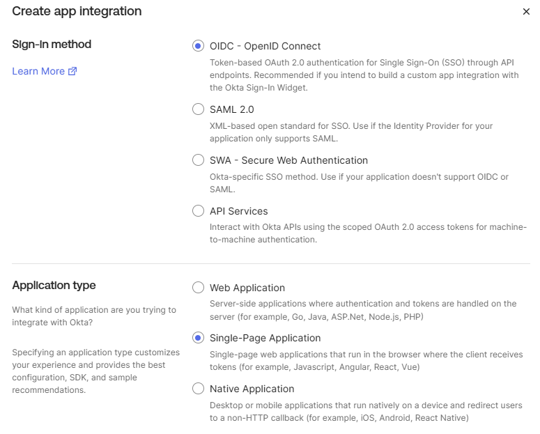

General settings: app integration name `Corp-Enterprise-Portal-SPA`, **Authorization Code** grant with PKCE enforced for the public client, sign-in redirect URI `http://localhost:8080/login/callback` and sign-out URI `http://localhost:8080`:

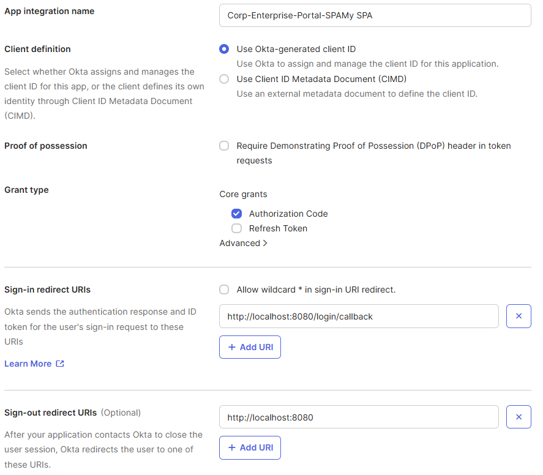

Access was limited to the Engineering workforce group so only `GG_Dept_Engineering` members (such as `cmendoza`) can ever obtain tokens from this app:

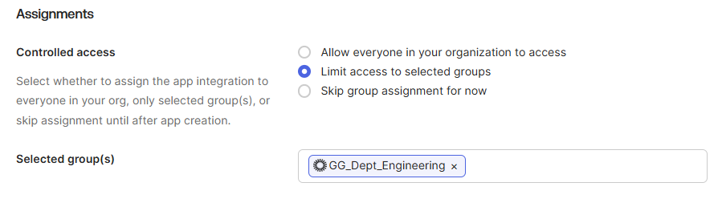

After saving, the **General** tab exposed the public `Client ID` (`0oa1a98u39gytCccL698`) with no client secret — the SPA's credential-less posture:

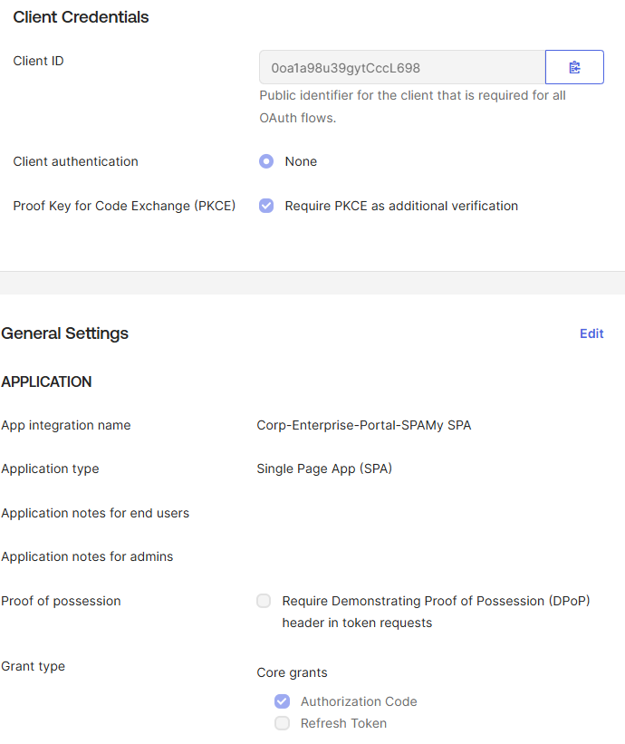

### Phase 2: Custom Authorization Server, Scope, Claims & 5-Minute Access Policy
Under **Security -> API**, I created the Custom Authorization Server with **Audience `api://enterprise-portal`** (issuer `.../oauth2/EnterprisePortalAuthServer`), isolating portal tokens from the Org issuer and any other internal API:

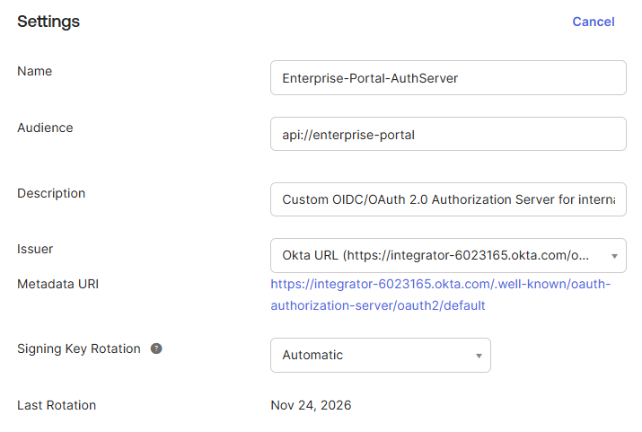

Then the custom scope `reports:read` (*Read enterprise reports*) included in public metadata:

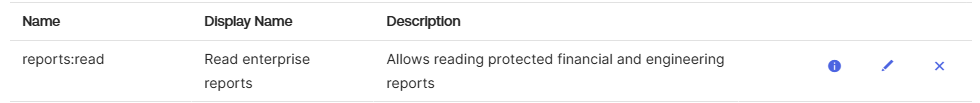

Two custom claims were mapped into the **Access Token** with `Always` inclusion — `department` via the Okta Expression Language (`user.department`) and `groups` via a `Matches regex: .*` group filter. This is the classic pitfall: a claim left on the default `ID Token` type never reaches the backend API:

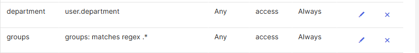

The Access Policy `Portal-API-Access-Policy` (assigned to the SPA client) with rule `Allow-Engineering-Reports-Scope` — **Authorization Code** grant only, *User is assigned the app*, requested scopes `openid profile email reports:read`:

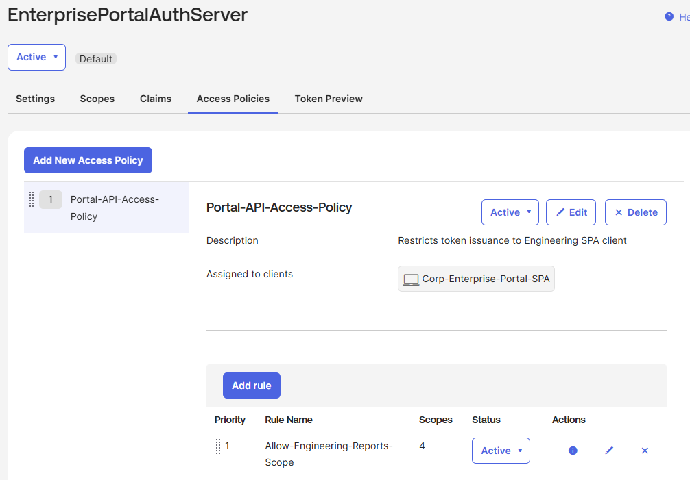

The rule's THEN block sets the **Access token lifetime to 5 minutes**, which is exactly the `exp - iat = 300` seconds observable in the captured JWT:

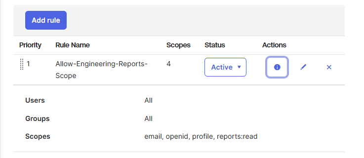

### Phase 3: Executing the Real PKCE Flow from PowerShell
*(Prerequisite: `cmendoza`'s profile carries `department = Engineering` under **Directory -> People -> Profile**, so the expression claim resolves.)*

I executed the PKCE parameter generator: a cryptographically random 32-byte `code_verifier`, its SHA-256 `code_challenge` (Base64URL), plus `state` (CSRF) and `nonce` (replay) values, with the `/authorize` URL copied to the clipboard for an incognito window:

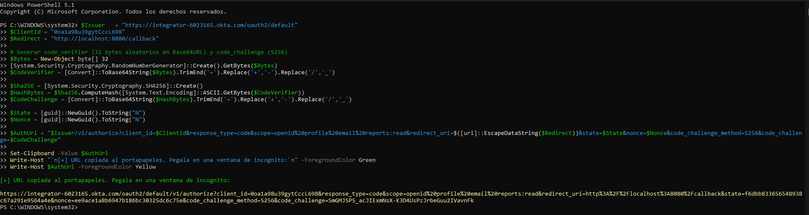

The first `/authorize` attempt failed with `400 Bad Request` — the `redirect_uri` did not match the registered whitelist:

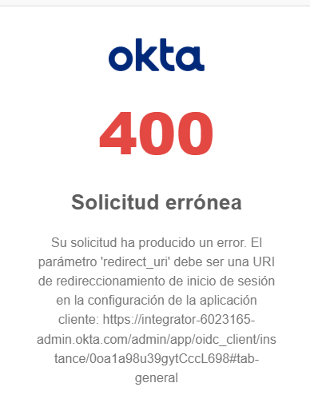

Debugging it methodically, I first ruled out **user assignment** (the app's People tab confirmed `cmendoza` via `GG_Dept_Engineering`):

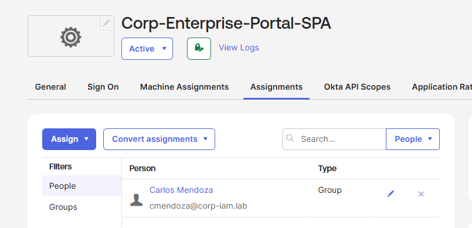

Then the **Authorization Server Access Policy** (active, correct grant types and scopes):

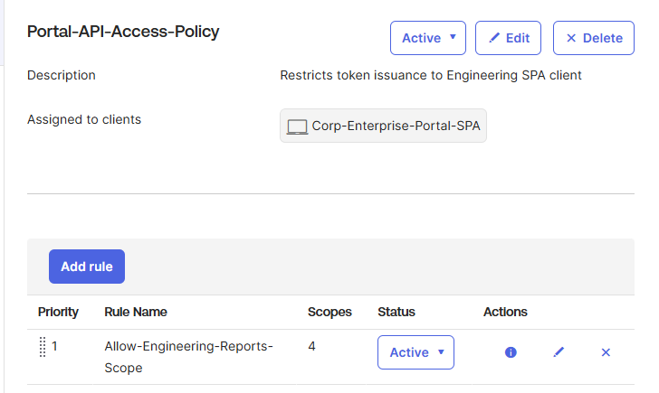

The System Log revealed what actually happened: the user *had* authenticated successfully, but the browser then attempted to open the **Admin Console** (`-admin` subdomain), which a standard user cannot access (`403 user_not_assigned`):

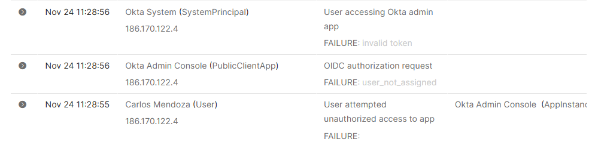

Following the admin link had surfaced that 403 page directly in the browser:

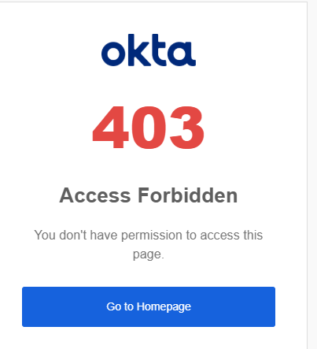

After eliminating assignment and policy, the real culprit surfaced in the app's **General** tab — the registered redirect URI was Okta's SPA default `http://localhost:8080/login/callback`, not the `/callback` path the script was sending:

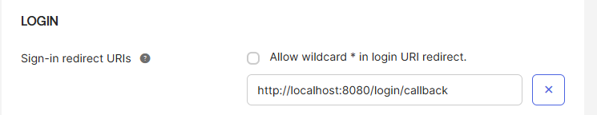

The script's `$Redirect` was still pointing at the wrong path:

The fix was a single-line alignment of `$Redirect` to the exact registered URI:

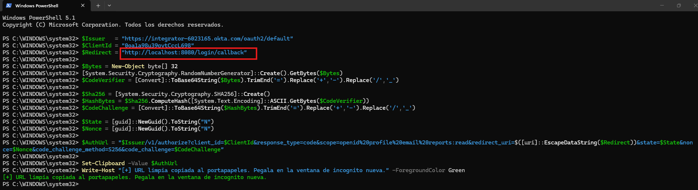

The next run produced a different — and self-inflicted — failure: a typo'd `$Issuer` (the custom authorization server's issuer must match character-for-character):

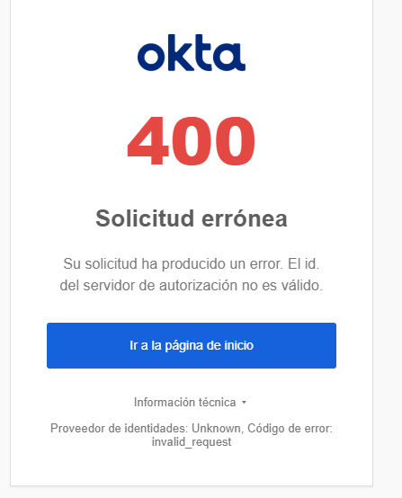

I corrected the issuer parameter to `https://integrator-6023165.okta.com/oauth2/EnterprisePortalAuthServer`:

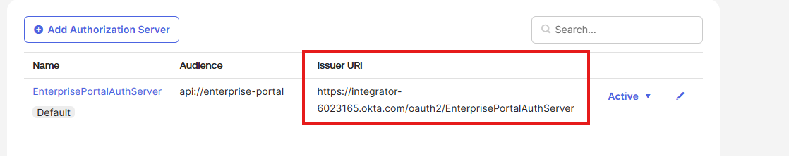

Re-running the script regenerated a clean `/authorize` URL (fresh `code_challenge`, `state`, `nonce`):

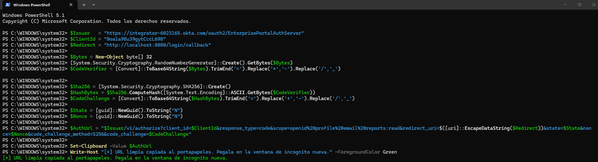

The incognito browser then landed on the tenant's real sign-in page with the test identity:

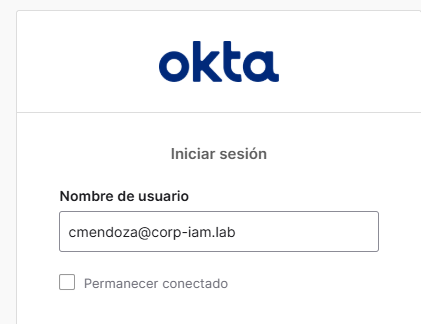

Okta then presented the security method selection — and the only compliant option for the policy is the **passkey** (the phishing-resistant factor inherited from Lab 01):

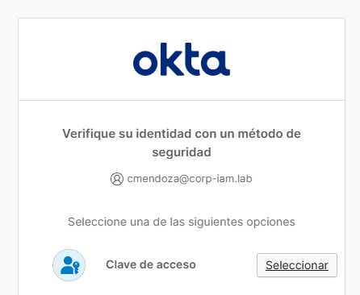

The browser redirected to the local callback with `code=...&state=...` (localhost refusing the connection is expected — the code lives in the URL):

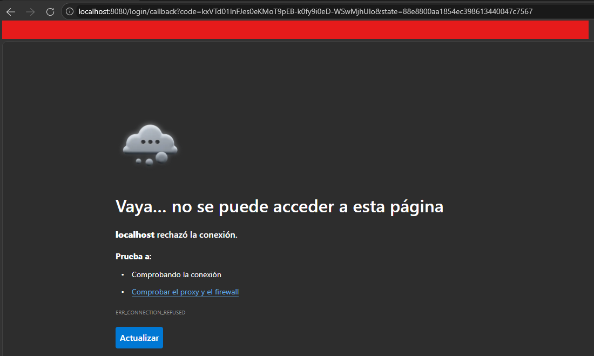

### Phase 4: Token Redemption & JWT Claim Verification
Because a hand-copied code risks expiring mid-exchange, the final run used [`Invoke-OidcPkceFlow.ps1`](scripts/Invoke-OidcPkceFlow.ps1): an `HttpListener` captures the callback automatically and redeems the code *immediately*, then decodes both JWT payloads locally. The decoded **Access Token** printed in the console confirms `aud = api://enterprise-portal`, `scp` containing `reports:read`, `department = Engineering`, `groups` containing `GG_Dept_Engineering`, `sub = cmendoza@corp-iam.lab`, and `exp - iat = 300` seconds — exactly the claims a backend API would authorize against:

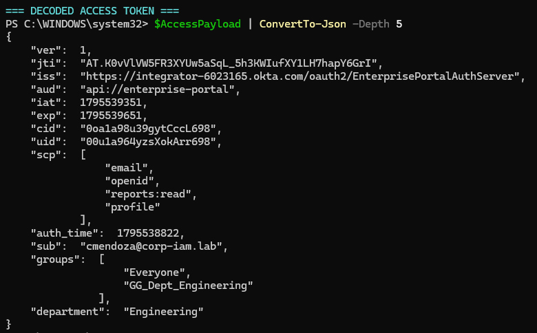

The decoded token pair (ID Token with its client `aud` and matching `nonce`, Access Token with the API audience and custom claims) was then persisted as the JSON evidence artifact ([`payloads/decoded-id-access-token.json`](payloads/decoded-id-access-token.json)):

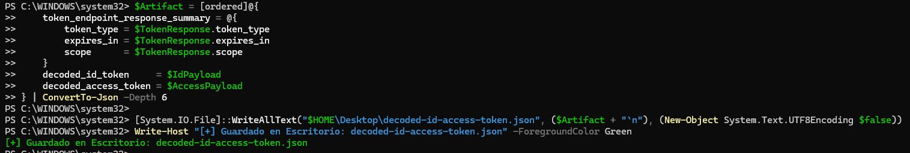
