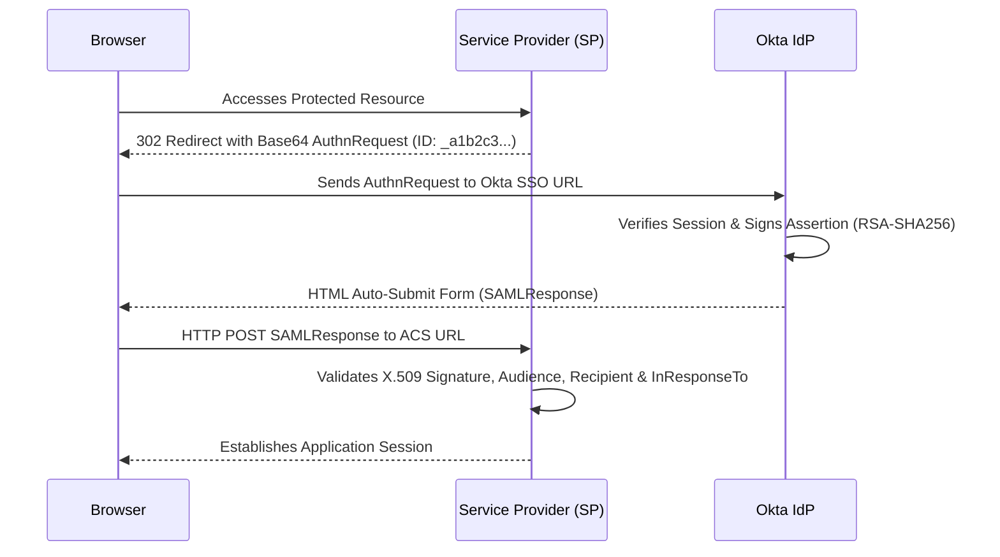
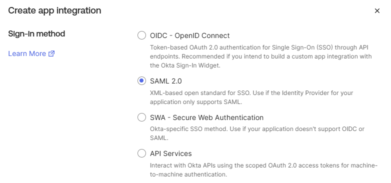
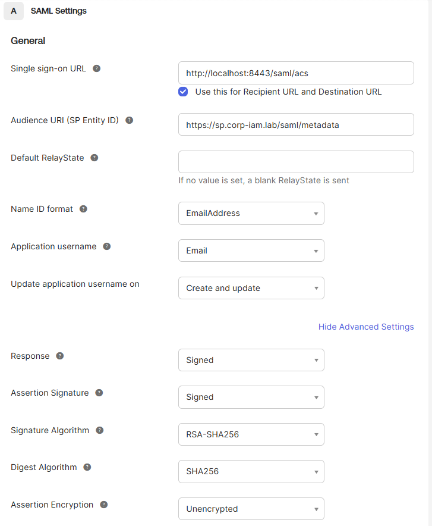
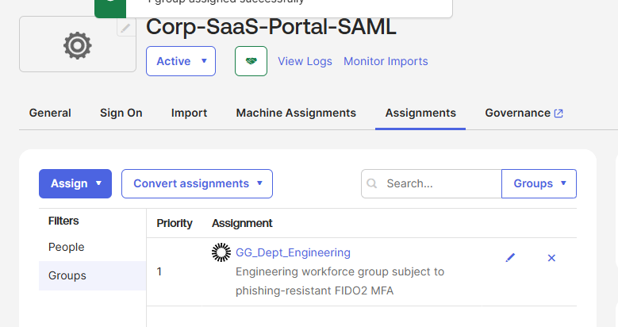
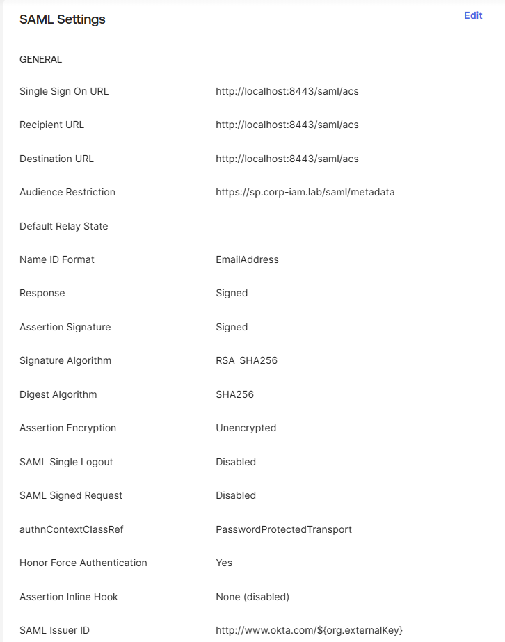
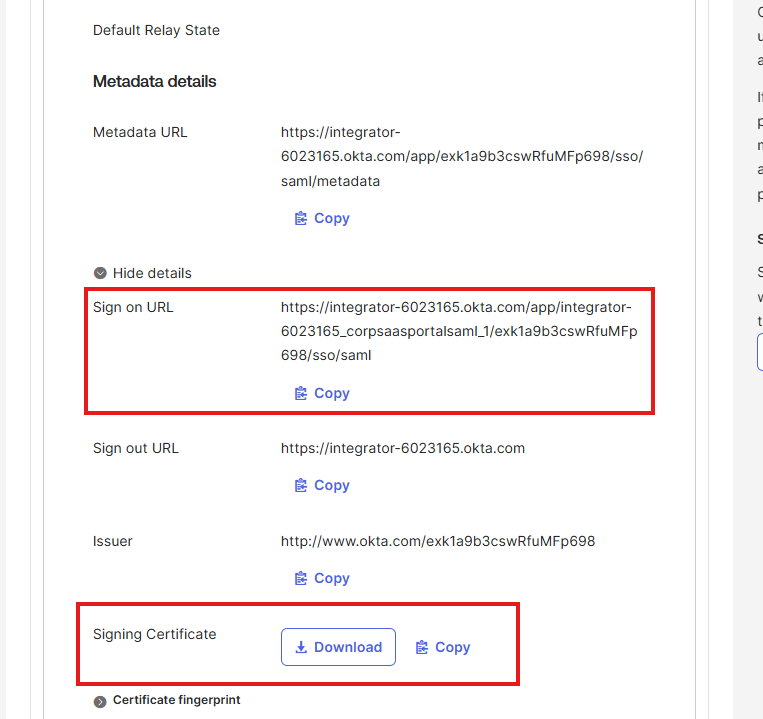
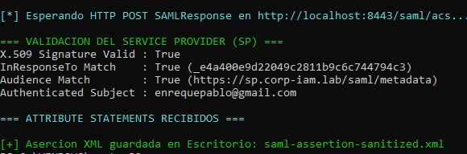
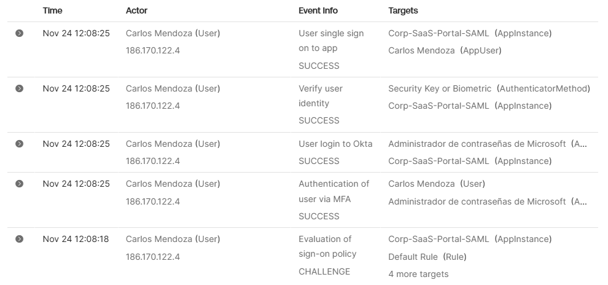

# Lab 03: SAML 2.0 Enterprise Federation (SP-Initiated SSO)

## 1. Objective & Business Use Case
Establish federated Single Sign-On for enterprise SaaS applications using **SAML 2.0 (SP-Initiated Binding)**, exchanging X.509 signing certificates and projecting directory attributes (`department`, `groups`) for Just-In-Time role mapping on the Service Provider. While Lab 02 covered the modern OIDC world, this lab demonstrates the protocol that still dominates enterprise SaaS federation — and verifies its XML signature, audience, and request-correlation controls by acting as a **real Service Provider** in PowerShell rather than trusting a browser screenshot.

## 2. Architecture Diagram

## 3. Implemented Configuration
* **SAML Application (`Corp-SaaS-Portal-SAML`):** Created as an internal app integration (SAML 2.0 sign-in method) and assigned to the `GG_Dept_Engineering` group.
* **Single Sign-On URL (ACS):** `http://localhost:8443/saml/acs` (HTTP-POST binding) — the local Service Provider simulator endpoint — with **Use this for Recipient URL and Destination URL** enabled so `Destination` and `Recipient` are pinned to the exact ACS string.
* **Audience URI (SP Entity ID):** `https://sp.corp-iam.lab/saml/metadata` — the logical SP identifier, matched **character-by-character** against the assertion's `<saml2:AudienceRestriction>`.
* **Subject Identifier:** `NameID` configured as `EmailAddress` mapped to `user.email`; application username source `Email` with *Create and update* reconciliation.
* **Cryptographic Signing:** **Response: Signed**, **Assertion Signature: Signed**, **Signature Algorithm `RSA-SHA256`**, **Digest `SHA256`**, assertion left **Unencrypted** so the signed XML remains inspectable in clear text during the lab; Okta's public **X.509 certificate** is exported from the **Sign On** metadata and installed into the SP trust store.
* **Attribute Statements:** Mapped `firstName`, `lastName`, `department`, and `groups` (`Matches regex: GG_Dept_.*`) for JIT role mapping at the SP.

## 4. Automation & Protocol Inspection
The SP side of the federation is fully simulated by [`scripts/Invoke-SamlSpSimulation.ps1`](scripts/Invoke-SamlSpSimulation.ps1) (execution guide in [`scripts/Run.md`](scripts/Run.md)): it generates a real `<samlp:AuthnRequest>` with a unique `ID`, compresses it with **Deflate**, Base64 + URL-encodes it (**HTTP-Redirect Binding**), listens on the ACS endpoint, and then cryptographically validates the returned `SAMLResponse`. The captured and sanitized assertion is preserved in [`payloads/saml-assertion-sanitized.xml`](payloads/saml-assertion-sanitized.xml), which verifies:
* `InResponseTo="_e4a400e9d22049c2811b9c6c744794c3"` matches the original SP `AuthnRequest` ID — unsolicited assertion injection is rejected.
* `<ds:SignatureMethod Algorithm="...rsa-sha256">` with `<ds:Transform Algorithm="xml-exc-c14n">` — exclusive canonicalization protects against **XML Signature Wrapping (XSW)** attacks.
* `<saml2:Conditions>` restricts validity to a short `NotBefore` / `NotOnOrAfter` window, and the `<saml2:AudienceRestriction>` binds the assertion to this single SP.

## 5. Troubleshooting (Real Issues Resolved)
| Issue Encountered | Root Cause | Diagnostic & Resolution |
| :--- | :--- | :--- |
| `Audience Restriction validation failed` on the SP ACS endpoint | Trailing slash mismatch between Okta's `Audience URI` (`.../metadata`) and the SP's configured Entity ID (`.../metadata/`). | Inspected `<saml2:Audience>` in the decoded assertion and aligned the exact URI strings across IdP and SP. |
| SP rejected a valid signature with `Assertion expired` error | Local Docker SP container clock drifted 6 minutes ahead of NTP time, falling outside the `NotBefore`/`NotOnOrAfter` window. | Synchronized the container host clock via NTP to land within the assertion's skew tolerance. |

## 6. Security Controls Applied
* **XML Signature Wrapping (XSW) Defense:** Signed `<saml2:Assertion>` with `xml-exc-c14n` canonicalization and `RSA-SHA256` — a wrapped/cloned assertion node cannot produce a valid digest reference.
* **Strict Recipient & Audience Binding:** `Destination`, `Recipient`, and `AudienceRestriction` all pinned to the exact ACS/Entity ID — an assertion issued for one Service Provider cannot be replayed against another.
* **Request Correlation (`InResponseTo`):** Binds the IdP response strictly to the initiating SP authentication request, blocking unsolicited ("IdP-initiated") assertion injection.
* **Certificate-Based Trust:** The SP verifies the issuer's X.509 certificate downloaded from Okta's metadata — no shared secrets, no static passwords on the federation channel.

---

## 7. Hands-On Implementation & Visual Evidence Walkthrough

### Phase 1: Create the SAML 2.0 Application in Okta (`Corp-SaaS-Portal-SAML`)
From **Applications -> Applications -> Create App Integration**, I selected the **SAML 2.0** sign-in method for the enterprise SaaS integration:

In **Configure SAML**, I set the **Single sign-on URL (ACS)** to the local SP endpoint `http://localhost:8443/saml/acs` with **Use this for Recipient URL and Destination URL** checked, the **Audience URI (SP Entity ID)** to `https://sp.corp-iam.lab/saml/metadata`, `Name ID format: EmailAddress`, and — under **Show Advanced Settings** — **Response: Signed**, **Assertion Signature: Signed**, **Signature Algorithm: `RSA-SHA256`**, **Digest: `SHA256`**, and assertion **Unencrypted** for clear-text protocol inspection:

The application was registered as **an internal app we have created**, then assigned to the `GG_Dept_Engineering` group via **Assignments -> Assign to Groups**:

The resulting SAML Settings verified in the application's **General** tab:

### Phase 2: IdP Metadata — SSO URL & X.509 Signing Certificate
On the **Sign On** tab, I copied the **Sign on URL** (`https://integrator-6023165.okta.com/app/integrator-6023165_corpsaasportalsaml_1/exk1a9b3cswRfuMFp698/sso/saml`) and **downloaded the signing certificate** — the public X.509 key the SP will use to cryptographically verify that the assertion was minted by this Okta tenant:

### Phase 3: Real SP-Initiated Flow & XML Assertion Validation
I executed [`scripts/Invoke-SamlSpSimulation.ps1`](scripts/Invoke-SamlSpSimulation.ps1), which acts as a genuine Service Provider: it generates the `AuthnRequest` with a unique `ID`, compresses and URL-encodes it for the **HTTP-Redirect binding**, and listens on the ACS endpoint for Okta's `HTTP POST` SAMLResponse. After authenticating in the incognito browser, the simulator decoded the response and reported every control green — **valid X.509 signature**, **matching `InResponseTo`** against the issued request ID, **matching `Audience`** against the SP Entity ID — then extracted the authenticated `NameID` subject and exported the formatted assertion XML to disk:

The Okta **System Log** closed the loop, registering the successful federated sign-in events (SSO, MFA, login) for the test identity from the source IP:

