# Lab 04: Automated SCIM 2.0 User & Group Lifecycle Provisioning

## 1. Objective & Business Use Case
Automate downstream SaaS account creation, attribute updates, group synchronization, and instant deprovisioning upon offboarding using **SCIM 2.0 (RFC 7643 / RFC 7644)**, eliminating manual SaaS administration and orphaned external accounts. Because Okta's provisioning engine runs in the cloud and only speaks to **HTTPS** endpoints, this lab also engineers the full test rig: a **working SCIM 2.0 server written in PowerShell** and exposed through an SSH-native HTTPS tunnel — so every `POST`, `PATCH`, and group push below is a real wire capture, not a mock.

## 2. Architecture Diagram
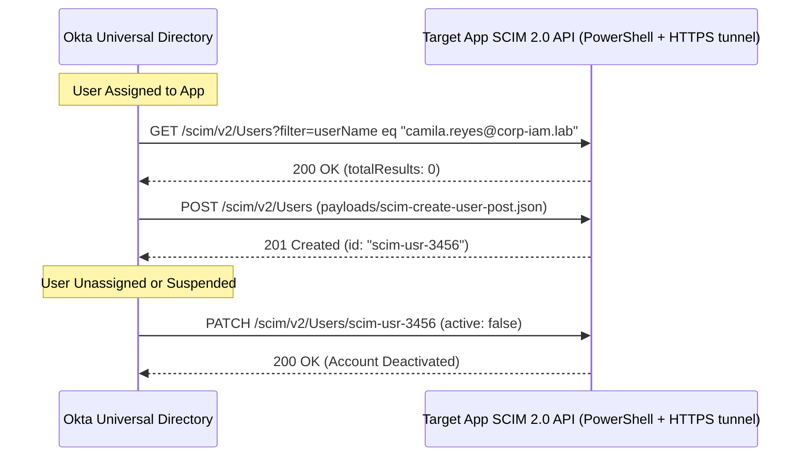

## 3. Implemented Configuration
* **SCIM Connector Integration (`Corp-SaaS-SCIM-Provisioning`, based on the *SCIM 2.0 Test App (OAuth Bearer Token)* catalog integration):** configured against a **live SCIM 2.0 server** ([`scripts/SCIMServer.ps1`](scripts/SCIMServer.ps1)) exposed over HTTPS through a localhost.run SSH tunnel (e.g. `https://b064b8c3c41e5b.app.lhr.life/scim/v2`), authenticated with an **OAuth 2.0 Bearer Token** (`scim-lab-secret-token-2026`).
* **Provisioning Lifecycle Actions (To App):** all three enabled — **Create Users**, **Update User Attributes**, and **Deactivate Users**.
* **Idempotent Creation:** Okta first issues `GET /Users?filter=userName eq ...` and only issues `POST /Users` when no match exists.
* **Push Groups:** the Okta group `GG_Dept_Engineering` is synchronized to the target application through `/scim/v2/Groups`, driving role assignment from directory membership instead of manual SaaS clicks.

## 4. Automation & Protocol Inspection
* **Joiner Flow ([`payloads/scim-create-user-post.json`](payloads/scim-create-user-post.json)):** captured from the wire — the `POST /Users` body carries the core schema plus the **Enterprise User extension** (`urn:ietf:params:scim:schemas:extension:enterprise:2.0:User` with `department: Engineering`), the Okta `externalId` linkage (`00u1a9cg0erXBaQRq698`), and a server-assigned `id` (`scim-usr-3456`).
* **Leaver Flow ([`payloads/scim-deactivate-user-patch.json`](payloads/scim-deactivate-user-patch.json)):** instead of deleting the historical record, Okta sends an RFC 7644 `PatchOp` (`"op": "replace"`, `"value": { "active": false }`) — a reversible soft-disable that preserves audit history.
* **Test Rig ([`scripts/SCIMServer.ps1`](scripts/SCIMServer.ps1) + [`scripts/Start-ScimHttpsTunnel.ps1`](scripts/Start-ScimHttpsTunnel.ps1)):** a PowerShell `HttpListener` implementing `GET`/`POST`/`PUT`/`PATCH` on `/scim/v2/Users`, `/Groups`, and `?filter=` queries, bearer-token auth with `401` on mismatch, in-memory stores, and automatic JSON artifact capture for every received payload (execution guide in [`scripts/Run.md`](scripts/Run.md)).

## 5. Troubleshooting (Real Issues Resolved)
| Issue Encountered | Root Cause | Diagnostic & Resolution |
| :--- | :--- | :--- |
| Provisioning requests returning `400` errors visible in the tunnel log | The **wrong catalog integration** had been added — the *SCIM 1.1 Test App* variant instead of the **SCIM 2.0 Test App (OAuth Bearer Token)**. | Identified the integration version from the tunnel's `/scim/v2/Users` 400 responses, removed it, and added the correct **SCIM 2.0 Test App (OAuth Bearer Token)** integration; credentials validated with **Test API Credentials**. |
| SCIM server intermittently unreachable from the public tunnel | `HttpListener` prefix binding left the endpoint on an IPv6/ambiguous interface. | Reconfigured the listener to bind **explicitly to IPv4** `http://127.0.0.1:8090/` and restarted the server (both windows verified). |
| `Test API Credentials` failing mid-session during Push Groups | The localhost.run SSH tunnel **dropped** while the group sync was running. | Re-established the tunnel, and hardened it with `ServerAliveInterval=15` in [`Start-ScimHttpsTunnel.ps1`](scripts/Start-ScimHttpsTunnel.ps1) to keep the reverse tunnel alive during long provisioning cycles. |
| `409 Conflict` when assigning an existing SaaS test user | Target SCIM server already held a local record with the same `userName` not yet linked to an Okta `externalId`. | Ran an Okta **Import** task to match and link existing records via `userName` before pushing updates. |
| Deactivation failed with `400 Bad Request` on `PATCH /Users/{id}` | Target SCIM implementation required explicit attribute path notation (`"path": "active"`) rather than an unpathed JSON object. | Updated the SCIM connector PATCH compatibility settings to emit explicit path operations. |

## 6. Security Controls Applied
* **Automated Offboarding Revocation:** Removing the app assignment (or deactivating the Okta user) immediately issues the downstream `PATCH active: false` — no helpdesk ticket, no orphaned SaaS account, no 30-day "leaver gap".
* **Idempotent Provisioning:** Filter-then-create semantics prevent duplicate accounts on retry storms.
* **Data Minimization:** Only required identity attributes (`userName`, `name`, `title`, `department`) are mapped in the SCIM profile editor.
* **Transport & API Security:** The entire provisioning channel runs over the tunnel's **HTTPS** with a scoped **Bearer token**; the lab server answers `401` SCIM error responses on any token mismatch.

---

## 7. Hands-On Implementation & Visual Evidence Walkthrough

### Phase 1: Stand Up the SCIM 2.0 Server & HTTPS Tunnel
Since Okta's provisioning engine can only call **HTTPS** endpoints, I stood up a complete SCIM 2.0 server in PowerShell ([`scripts/SCIMServer.ps1`](scripts/SCIMServer.ps1)) — in-memory user/group stores, Bearer token validation, RFC 7644 `PATCH` handling, and automatic capture of every JSON payload it receives:

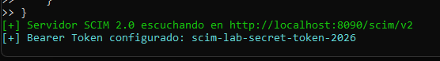

In a second window, the reverse SSH tunnel (`ssh -R 80:127.0.0.1:8090 nokey@localhost.run`) published the local server under a public HTTPS endpoint:

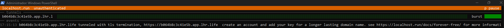

### Phase 2: Add the SCIM 2.0 Test App Integration
In **Applications -> Browse App Catalog**, I searched for the **SCIM 2.0 Test App (OAuth Bearer Token)** — the *OAuth Bearer Token* variant, not *Header Auth* or *Basic Auth*:

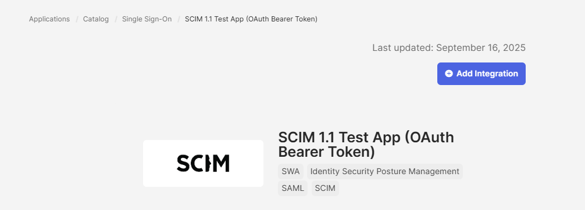

The application was labeled `Corp-SaaS-SCIM-Provisioning` with the icon hidden from end users (provisioning runs in the background), leaving SWA defaults in place:

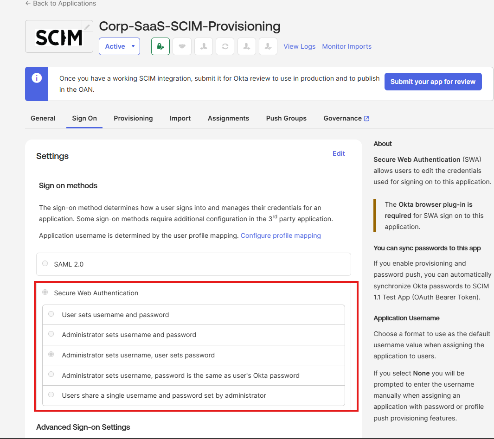

### Phase 3: Configure the API Integration — and Fix the Real Errors
Under **Provisioning -> Configure API Integration**, I enabled the integration with the tunnel's **SCIM Base URL** and the OAuth Bearer token, then clicked **Test API Credentials**:

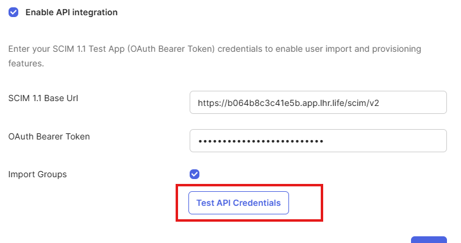

The first attempts failed — the tunnel's log filled with `GET /scim/v2/Users` requests returning **400 errors**:

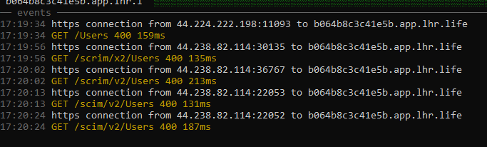

The root cause: the **wrong catalog integration** — I had initially added the *SCIM 1.1 Test App* variant instead of the **SCIM 2.0** one. Re-adding the correct **SCIM 2.0 Test App (OAuth Bearer Token)** resolved the protocol mismatch:

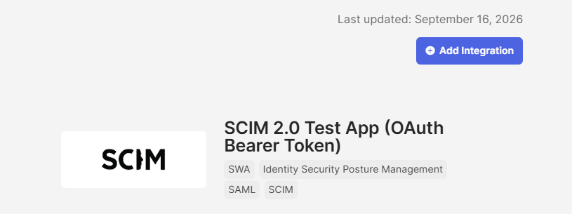

I additionally hardened the lab server by rebinding it **explicitly to the IPv4 loopback** (`127.0.0.1:8090`) so the reverse tunnel always reached the `HttpListener`. With the correct integration and the IPv4 binding in place, **Test API Credentials** came back green — credentials verified successfully:

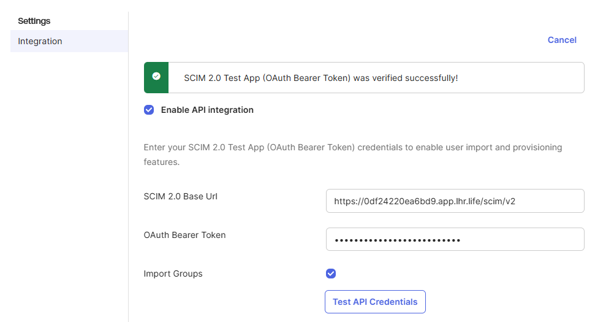

The tunnel's log confirmed the connector was now reaching the server: inbound HTTPS followed by `GET /scim/v2/Users` returning **200 OK**:

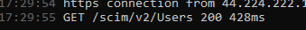

Finally, under **Provisioning -> To App**, I enabled the three lifecycle actions — **Create Users**, **Update User Attributes**, and **Deactivate Users**:

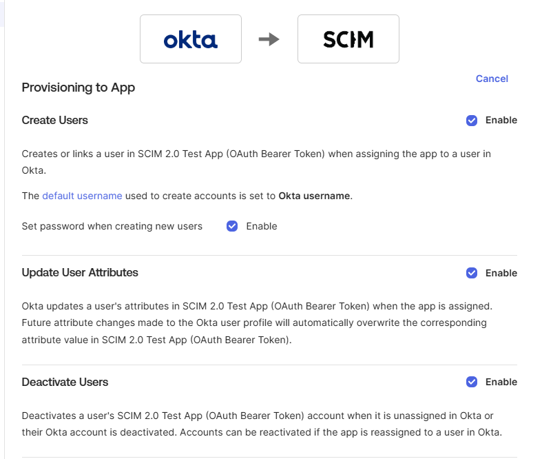

### Phase 4: The Full JML Cycle — Joiner, Push Groups, Leaver
**Joiner.** I created the test user **Camila Reyes** (`camila.reyes@corp-iam.lab`) with `Department: Engineering` and `Title: Cloud Security Engineer`, then assigned her to `Corp-SaaS-SCIM-Provisioning` via **Assignments -> Assign to People**:

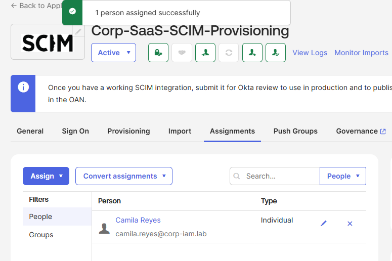

The provisioning engine immediately executed the idempotent sequence on the wire: `GET /scim/v2/Users?filter=userName eq "camila.reyes@corp-iam.lab"` → `totalResults: 0` → `POST /scim/v2/Users` → `201 Created` (`scim-usr-3456`), with the exact payload auto-saved as [`payloads/scim-create-user-post.json`](payloads/scim-create-user-post.json):

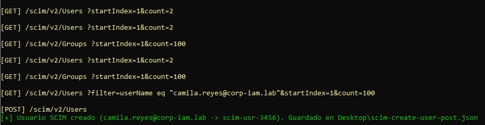

The created downstream account confirmed in the server console:

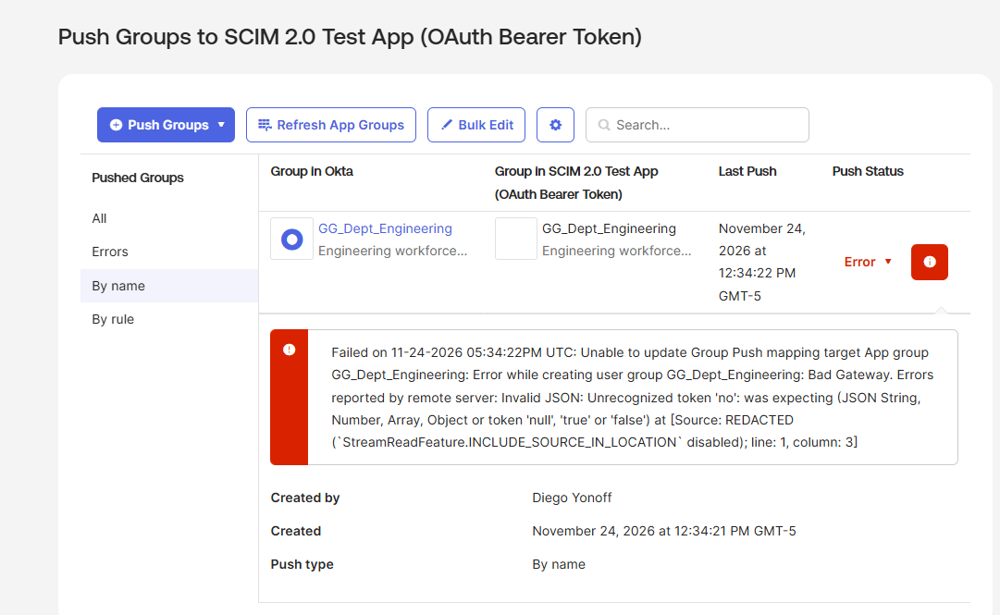

**Push Groups.** Mid-test, the SSH tunnel dropped — the group sync failed with connectivity errors, proving the lab exercises *real* failure modes. I re-established the tunnel (which assigned a fresh public HTTPS URL) and updated the connector's Base URL to the new endpoint:

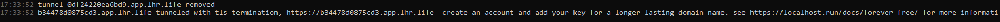

After re-establishing the tunnel, I pushed `GG_Dept_Engineering` via **Push Groups -> Find groups by name**; its status turned **Active**:

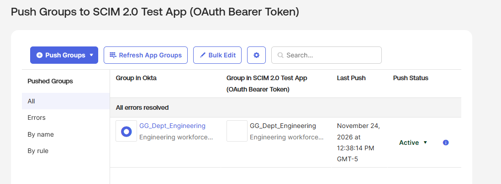

The server console confirmed the group synchronization on the wire:

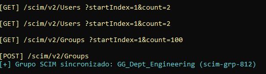

**Leaver.** Removing Camila's app assignment (equivalently: deactivating her Okta account) triggered instant deprovisioning:

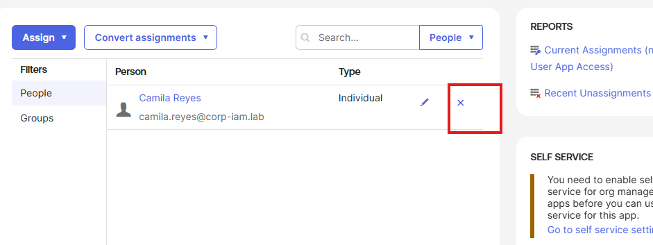

The server received the RFC 7644 `PatchOp` deactivating the downstream account, captured verbatim as [`payloads/scim-deactivate-user-patch.json`](payloads/scim-deactivate-user-patch.json):

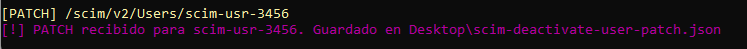

And Okta's **System Log** closed the loop with the `application.provision.user.deactivate` event:

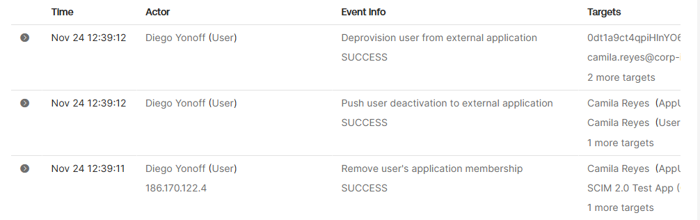
