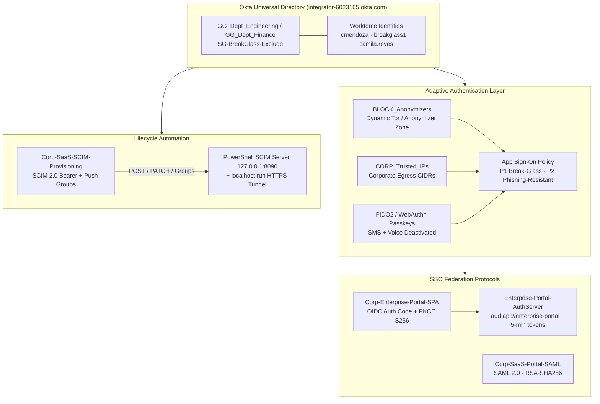

# Module 02: Okta Workforce Identity — Adaptive Access, Federation & SCIM Lifecycle Engineering

An end-to-end, hands-on **Workforce Identity & Access Management** portfolio series built on a live Okta tenant: adaptive phishing-resistant authentication (**FIDO2 / WebAuthn** + **Network Zones**), modern federation protocols for workforce SSO (**OIDC Authorization Code + PKCE** and **SAML 2.0 SP-Initiated**), and automated downstream lifecycle provisioning (**SCIM 2.0 / RFC 7643-7644**) — every control validated with **real wire captures, decoded JWTs, signed XML assertions, and System Log events** instead of screenshots alone.

> **Companion Reference:** For textbook definitions paired with real-world enterprise deployment scenarios for every protocol, policy, and control used across these labs, see **[`GLOSSARY.md`](GLOSSARY.md)**.

---

## End-to-End Workforce IAM Architecture

---

## Repository Structure & Lab Index

| Lab | Domain & Focus Area | Key Technologies & Controls | Automation & Artifacts |
| :--- | :--- | :--- | :--- |
| **[`01-adaptive-sso-phishing-resistant-mfa`](01-adaptive-sso-phishing-resistant-mfa/README.md)** | Adaptive SSO & Phishing-Resistant MFA | Okta Network Zones (Dynamic Tor blocking + IP zones), FIDO2 / WebAuthn passkeys, Authenticator hardening (SMS/Voice off), App Sign-On policy priority stack with break-glass exception | End-to-end System Log validation evidence (`24` verified captures) |
| **[`02-oidc-federation`](02-oidc-federation/README.md)** | OIDC Authorization Code Flow with PKCE & Custom Claims | PKCE (`S256`), Custom Authorization Server (`aud api://enterprise-portal`), custom scopes (`reports:read`) and claims (`department`, `groups`), 5-minute access tokens | [`Invoke-OidcPkceFlow.ps1`](02-oidc-federation/scripts/Invoke-OidcPkceFlow.ps1) [`Run.md`](02-oidc-federation/scripts/Run.md) [`decoded-id-access-token.json`](02-oidc-federation/payloads/decoded-id-access-token.json) |
| **[`03-saml-federation`](03-saml-federation/README.md)** | SAML 2.0 SP-Initiated Enterprise Federation | AuthnRequest (HTTP-Redirect binding), RSA-SHA256 signed assertions, X.509 trust, `InResponseTo` / audience validation via a real PowerShell SP simulator | [`Invoke-SamlSpSimulation.ps1`](03-saml-federation/scripts/Invoke-SamlSpSimulation.ps1) [`Run.md`](03-saml-federation/scripts/Run.md) [`saml-assertion-sanitized.xml`](03-saml-federation/payloads/saml-assertion-sanitized.xml) |
| **[`04-scim-lifecycle-provisioning`](04-scim-lifecycle-provisioning/README.md)** | Automated SCIM 2.0 JML Lifecycle Provisioning | Idempotent `POST /Users`, RFC 7644 `PATCH` deactivation, Push Groups, Enterprise User extension, live PowerShell SCIM server exposed via reverse SSH HTTPS tunnel | [`SCIMServer.ps1`](04-scim-lifecycle-provisioning/scripts/SCIMServer.ps1) [`Start-ScimHttpsTunnel.ps1`](04-scim-lifecycle-provisioning/scripts/Start-ScimHttpsTunnel.ps1) [`Run.md`](04-scim-lifecycle-provisioning/scripts/Run.md) [`scim-create-user-post.json`](04-scim-lifecycle-provisioning/payloads/scim-create-user-post.json) [`scim-deactivate-user-patch.json`](04-scim-lifecycle-provisioning/payloads/scim-deactivate-user-patch.json) |
| **[`GLOSSARY.md`](GLOSSARY.md)** | Workforce IAM & Federation Concept Reference Guide | Structured **Acronym/Feature -> Theory -> Real-World Practice** breakdown across all 4 labs | Complete reference manual |

---

## Lab Environment Topology

* **Okta Workforce Tenant (`integrator-6023165.okta.com`):**
  * **Tenant tier:** Okta Workforce Identity (integrator plan, registered with an institutional account).
  * **Admin Console:** `integrator-6023165-admin.okta.com`.
  * **Network perimeter:** `BLOCK_Anonymizers` (dynamic zone: Tor exit nodes + anonymous proxies, tenant-gateway blocking) and `CORP_Trusted_IPs` (IP zone: current egress `/32` + simulated corporate range `203.0.113.0/24`).
  * **Authenticator posture:** FIDO2 (WebAuthn) + Okta Verify + Password active; Phone (SMS/Voice) deactivated tenant-wide.
* **Directory objects:** groups `GG_Dept_Engineering`, `GG_Dept_Finance`, `SG-BreakGlass-Exclude`; workforce identities `cmendoza@corp-iam.lab` (Engineering, passkey enrolled), `breakglass1@corp-iam.lab` (Super Administrator, excluded from strict policies), and `camila.reyes@corp-iam.lab` (SCIM joiner/leaver test identity, `department = Engineering`).
* **Federation applications:** `Corp-Enterprise-Portal-SPA` (OIDC SPA, client `0oa1a98u39gytCccL698`, PKCE enforced, limited to Engineering), `Corp-SaaS-Portal-SAML` (SAML 2.0, ACS `http://localhost:8443/saml/acs`, Entity ID `https://sp.corp-iam.lab/saml/metadata`), and `Corp-SaaS-SCIM-Provisioning` (SCIM 2.0 Test App · OAuth Bearer Token).
* **Authorization infrastructure:** Custom Authorization Server `Enterprise-Portal-AuthServer` (issuer `https://integrator-6023165.okta.com/oauth2/EnterprisePortalAuthServer`, audience `api://enterprise-portal`, custom scope `reports:read`, claims `department`/`groups` on the Access Token, 5-minute token lifetime).
* **SCIM test rig:** a full **SCIM 2.0 server implemented in PowerShell** (`scripts/SCIMServer.ps1`) bound to IPv4 `127.0.0.1:8090`, published over HTTPS through a **localhost.run reverse SSH tunnel**, authenticated with a scoped Bearer token.

---

## Real-World Engineering & Troubleshooting Highlights

Every lab documents real operational issues encountered and resolved during deployment rather than sanitized textbook happy paths:

1. **Anti-Lockout Policy Ordering (Lab 01):** Enforcing a phishing-resistant (passkey-only) rule before a break-glass exception existed at a higher priority is how tenants get locked out — solved by stacking `Allow-BreakGlass-Emergency` at Priority 1 with relaxed constraints above `Enforce-FIDO2-Phishing-Resistant-Engineering` at Priority 2.
2. **Character-Exact Redirect URI Debugging (Lab 02):** A `400` from `/v1/authorize` led through a full differential diagnosis — user assignment (correct), Access Policy (correct), a `403` from landing on the `-admin` console subdomain (red herring) — before the actual culprit surfaced: the script's `$Redirect` (`/callback`) versus Okta's SPA default (`/login/callback`). Okta validates `redirect_uri` character-by-character.
3. **Authorization Code Expiry (Lab 02):** A manually-copied authorization code expired before the token exchange could complete — the final script captures the callback with an `HttpListener` and redeems the code *instantly*, then decodes both JWTs locally.
4. **Real Service Provider Validation (Lab 03):** Instead of trusting a browser trace, the SAML assertion was validated by a genuine SP simulator in PowerShell: Deflate + Base64 `AuthnRequest` generation, X.509 signature verification, `InResponseTo` and audience checking, and formatted assertion export.
5. **SCIM Integration Version & Tunnel Failures (Lab 04):** Real 400s in the tunnel log traced back to adding the *SCIM 1.1* Test App instead of the **SCIM 2.0** one; the listener was then rebound explicitly to IPv4, and a mid-Push-Groups SSH tunnel drop forced a re-established HTTPS URL and connector Base URL update — a genuine taste of production provisioning connector maintenance.

---

## Quick Start for Automation Scripts

Each automated lab contains a `scripts/` directory housing the production PowerShell script and a dedicated **`Run.md`** execution guide with prerequisites, session execution policy commands, and verification queries:

* **Lab 02 (OIDC + PKCE):** [`02-oidc-federation/scripts/Run.md`](02-oidc-federation/scripts/Run.md) — parameterizes issuer/client/redirect, runs the automated flow, and verifies the decoded claims (`aud`, `scp`, `department`, `groups`, `exp - iat = 300`).
* **Lab 03 (SAML SP Simulator):** [`03-saml-federation/scripts/Run.md`](03-saml-federation/scripts/Run.md) — points the simulator at your IdP SSO URL and certificate, executes the SP-initiated flow, and verifies signature / `InResponseTo` / audience in the captured XML.
* **Lab 04 (SCIM Rig):** [`04-scim-lifecycle-provisioning/scripts/Run.md`](04-scim-lifecycle-provisioning/scripts/Run.md) — starts the SCIM server + HTTPS tunnel, wires the Okta connector, and exercises the full Joiner / Push Groups / Leaver cycle.
