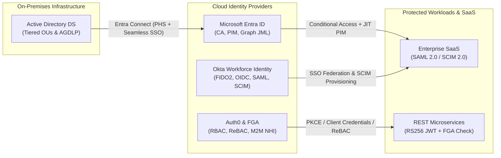

# IAM Engineering & Identity Security Labs

Hands-on Identity and Access Management (IAM) engineering portfolio covering **Workforce Identity**, **Hybrid Active Directory**, **Federation Protocols (OIDC, OAuth 2.0, SAML 2.0)**, **Automated Lifecycle Provisioning (JML & SCIM 2.0)**, **Fine-Grained Authorization (ReBAC)**, and **Non-Human Identity (NHI)** security across **Microsoft Entra ID**, **Okta**, and **Auth0**.

Maintained by [@dieg0y](https://github.com/dieg0y).

> **Status:** the full roadmap is published below — labs land module by module, and each folder gets its walkthrough, scripts, and evidence as it is completed. Skills on [my portfolio](https://dieg0y.github.io/#/skills) are only marked hands-on once a module is finished.

---

## High-Level Architecture Overview

---

## Repository Index

### 01. Microsoft Entra ID & Active Directory (`01-microsoft-entra-ad/`)
| Lab | Focus Area | Key Protocols & Tooling |
| :--- | :--- | :--- |
| [`01-active-directory-administration`](./01-microsoft-entra-ad/01-active-directory-administration) | Tier-0/Standard OU isolation, AGDLP RBAC, and bulk CSV onboarding | Active Directory DS, PowerShell, GPO Auditing |
| [`02-hybrid-identity-entra-connect`](./01-microsoft-entra-ad/02-hybrid-identity-entra-connect) | Hybrid directory sync with OU filtering and Source Anchor validation | Entra Connect, PHS, Seamless SSO, `ms-DS-ConsistencyGuid` |
| [`03-user-lifecycle-management-jml`](./01-microsoft-entra-ad/03-user-lifecycle-management-jml) | Automated Joiner-Mover-Leaver provisioning and session revocation | Microsoft Graph PowerShell SDK, Dynamic Groups |
| [`04-conditional-access-pim-governance`](./01-microsoft-entra-ad/04-conditional-access-pim-governance) | Zero Trust Conditional Access policies and Just-In-Time admin elevation | Conditional Access JSON, PIM, FIDO2, Break-Glass |
| [`05-identity-governance-protection-delegation`](./01-microsoft-entra-ad/05-identity-governance-protection-delegation) | Entitlement Management access packages, Access Reviews, and risk-based identity protection with delegated administration | Entitlement Management, Access Reviews, Identity Protection, Administrative Units |

### 02. Okta Workforce Identity (`02-okta-workforce-identity/`)
| Lab | Focus Area | Key Protocols & Tooling |
| :--- | :--- | :--- |
| [`01-adaptive-sso-phishing-resistant-mfa`](./02-okta-workforce-identity/01-adaptive-sso-phishing-resistant-mfa) | AiTM-resistant authentication policies and IP perimeter gating | WebAuthn / FIDO2, Okta Network Zones |
| [`02-oidc-federation`](./02-okta-workforce-identity/02-oidc-federation) | Authorization Code + PKCE flow and custom Access Token claims | OIDC, OAuth 2.0 PKCE (`S256`), Custom Auth Server |
| [`03-saml-federation`](./02-okta-workforce-identity/03-saml-federation) | SP-Initiated enterprise federation and XML assertion inspection | SAML 2.0, X.509 RSA-SHA256, SAML-tracer |
| [`04-scim-lifecycle-provisioning`](./02-okta-workforce-identity/04-scim-lifecycle-provisioning) | Automated downstream user creation, updates, and offboarding | SCIM 2.0 (RFC 7643 / 7644), `POST /Users`, `PATCH` |

### 03. Auth0 Customer & M2M Identity (`03-auth0-customer-m2m-identity/`)
| Lab | Focus Area | Key Protocols & Tooling |
| :--- | :--- | :--- |
| [`01-oauth2-oidc-authentication`](./03-auth0-customer-m2m-identity/01-oauth2-oidc-authentication) | Asymmetric JWT verification and API permission enforcement | OAuth 2.0, `RS256`, JWKS, Python FastAPI |
| [`02-fine-grained-authorization-fga`](./03-auth0-customer-m2m-identity/02-fine-grained-authorization-fga) | Hierarchical multi-tenant permissions via relationship tuples | Auth0 FGA / OpenFGA, ReBAC DSL |
| [`03-m2m-non-human-identity-auth`](./03-auth0-customer-m2m-identity/03-m2m-non-human-identity-auth) | Workload identity authentication with short-lived cached tokens | OAuth 2.0 Client Credentials, NHI Governance |

---

## Security & Hygiene Standards
* **Zero Secrets Committed:** All scripts read credentials exclusively from environment variables or secure runtime prompts.
* **Sanitized Artifacts:** Captured XML assertions, JWT payloads, and directory identifiers in `payloads/` and `evidence/` have cryptographic signatures and tenant-specific secrets redacted.
