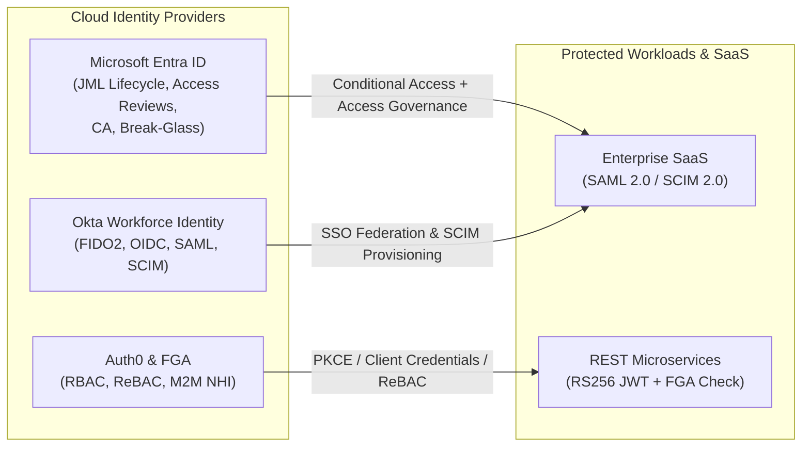

# IAM Engineering & Identity Security Labs

Hands-on Identity and Access Management (IAM) engineering portfolio covering **Workforce Identity**, **User Lifecycle Management (Joiner–Mover–Leaver)**, **Federation Protocols (OIDC, OAuth 2.0, SAML 2.0)**, **Automated Provisioning (SCIM 2.0)**, **Fine-Grained Authorization (ReBAC)**, and **Non-Human Identity (NHI)** security across **Microsoft Entra ID**, **Okta**, and **Auth0**.

Maintained by [@dieg0y](https://github.com/dieg0y).

> **Status:** Module 01 has landed with its full walkthrough and evidence. Modules 02–03 are published on the roadmap below — each folder gets its walkthrough, scripts, and evidence as it is completed. Skills on [my portfolio](https://dieg0y.github.io/#/skills) are only marked hands-on once a module is finished.

---

## High-Level Architecture Overview

---

## Repository Index

### 01. Microsoft Entra ID User Lifecycle Management (`01-entra-id-user-lifecycle-management/`)
| Lab | Focus Area | Key Protocols & Tooling |
| :--- | :--- | :--- |
| [`01-create-user-manually`](./01-entra-id-user-lifecycle-management/01-create-user-manually) | Joiner onboarding: manual user creation and configuration | Entra Admin Center, User Provisioning |
| [`02-create-group-and-assign-membership`](./01-entra-id-user-lifecycle-management/02-create-group-and-assign-membership) | Group-based access management and membership assignment | Security Groups, Least Privilege |
| [`03-reset-password-disable-and-re-enable-an-account`](./01-entra-id-user-lifecycle-management/03-reset-password-disable-and-re-enable-an-account) | Help Desk identity administration: password resets and account state changes | Password Reset, Account Disable / Re-enable |
| [`04-sign-in-logs-audit-and-monitoring`](./01-entra-id-user-lifecycle-management/04-sign-in-logs-audit-and-monitoring) | Sign-in activity auditing and security monitoring | Entra Sign-in Logs, Audit & Monitoring |
| [`05-mover-and-leaver-promotion-and-offboarding`](./01-entra-id-user-lifecycle-management/05-mover-and-leaver-promotion-and-offboarding) | Mover promotions and Leaver offboarding with access revocation | JML, Group Membership, Offboarding |
| [`06-access-review`](./01-entra-id-user-lifecycle-management/06-access-review) | Identity governance validation of user access | Entra ID Governance, Access Reviews |
| [`07-break-glass-and-conditional-access`](./01-entra-id-user-lifecycle-management/07-break-glass-and-conditional-access) | Emergency administrative access and Conditional Access enforcement | Break-Glass Accounts, Conditional Access |

### 02. Okta Workforce Identity (`02-okta-workforce-identity/`)
| Lab | Focus Area | Key Protocols & Tooling |
| :--- | :--- | :--- |
| [`01-adaptive-sso-phishing-resistant-mfa`](./02-okta-workforce-identity/01-adaptive-sso-phishing-resistant-mfa) | AiTM-resistant authentication policies and IP perimeter gating | WebAuthn / FIDO2, Okta Network Zones |
| [`02-oidc-federation`](./02-okta-workforce-identity/02-oidc-federation) | Authorization Code + PKCE flow and custom Access Token claims | OIDC, OAuth 2.0 PKCE (`S256`), Custom Auth Server |
| [`03-saml-federation`](./02-okta-workforce-identity/03-saml-federation) | SP-Initiated enterprise federation and XML assertion inspection | SAML 2.0, X.509 RSA-SHA256, SAML-tracer |
| [`04-scim-lifecycle-provisioning`](./02-okta-workforce-identity/04-scim-lifecycle-provisioning) | Automated downstream user creation, updates, and offboarding | SCIM 2.0 (RFC 7643 / 7644), `POST /Users`, `PATCH` |

### 03. Auth0 Customer & M2M Identity (`03-auth0-customer-m2m-identity/`)
| Lab | Focus Area | Key Protocols & Tooling |
| :--- | :--- | :--- |
| [`01-oauth2-oidc-authentication`](./03-auth0-customer-m2m-identity/01-oauth2-oidc-authentication) | Asymmetric JWT verification and API permission enforcement | OAuth 2.0, `RS256`, JWKS, Python FastAPI |
| [`02-fine-grained-authorization-fga`](./03-auth0-customer-m2m-identity/02-fine-grained-authorization-fga) | Hierarchical multi-tenant permissions via relationship tuples | Auth0 FGA / OpenFGA, ReBAC DSL |
| [`03-m2m-non-human-identity-auth`](./03-auth0-customer-m2m-identity/03-m2m-non-human-identity-auth) | Workload identity authentication with short-lived cached tokens | OAuth 2.0 Client Credentials, NHI Governance |

---

## Security & Hygiene Standards
* **Zero Secrets Committed:** All scripts read credentials exclusively from environment variables or secure runtime prompts.
* **Sanitized Artifacts:** Captured screenshots, XML assertions, JWT payloads, and directory identifiers in `images/`, `payloads/`, and `evidence/` have cryptographic signatures and tenant-specific secrets redacted.
